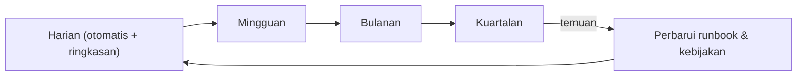

# Checklist Operasional Harian, Mingguan, Bulanan, dan Kuartalan

!!! info "Identitas chapter"
    **ID:** `CH-13-03-05` · **Kategori/modul:** CAT-13 / MOD-13-03 (Operasi Rutin dan Tata Kelola) · **Estimasi:** 90 menit · **Lingkungan:** produksi · [Lihat chapter ini di dashboard](../../../#CH-13-03-05)

!!! note "Catatan"
    Daftar berikut adalah cakupan awal. Sesuaikan frekuensi dan ambang dengan beban dan toleransi risiko Anda. Belum dijalankan penulis pada VM (`verified_on: null`).

## 1. Ringkasan

Operasi yang andal bergantung pada rutinitas. Anda menyusun checklist harian, mingguan, bulanan, dan kuartalan yang dapat diaudit: tiap butir punya perintah atau bukti dan pemiliknya.

## 2. Tujuan Pembelajaran

1. Menyusun checklist per periode dengan bukti terukur.
2. Mengaitkan butir dengan skrip dan chapter terkait.
3. Menyimpan catatan eksekusi untuk audit.

## 3. Prasyarat

- `CH-13-03-04` — Kapasitas, Perluasan Storage, dan Offboarding Akun.
- Seluruh topik operasi (`CAT-13` modul 1 dan 2) dan monitoring (`CAT-11`).

## 4. Materi Teori

### 4.1 Cakupan per periode

| Periode | Butir | Bukti |
|---|---|---|
| Harian | Status service & antrean, deferred/bounce, disk, alert semalam | `mail-healthcheck.sh` exit 0, ringkasan bounce |
| Mingguan | Login gagal & Fail2ban, update keamanan, ringkasan volume keluar, uji restore sampel | Keluaran perintah, laporan restore |
| Bulanan | Reputasi & laporan DMARC, penggunaan quota, audit akun, uji perpanjangan sertifikat | Catatan bulanan |
| Kuartalan | Simulasi DR, review kebijakan & retensi, rotasi secrets, review dokumentasi & runbook, penilaian kerentanan | Laporan DR, daftar rotasi |



### 4.2 Otomatisasi vs manual
Yang bisa diperiksa mesin (disk, sertifikat, layanan) diotomasi dan hanya dilaporkan saat gagal; yang membutuhkan penilaian (reputasi, tren, kebijakan) tetap manual dan terjadwal.

## 5. Praktik dan Implementasi

1. Salin tabel ke dokumen operasional dan lengkapi pemilik tiap butir.
2. Otomasikan butir yang bisa.
3. Buat lembar catatan (tanggal, pelaksana, hasil, tindak lanjut).
4. Jalankan satu siklus harian dan satu mingguan.

## 6. Perintah Linux

```bash title="Contoh paket pemeriksaan harian"
sudo /usr/local/sbin/mail-healthcheck.sh; echo "exit=$?"
postqueue -p | tail -1
sudo journalctl -u 'postfix@-' --since yesterday --no-pager | grep -oE 'status=(deferred|bounced)' | sort | uniq -c
df -h /var/vmail; df -i /var/vmail
```

```bash title="Contoh mingguan"
sudo fail2ban-client status
sudo journalctl -u dovecot --since "7 days ago" --no-pager | grep -ci 'auth failed'
apt list --upgradable 2>/dev/null | wc -l
```

Pola `auth failed` mengikuti log Dovecot Anda; verifikasi teks aslinya.

## 7. Konfigurasi

Tidak ada berkas konfigurasi yang diubah pada chapter ini.

## 8. Verifikasi

- Setiap butir memiliki pemilik dan bukti.
- Lembar catatan terisi untuk satu siklus.
- Butir otomatis memberi alert hanya saat gagal.

## 9. Troubleshooting

| Gejala | Kemungkinan penyebab | Tindakan |
|---|---|---|
| Checklist diabaikan | Terlalu panjang | Ringkas, otomasi |
| Bukti tidak ada | Tidak dicatat | Wajibkan lembar catatan |
| Butir tak ada pemilik | Tak ditugaskan | Tetapkan |
| Kuartalan terlewat | Tak dijadwalkan | Masukkan ke kalender |

## 10. Security Review

- Lembar catatan tidak boleh memuat kata sandi atau token.
- Review rotasi secrets mencakup kunci DKIM, kunci API, dan kata sandi layanan.
- Audit internal oleh orang lain memperkuat kontrol.

## 11. Latihan

1. Isi checklist untuk server Anda dan jalankan hari pertama.
2. Tambahkan dua butir khusus lingkungan Anda.
3. Rancang cara memastikan checklist benar-benar dijalankan.

## 12. Assessment

1. Apa yang sebaiknya diotomasi?
2. Mengapa butir memerlukan bukti?
3. Apa fungsi review kuartalan?

**Kunci singkat.** (1) Yang dapat diperiksa mesin. (2) Agar dapat diaudit. (3) Menjaga kebijakan, runbook, dan rahasia tetap mutakhir.

## 13. Checklist Kelulusan

- [ ] Checklist empat periode lengkap dengan pemilik dan bukti.
- [ ] Satu siklus harian dan mingguan dijalankan.

!!! note "Status belajar"
    Ubah status chapter secara manual di dashboard. Menyelesaikan checklist ini tidak mengubah status otomatis.

## 14. Referensi Resmi

- [Google SRE Book: Eliminating Toil](https://sre.google/sre-book/eliminating-toil/)
- [Postfix: postconf(5)](https://www.postfix.org/postconf.5.html)
- [Fail2ban: Dokumentasi](https://fail2ban.readthedocs.io/en/latest/)

Tautan referensi tidak diverifikasi otomatis pada build ini; periksa ketersediaannya sebelum dipakai.

---

[Kembali ke dashboard kurikulum](../../../#CH-13-03-05){ .md-button }
