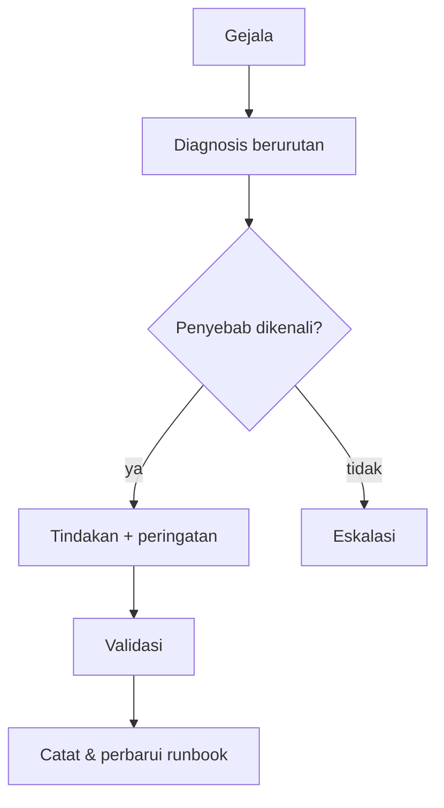

# Runbook Operasional

!!! info "Identitas chapter"
    **ID:** `CH-13-03-06` · **Kategori/modul:** CAT-13 / MOD-13-03 (Operasi Rutin dan Tata Kelola) · **Estimasi:** 150 menit · **Lingkungan:** produksi · [Lihat chapter ini di dashboard](../../../#CH-13-03-06)

!!! note "Status verifikasi"
    Isi chapter ini ditulis dari dokumentasi resmi dan belum dijalankan penulis pada VM (`verified_on: null`).

## 1. Ringkasan

Runbook mengubah pengetahuan di kepala satu orang menjadi prosedur yang dapat dijalankan siapa saja saat tertekan. Anda menulis runbook dengan format baku (gejala, diagnosis, tindakan, validasi, eskalasi) dan mengujinya lewat simulasi.

## 2. Tujuan Pembelajaran

1. Menulis runbook dengan struktur yang konsisten.
2. Menulis dua runbook contoh: antrean membengkak dan sertifikat kedaluwarsa.
3. Menguji runbook lewat simulasi (*game day*) dan memperbaikinya.

## 3. Prasyarat

- `CH-13-03-05` — Checklist Operasional Harian, Mingguan, Bulanan, dan Kuartalan.
- Seluruh materi operasi (`CAT-13`), troubleshooting dasar (`CH-13-02-03`).

## 4. Materi Teori

### 4.1 Format baku

| Bagian | Isi |
|---|---|
| Gejala | Bagaimana masalah tampak (alert, keluhan) |
| Dampak | Siapa/apa terdampak |
| Diagnosis | Langkah berurutan dengan perintah dan hasil yang diharapkan |
| Tindakan | Perbaikan, termasuk peringatan keselamatan |
| Validasi | Bukti masalah selesai |
| Eskalasi | Kapan dan ke siapa |
| Riwayat | Versi dan hasil uji terakhir |



### 4.2 Contoh ringkas: antrean membengkak

- **Gejala:** alert antrean > ambang.
- **Diagnosis:** `postqueue -p | tail -1`, `postqueue -j | jq -r '.recipients[].delay_reason' | sort | uniq -c | sort -rn | head`; periksa log `status=deferred`.
- **Tindakan:** bila satu tujuan menolak, tunggu/kurangi laju; bila sumber spam, `CH-13-02-04`.
- **Validasi:** antrean turun di bawah ambang selama 30 menit.
- **Eskalasi:** jika tidak turun dalam 1 jam atau ada indikasi kompromi.

### 4.3 Contoh ringkas: sertifikat hampir kedaluwarsa
- **Gejala:** health check memberi `PERINGATAN: sertifikat < 14 hari`.
- **Diagnosis:** `sudo certbot certificates`, `sudo certbot renew --dry-run`, `systemctl list-timers | grep certbot`.
- **Tindakan:** perbaiki penyebab (port 80, DNS, hook) lalu `sudo certbot renew`.
- **Validasi:** tanggal baru, layanan memuat sertifikat baru (`openssl s_client`).

## 5. Praktik dan Implementasi

1. Tulis dua runbook contoh lengkap dalam format di atas.
2. Minta rekan (atau diri Anda esok hari) mengikutinya tanpa bantuan.
3. Catat langkah yang tidak jelas dan perbaiki.
4. Lakukan simulasi: matikan sesuatu di lab dan jalankan runbook.

## 6. Perintah Linux

```bash title="Uji kering runbook sertifikat (aman)"
sudo certbot certificates
sudo certbot renew --dry-run
```

Dua perintah itu tidak mengubah sertifikat produksi (`--dry-run` memakai lingkungan staging). Runbook antrean memakai perintah baca-saja pada diagnosis; tindakan penghapusan tetap memerlukan persetujuan.

## 7. Konfigurasi

Tidak ada berkas konfigurasi yang diubah pada chapter ini.

## 8. Verifikasi

- Dua runbook ada dan dijalankan oleh orang lain dengan sukses.
- Riwayat uji tercatat (tanggal, penguji, hasil, perbaikan).
- Runbook dapat diakses saat server utama mati (salinan di luar server).

## 9. Troubleshooting

| Gejala | Kemungkinan penyebab | Tindakan |
|---|---|---|
| Runbook tidak bisa diikuti | Asumsi tersembunyi | Uji dengan orang lain |
| Runbook usang | Perubahan konfigurasi | Tinjau tiap kuartal / saat berubah |
| Perintah destruktif tanpa peringatan | Penulisan tergesa | Tambah peringatan dan persetujuan |
| Tak ada salinan di luar server | Disimpan hanya di server | Simpan di repositori/wiki terpisah |

## 10. Security Review

- Runbook tidak memuat kata sandi atau token; rujuk lokasi rahasia saja.
- Tindakan destruktif (hapus antrean, restore) dilengkapi pemeriksaan dan persetujuan.
- Akses ke runbook sesuai kebutuhan; ia memuat arsitektur internal.

## 11. Latihan

1. Tulis runbook ketiga: "pengguna tidak bisa login".
2. Jalankan game day dengan satu skenario terkendali.
3. Hitung waktu dari alert sampai validasi dan catat.

## 12. Assessment

1. Mengapa runbook diuji oleh orang lain?
2. Apa isi bagian validasi?
3. Mengapa runbook disimpan di luar server?

**Kunci singkat.** (1) Menemukan asumsi tersembunyi. (2) Bukti bahwa masalah selesai. (3) Server mungkin tidak dapat diakses saat insiden.

## 13. Checklist Kelulusan

- [ ] Dua runbook ditulis dan diuji orang lain.
- [ ] Hasil simulasi dan perbaikan tercatat.
- [ ] Salinan runbook tersedia di luar server.

!!! note "Status belajar"
    Ubah status chapter secara manual di dashboard. Menyelesaikan checklist ini tidak mengubah status otomatis.

## 14. Referensi Resmi

- [Google SRE Book: Being On-Call](https://sre.google/sre-book/being-on-call/)
- [Google SRE Workbook: Incident Response](https://sre.google/workbook/incident-response/)
- [NIST SP 800-61 Rev. 2](https://csrc.nist.gov/pubs/sp/800/61/r2/final)

Tautan referensi tidak diverifikasi otomatis pada build ini; periksa ketersediaannya sebelum dipakai.

---

[Kembali ke dashboard kurikulum](../../../#CH-13-03-06){ .md-button }
