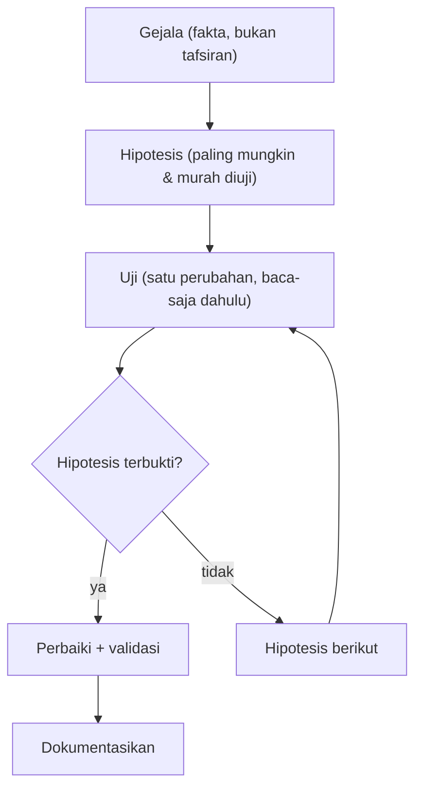

# Metodologi Troubleshooting Email

!!! info "Identitas chapter"
    **ID:** `CH-14-01-01` · **Kategori/modul:** CAT-14 / MOD-14-01 (Troubleshooting) · **Estimasi:** 60 menit · **Lingkungan:** produksi · [Lihat chapter ini di dashboard](../../../#CH-14-01-01)

!!! note "Status verifikasi"
    Isi chapter ini ditulis dari dokumentasi resmi dan belum dijalankan penulis pada VM (`verified_on: null`).

## 1. Ringkasan

Troubleshooting yang efektif adalah metode, bukan tebakan. Anda menerapkan pendekatan hipotesis dan uji yang memeriksa email lapis demi lapis dan mendokumentasikan temuan secara konsisten.

## 2. Tujuan Pembelajaran

1. Menerapkan siklus: gejala → hipotesis → uji → kesimpulan.
2. Memeriksa lapisan secara berurutan: DNS, jaringan, TLS, SMTP, autentikasi, kebijakan, pengiriman, mailbox.
3. Mendokumentasikan temuan dengan templat baku.

## 3. Prasyarat

- `CH-13-03-06` — Runbook Operasional.
- Pelacakan pesan (`CH-13-02-03`); runbook (`CH-13-03-06`).

## 4. Materi Teori

### 4.1 Siklus



### 4.2 Lapisan

| Lapisan | Pertanyaan | Alat |
|---|---|---|
| DNS | MX/A/PTR benar? | `dig` |
| Jaringan | Port terjangkau? | `nc`, `ss` |
| TLS | Sertifikat/handshake sehat? | `openssl s_client` |
| SMTP | Percakapan diterima? | log `smtpd`, `nc` |
| Autentikasi | SPF/DKIM/DMARC, login? | Header, `doveadm auth test` |
| Kebijakan | Reputasi, filter, relay | Log, kode 5.7.x |
| Pengiriman | Antrean/status | `postqueue`, log |
| Mailbox | Tersimpan/folder/kuota | `doveadm` |

### 4.3 Disiplin
Ubah satu hal pada satu waktu, catat sebelum dan sesudah, dan lebih dulu gunakan uji baca-saja. Perubahan acak menghilangkan jejak penyebab.

## 5. Praktik dan Implementasi

1. Ambil satu masalah nyata atau buatan di lab.
2. Tuliskan gejala sebagai fakta (waktu, pengirim, penerima, pesan galat).
3. Telusuri lapisan satu per satu.
4. Tulis catatan dengan templat.

## 6. Perintah Linux

```bash title="Pemeriksaan lapis-demi-lapis (contoh baca-saja)"
dig +short MX example.com
nc -vz mail.example.com 25
openssl s_client -connect mail.example.com:993 -servername mail.example.com </dev/null 2>/dev/null | openssl x509 -noout -dates
sudo journalctl -u 'postfix@-' --since "30 min ago" --no-pager | tail -20
sudo doveadm auth test ani@example.com
```

## 7. Konfigurasi

```text title="Templat catatan troubleshooting"
Waktu/Pelapor   :
Gejala (fakta)  :
Dampak          :
Hipotesis 1     : ... -> uji -> hasil
Hipotesis 2     : ... -> uji -> hasil
Akar masalah    :
Perbaikan       :
Validasi        :
Pencegahan      :
```

## 8. Verifikasi

- Catatan memuat urutan hipotesis dan hasil uji.
- Perbaikan divalidasi dengan uji yang sama dengan gejala awal.
- Pencegahan (monitor, runbook) dicatat.

## 9. Troubleshooting

| Gejala | Kemungkinan penyebab | Tindakan |
|---|---|---|
| Terlalu banyak perubahan sekaligus | Tak disiplin | Kembalikan, ulang satu per satu |
| Gejala berubah-ubah | Tafsiran, bukan fakta | Minta pesan galat persis |
| Tak ada akar masalah | Berhenti di gejala | Lanjutkan "mengapa" hingga penyebab |
| Masalah kembali | Perbaikan tanpa pencegahan | Tambah monitoring/runbook |

## 10. Security Review

- Saat mendiagnosis, hindari menurunkan keamanan (mematikan TLS, membuka relay) "sementara".
- Log yang dikutip dalam catatan disanitasi.
- Hati-hati memberikan akses root kepada pihak luar untuk membantu diagnosis.

## 11. Latihan

1. Diagnosis satu masalah buatan dan isi templat.
2. Tulis lima hipotesis awal untuk "email tidak sampai".
3. Jelaskan mengapa uji baca-saja didahulukan.

## 12. Assessment

1. Mengapa mengubah satu hal pada satu waktu?
2. Apa beda gejala dan tafsiran?
3. Mengapa akar masalah perlu dicari?

**Kunci singkat.** (1) Menjaga jejak penyebab. (2) Fakta teramati vs kesimpulan dini. (3) Agar tidak berulang.

## 13. Checklist Kelulusan

- [ ] Siklus hipotesis–uji diterapkan pada satu kasus.
- [ ] Templat catatan dipakai.

!!! note "Status belajar"
    Ubah status chapter secara manual di dashboard. Menyelesaikan checklist ini tidak mengubah status otomatis.

## 14. Referensi Resmi

- [Google SRE Book: Effective Troubleshooting](https://sre.google/sre-book/effective-troubleshooting/)
- [Postfix: DEBUG_README](https://www.postfix.org/DEBUG_README.html)
- [RFC 5321 — SMTP](https://www.rfc-editor.org/rfc/rfc5321)

Tautan referensi tidak diverifikasi otomatis pada build ini; periksa ketersediaannya sebelum dipakai.

---

[Kembali ke dashboard kurikulum](../../../#CH-14-01-01){ .md-button }
