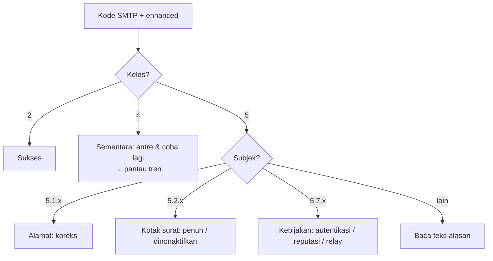

# Matriks Kegagalan Pengiriman dan Kode SMTP

!!! info "Identitas chapter"
    **ID:** `CH-14-01-02` · **Kategori/modul:** CAT-14 / MOD-14-01 (Troubleshooting) · **Estimasi:** 120 menit · **Lingkungan:** produksi · [Lihat chapter ini di dashboard](../../../#CH-14-01-02)

!!! note "Status verifikasi"
    Isi chapter ini ditulis dari dokumentasi resmi dan belum dijalankan penulis pada VM (`verified_on: null`).

## 1. Ringkasan

Setiap penolakan SMTP membawa kode tiga digit (RFC 5321) dan kode status diperluas (RFC 3463) yang memberi tahu kategori kegagalan. Anda menafsirkan keduanya dan menyusun matriks tindakan.

## 2. Tujuan Pembelajaran

1. Membedakan kelas 2xx, 4xx, dan 5xx dan makna kode diperluas `X.Y.Z`.
2. Menafsirkan kode yang sering muncul dan memilih tindakan.
3. Mengekstrak kode dari log dan merangkumnya.

## 3. Prasyarat

- `CH-14-01-01` — Metodologi Troubleshooting Email.
- Deferred dan bounce (`CH-13-02-02`).

## 4. Materi Teori

### 4.1 Struktur kode

Kode dasar: 2xx sukses, 4xx kegagalan sementara, 5xx kegagalan permanen. Kode diperluas `kelas.subjek.detail` (mis. `5.1.1`): kelas 2/4/5 sama maknanya; subjek menunjukkan area (1 alamat, 2 kotak surat, 3 sistem surat, 4 jaringan, 5 protokol, 6 isi/media, 7 keamanan/kebijakan).

### 4.2 Matriks (contoh umum)

| Kode | Makna umum (RFC) | Tindakan tipikal |
|---|---|---|
| 421 / 4.x.x | Layanan tidak tersedia / sementara | Tunggu, periksa beban dan penerima |
| 450 / 451 | Tindakan ditunda / galat lokal | Biasanya sementara; cek greylisting, DNS |
| 452 | Penyimpanan tidak cukup | Cek disk/kuota penerima |
| 550 5.1.1 | Alamat tujuan tidak ada | Koreksi alamat |
| 550 5.7.1 | Ditolak karena kebijakan | Periksa autentikasi, reputasi, relay |
| 552 5.2.2 | Kotak surat penuh | Beri tahu penerima |
| 553 5.1.3 | Sintaks alamat tidak valid | Perbaiki alamat |
| 554 | Transaksi gagal | Baca teks alasan |

Teks alasan bebas tiap server berbeda; yang baku adalah kode. Selalu baca juga teks alasannya.



## 5. Praktik dan Implementasi

1. Kumpulkan sepuluh baris `status=bounced` dan `status=deferred`.
2. Tafsirkan kode masing-masing dan isi matriks tindakan.
3. Buat ringkasan frekuensi kode.

## 6. Perintah Linux

```bash title="Mengekstrak kode dan alasan"
sudo journalctl -u 'postfix@-' --since "7 days ago" --no-pager | grep -E 'status=(bounced|deferred)' | grep -oE 'dsn=[0-9.]+, status=[a-z]+' | sort | uniq -c | sort -rn | head
sudo journalctl -u 'postfix@-' --since "7 days ago" --no-pager | grep 'status=bounced' | grep -oE '\(host [^)]*said: [0-9]{3}[^)]*\)' | head
```

Hasil yang diharapkan: tabel frekuensi DSN dan contoh pesan penolakan dari server penerima. Format teks bergantung pada penerima.

## 7. Konfigurasi

Tidak ada berkas konfigurasi yang diubah pada chapter ini.

## 8. Verifikasi

- Matriks tindakan terisi untuk sedikitnya lima kode.
- Ringkasan frekuensi mengidentifikasi tiga kode teratas dan penanganannya.

## 9. Troubleshooting

| Gejala | Kemungkinan penyebab | Tindakan |
|---|---|---|
| Kode tidak jelas | Teks khusus penerima | Cari dokumentasi penyedia penerima |
| Banyak `4.x.x` ke satu domain | Pembatasan laju | Kurangi laju, jadwalkan |
| `5.7.1` mendadak | Perubahan DNS/reputasi | `CH-14-01-04` |
| Kode non-baku | Server kustom | Baca dokumentasinya |

## 10. Security Review

- Jangan "melonggarkan" kebijakan relay untuk menghilangkan penolakan.
- Bounce ke alamat palsu menghasilkan backscatter.
- Teks penolakan bisa memuat alamat pihak ketiga; sanitasi saat berbagi.

## 11. Latihan

1. Buat kartu referensi satu halaman kode SMTP.
2. Cocokkan lima bounce nyata dengan tindakan.
3. Jelaskan beda `4.2.2` dan `5.2.2`.

## 12. Assessment

1. Apa arti angka pertama kode diperluas?
2. Kode apa yang berarti alamat tidak ada?
3. Mengapa membaca teks alasan?

**Kunci singkat.** (1) Sukses/sementara/permanen. (2) 5.1.1. (3) Kode baku, alasan menjelaskan konteks.

## 13. Checklist Kelulusan

- [ ] Matriks kode–tindakan tersedia.
- [ ] Frekuensi kode dari log dianalisis.

!!! note "Status belajar"
    Ubah status chapter secara manual di dashboard. Menyelesaikan checklist ini tidak mengubah status otomatis.

## 14. Referensi Resmi

- [RFC 5321 — SMTP](https://www.rfc-editor.org/rfc/rfc5321)
- [RFC 3463 — Enhanced Mail System Status Codes](https://www.rfc-editor.org/rfc/rfc3463)
- [IANA: Enhanced Status Codes](https://www.iana.org/assignments/smtp-enhanced-status-codes/smtp-enhanced-status-codes.xhtml)

Tautan referensi tidak diverifikasi otomatis pada build ini; periksa ketersediaannya sebelum dipakai.

---

[Kembali ke dashboard kurikulum](../../../#CH-14-01-02){ .md-button }
