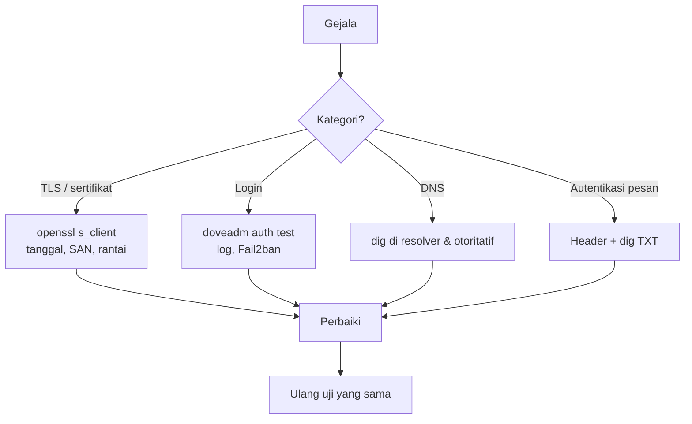

# Kegagalan Autentikasi, TLS, dan DNS

!!! info "Identitas chapter"
    **ID:** `CH-14-01-03` · **Kategori/modul:** CAT-14 / MOD-14-01 (Troubleshooting) · **Estimasi:** 120 menit · **Lingkungan:** produksi · [Lihat chapter ini di dashboard](../../../#CH-14-01-03)

!!! warning "Peringatan"
    Saat mendiagnosis autentikasi atau TLS, jangan melonggarkan keamanan untuk menguji (mis. mematikan verifikasi sertifikat atau membuka relay). Gunakan uji baca-saja. Belum dijalankan penulis pada VM (`verified_on: null`).

## 1. Ringkasan

Tiga kelompok kegagalan paling sering: login/TLS bermasalah, DNS salah, dan autentikasi pesan gagal. Anda memeriksa tiap kelompok dengan alat baca-saja dan memvalidasi perbaikannya.

## 2. Tujuan Pembelajaran

1. Mendiagnosis kegagalan login, TLS, dan DNS secara sistematis.
2. Membaca gejala dan memetakan ke penyebab.
3. Memvalidasi perbaikan dengan uji yang sama.

## 3. Prasyarat

- `CH-14-01-02` — Matriks Kegagalan Pengiriman dan Kode SMTP.
- Metodologi (`CH-14-01-01`); log autentikasi (`CH-07-02-03`).

## 4. Materi Teori

### 4.1 Matriks gejala

| Gejala | Kemungkinan | Uji |
|---|---|---|
| Klien: "sertifikat tidak valid" | Kedaluwarsa, nama tak cocok, rantai tak lengkap | `openssl s_client`, `-showcerts` |
| Login ditolak | Kata sandi, format nama, hash, ban Fail2ban | `doveadm auth test`, log, `fail2ban-client` |
| `AUTH` tidak ditawarkan | TLS belum aktif | `openssl s_client -starttls smtp` |
| Email tidak masuk | MX salah, port tertutup | `dig`, `nc` dari luar |
| `spf=fail` | IP tak di SPF | `dig TXT` |
| `dkim=fail` | Kunci/DNS atau pesan berubah | `opendkim-testkey`, header |



## 5. Praktik dan Implementasi

1. Buat tiga kegagalan terkontrol di lab (sertifikat salah nama, kata sandi salah, record SPF dihapus).
2. Diagnosis tiap kegagalan hanya dengan alat baca-saja.
3. Perbaiki dan validasi.

## 6. Perintah Linux

```bash title="TLS"
openssl s_client -connect mail.example.com:993 -servername mail.example.com </dev/null 2>/dev/null | openssl x509 -noout -subject -issuer -dates -ext subjectAltName
openssl s_client -connect mail.example.com:587 -starttls smtp -servername mail.example.com </dev/null 2>&1 | grep -iE 'verify|Verification|subject'
```

```bash title="Login"
sudo doveadm auth test ani@example.com
sudo journalctl -u dovecot --since "30 min ago" --no-pager | grep -iE 'auth|disconnected' | tail
sudo fail2ban-client status dovecot
```

```bash title="DNS dan autentikasi"
dig +short TXT example.com
dig @1.1.1.1 +short MX example.com
dig +norecurse @ns1.example.com TXT example.com
opendkim-testkey -d example.com -s 202610 -vvv
```

Hasil yang diharapkan: tiap perintah mengungkap titik gagal (tanggal/SAN sertifikat, alasan login, record yang hilang). Keluaran bergantung pada kondisi.

## 7. Konfigurasi

Tidak ada berkas konfigurasi yang diubah pada chapter ini.

## 8. Verifikasi

- Tiap kegagalan terkontrol ditemukan dengan alat baca-saja dalam batas waktu.
- Setelah perbaikan, uji yang sama lulus.
- Pencegahan (alert kedaluwarsa, pemantauan DNS) ditambahkan.

## 9. Troubleshooting

| Gejala | Kemungkinan penyebab | Tindakan |
|---|---|---|
| Diagnosis berputar-putar | Mengubah banyak hal | Kembali ke metodologi |
| DNS beda antar resolver | Cache/propagasi | Uji otoritatif, tunggu TTL |
| Login berhasil di CLI gagal di klien | Format/TLS klien | Samakan format dan mode keamanan |
| Perbaikan tidak bertahan | Perubahan manual tak tercatat | Catat dan otomasi |

## 10. Security Review

- Jangan menaruh kata sandi nyata di `s_client` atau skrip uji.
- Pindai/uji hanya aset milik sendiri.
- Hentikan pembukaan akses sementara yang lupa ditutup kembali (periksa firewall pasca-diagnosis).

## 11. Latihan

1. Isi matriks gejala dengan dua gejala dari lingkungan Anda.
2. Tulis skrip yang menjalankan lima pemeriksaan di atas dan melaporkannya.
3. Jelaskan cara membedakan masalah klien dan server.

## 12. Assessment

1. Apa yang diperiksa dari sertifikat?
2. Mengapa menguji nameserver otoritatif?
3. Mengapa tidak mematikan verifikasi sertifikat?

**Kunci singkat.** (1) Tanggal, SAN, rantai. (2) Menghindari cache. (3) Menghilangkan perlindungan.

## 13. Checklist Kelulusan

- [ ] Tiga kegagalan terkontrol didiagnosis dan diperbaiki.
- [ ] Skrip pemeriksaan dibuat.

!!! note "Status belajar"
    Ubah status chapter secara manual di dashboard. Menyelesaikan checklist ini tidak mengubah status otomatis.

## 14. Referensi Resmi

- [OpenSSL: s_client](https://docs.openssl.org/3.0/man1/openssl-s_client/)
- [Dokumentasi Dovecot 2.3: Authentication](https://doc.dovecot.org/2.3/configuration_manual/authentication/)
- [RFC 7208 — SPF](https://www.rfc-editor.org/rfc/rfc7208)
- [RFC 6376 — DKIM](https://www.rfc-editor.org/rfc/rfc6376)

Tautan referensi tidak diverifikasi otomatis pada build ini; periksa ketersediaannya sebelum dipakai.

---

[Kembali ke dashboard kurikulum](../../../#CH-14-01-03){ .md-button }
