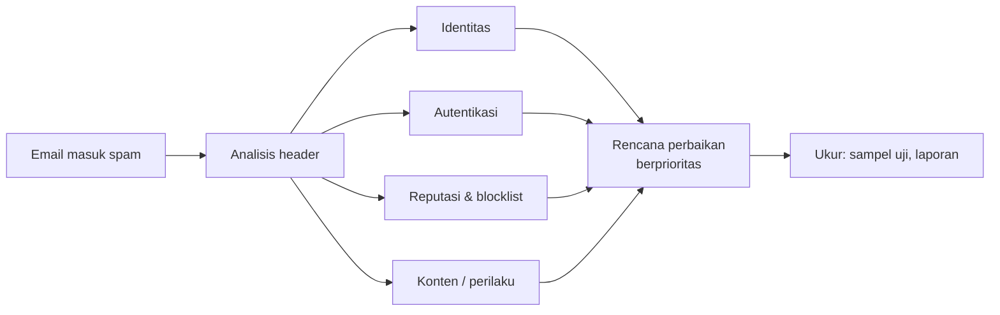

# Penyebab Email Masuk Spam dan Penurunan Reputasi

!!! info "Identitas chapter"
    **ID:** `CH-14-01-04` · **Kategori/modul:** CAT-14 / MOD-14-01 (Troubleshooting) · **Estimasi:** 90 menit · **Lingkungan:** produksi · [Lihat chapter ini di dashboard](../../../#CH-14-01-04)

!!! note "Status verifikasi"
    Isi chapter ini ditulis dari dokumentasi resmi dan belum dijalankan penulis pada VM (`verified_on: null`).

## 1. Ringkasan

Email masuk spam atau reputasi turun jarang punya satu sebab. Anda membaca header untuk menemukan sebab nyata dan menyusun rencana perbaikan yang berurutan: identitas, autentikasi, perilaku pengiriman, konten, dan kontak dengan penyedia.

## 2. Tujuan Pembelajaran

1. Menganalisis header dan DNS untuk penyebab spam.
2. Menyusun rencana perbaikan reputasi yang berprioritas.
3. Mengukur efek perbaikan tanpa klaim jaminan.

## 3. Prasyarat

- `CH-14-01-03` — Kegagalan Autentikasi, TLS, dan DNS.
- Analisis header (`CH-12-02-03`); pemantauan reputasi (`CH-13-03-01`).

## 4. Materi Teori

### 4.1 Daftar periksa penyebab

| Kategori | Pertanyaan |
|---|---|
| Identitas | PTR=A=HELO? IPv6 konsisten? |
| Autentikasi | SPF/DKIM/DMARC lulus & selaras? |
| Reputasi IP | Masuk blocklist? IP baru? |
| Perilaku | Lonjakan volume, bounce tinggi, pengaduan? |
| Konten | Tautan pendek, lampiran berisiko, perbandingan teks/HTML? |
| Praktik | Daftar tanpa persetujuan, tanpa opsi berhenti? |



### 4.2 Prioritas

Perbaiki yang paling mendasar dahulu: identitas dan autentikasi (mudah dan wajib), baru perilaku dan konten. Hasil perbaikan terlihat setelah hari hingga minggu karena reputasi bergerak lambat.

## 5. Praktik dan Implementasi

1. Kumpulkan tiga contoh pesan yang masuk spam.
2. Isi daftar periksa untuk tiap contoh.
3. Urutkan perbaikan menurut dampak dan biaya.
4. Terapkan, ukur ulang setelah satu minggu.

## 6. Perintah Linux

```bash title="Memeriksa identitas dan autentikasi"
dig +short -x 192.0.2.10
postconf myhostname smtp_helo_name
dig +short TXT example.com
dig +short TXT _dmarc.example.com
```

```bash title="Statistik penolakan"
sudo journalctl -u 'postfix@-' --since "7 days ago" --no-pager | grep -oE 'dsn=5\.7\.[0-9]+' | sort | uniq -c
```

Hasil yang diharapkan: identitas dan autentikasi sesuai tabel, dan jumlah `5.7.x` yang dapat diurutkan menurut prioritas.

## 7. Konfigurasi

Tidak ada berkas konfigurasi yang diubah pada chapter ini.

## 8. Verifikasi

- Daftar periksa terisi dengan bukti tiap pesan.
- Rencana perbaikan berprioritas dan berpemilik.
- Pengukuran lanjutan seminggu kemudian dicatat apa adanya.

## 9. Troubleshooting

| Gejala | Kemungkinan penyebab | Tindakan |
|---|---|---|
| Semua lulus tapi tetap spam | Reputasi/riwayat/konten | Bersabar, kurangi volume, tinjau konten |
| Spam hanya di satu penyedia | Kebijakan penyedia | Gunakan saluran dukungan/postmaster |
| Baik di awal lalu turun | Perubahan perilaku | Cari lonjakan/akun terkompromi |
| Blocklist | Penyebab IP | Perbaiki penyebab, ajukan delist |

## 10. Security Review

- Jangan membeli "perbaikan reputasi" instan.
- Penurunan mendadak dapat menandakan akun terkompromi (`CH-13-02-04`).
- Hindari trik penghindar filter; itu melanggar kebijakan penerima.

## 11. Latihan

1. Isi daftar periksa untuk satu penyedia berbeda.
2. Tulis rencana perbaikan 30 hari.
3. Tentukan metrik keberhasilan yang jujur.

## 12. Assessment

1. Mengapa identitas dan autentikasi lebih dahulu?
2. Mengapa efek perbaikan lambat?
3. Apa tanda lain selain konten?

**Kunci singkat.** (1) Mendasar, murah, wajib. (2) Reputasi dibangun bertahap. (3) Perilaku volume/bounce dan IP.

## 13. Checklist Kelulusan

- [ ] Tiga kasus dianalisis.
- [ ] Rencana perbaikan dan pengukuran ulang tercatat.

!!! note "Status belajar"
    Ubah status chapter secara manual di dashboard. Menyelesaikan checklist ini tidak mengubah status otomatis.

## 14. Referensi Resmi

- [RFC 7489 — DMARC](https://www.rfc-editor.org/rfc/rfc7489)
- [M3AAWG: Dokumen praktik terbaik](https://www.m3aawg.org/published-documents)
- [Google Postmaster Tools](https://postmaster.google.com/)

Tautan referensi tidak diverifikasi otomatis pada build ini; periksa ketersediaannya sebelum dipakai.

---

[Kembali ke dashboard kurikulum](../../../#CH-14-01-04){ .md-button }
