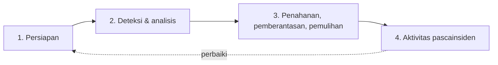

# Prosedur Incident Response dan Preservasi Forensik

!!! info "Identitas chapter"
    **ID:** `CH-14-02-01` · **Kategori/modul:** CAT-14 / MOD-14-02 (Incident Response) · **Estimasi:** 120 menit · **Lingkungan:** produksi · [Lihat chapter ini di dashboard](../../../#CH-14-02-01)

!!! danger "Peringatan keras"
    Server yang diduga dikompromikan tidak boleh dipercaya. Jangan menjalankan alat dari server itu tanpa menyadari bahwa hasilnya bisa dimanipulasi. Ambil snapshot disk lebih dulu, kumpulkan bukti ke media terpisah, dan libatkan pihak berwenang bila perlu. Belum dijalankan penulis pada VM (`verified_on: null`).

## 1. Ringkasan

Incident response (IR) memiliki urutan: persiapan, deteksi dan analisis, penahanan, pemberantasan dan pemulihan, lalu pelajaran. Chapter ini membahas tahapan itu dan praktik dasar preservasi bukti agar investigasi dan pelaporan tetap sah.

## 2. Tujuan Pembelajaran

1. Menjelaskan tahapan IR dan keputusan tiap tahap.
2. Mengamankan bukti (log, status sistem) dengan checksum dan rantai penguasaan.
3. Mencatat garis waktu insiden.

## 3. Prasyarat

- `CH-14-01-04` — Penyebab Email Masuk Spam dan Penurunan Reputasi.
- Penahanan awal (`CH-13-02-04`); komunikasi insiden (`CH-13-03-03`).

## 4. Materi Teori

### 4.1 Tahapan (NIST SP 800-61)



### 4.2 Urutan volatilitas

Kumpulkan dahulu data yang paling cepat hilang: memori/proses/koneksi, lalu berkas sementara, lalu log dan disk. Snapshot disk virtual dari hypervisor menyimpan keadaan tanpa mengandalkan server yang mungkin dimanipulasi.

### 4.3 Rantai penguasaan

Catat siapa mengambil bukti apa, kapan, dari mana, dan hash-nya. Salin ke media terpisah dengan akses terbatas dan jangan ubah aslinya.

## 5. Praktik dan Implementasi

1. Latih di VM lab yang dianggap "terkompromi".
2. Ambil snapshot disk.
3. Kumpulkan bukti status dan log.
4. Hitung hash dan catat rantai penguasaan.
5. Susun garis waktu.

## 6. Perintah Linux

```bash title="Mengumpulkan bukti status (di VM lab)"
d=/root/bukti-$(date +%Y%m%d-%H%M)
sudo install -d -m 0700 "$d"
{ date -Is; uptime; who -a; last -n 30; } | sudo tee "$d/waktu-pengguna.txt" >/dev/null
sudo ss -tunap | sudo tee "$d/koneksi.txt" >/dev/null
ps auxfww | sudo tee "$d/proses.txt" >/dev/null
sudo journalctl --since "7 days ago" --no-pager | sudo tee "$d/journal-7hari.txt" >/dev/null
sudo postqueue -p | sudo tee "$d/antrean.txt" >/dev/null
```

```bash title="Hash dan arsip"
sudo sh -c "cd $d && sha256sum * > SHA256SUMS"
sudo tar -czf "$d.tar.gz" -C /root "$(basename $d)"
sudo sha256sum "$d.tar.gz"
```

Salin arsip dan hash-nya ke host terpisah (`scp` ke media terkontrol) dan catat hash di lembar rantai penguasaan. Bukti berisi data pribadi, jadi enkripsi dan batasi aksesnya.

## 7. Konfigurasi

```text title="Lembar rantai penguasaan (contoh)"
ID bukti : B-001
Sumber   : mail.example.com (journal 7 hari)
Diambil  : 2026-xx-xx 10:12 UTC oleh <nama/peran>
Hash     : sha256:<...>
Disimpan : <lokasi terbatas>
Diakses  : tanggal / siapa / tujuan
```

## 8. Verifikasi

- Snapshot dan arsip bukti ada beserta hash.
- Garis waktu insiden tersusun dari bukti, bukan ingatan.
- Aslinya tidak diubah; hanya salinan yang dianalisis.

## 9. Troubleshooting

| Gejala | Kemungkinan penyebab | Tindakan |
|---|---|---|
| Bukti hilang karena reboot | Memori tidak dikumpulkan | Latih urutan volatilitas |
| Hash tidak cocok | Berkas berubah | Anggap bukti rusak, catat |
| Log sudah berputar | Retensi pendek | Perpanjang retensi (`CH-10-03-02`) |
| Waktu tidak sinkron | NTP bermasalah | Catat selisih waktu |

## 10. Security Review

- Jangan menyimpan bukti di server yang sama dengan sistem terkompromi.
- Bukti memuat kredensial dan email: enkripsi dan batasi akses.
- Insiden yang melibatkan data pribadi dapat memiliki kewajiban pelaporan hukum; konsultasikan pihak berwenang.

## 11. Latihan

1. Simulasikan satu insiden dan hasilkan paket bukti.
2. Tulis garis waktu dari bukti.
3. Tulis kriteria untuk melibatkan pihak luar (hukum, penyedia).

## 12. Assessment

1. Apa urutan volatilitas?
2. Mengapa hash dan rantai penguasaan?
3. Mengapa snapshot dari hypervisor?

**Kunci singkat.** (1) Paling cepat hilang dahulu. (2) Menunjukkan bukti tidak berubah. (3) Tidak bergantung pada server yang mungkin dimanipulasi.

## 13. Checklist Kelulusan

- [ ] Paket bukti dilatih dengan hash dan rantai penguasaan.
- [ ] Garis waktu dibuat dari bukti.

!!! note "Status belajar"
    Ubah status chapter secara manual di dashboard. Menyelesaikan checklist ini tidak mengubah status otomatis.

## 14. Referensi Resmi

- [NIST SP 800-61 Rev. 2](https://csrc.nist.gov/pubs/sp/800/61/r2/final)
- [RFC 3227 — Guidelines for Evidence Collection and Archiving](https://www.rfc-editor.org/rfc/rfc3227)
- [NIST SP 800-86 — Integrating Forensic Techniques into IR](https://csrc.nist.gov/pubs/sp/800/86/final)

Tautan referensi tidak diverifikasi otomatis pada build ini; periksa ketersediaannya sebelum dipakai.

---

[Kembali ke dashboard kurikulum](../../../#CH-14-02-01){ .md-button }
