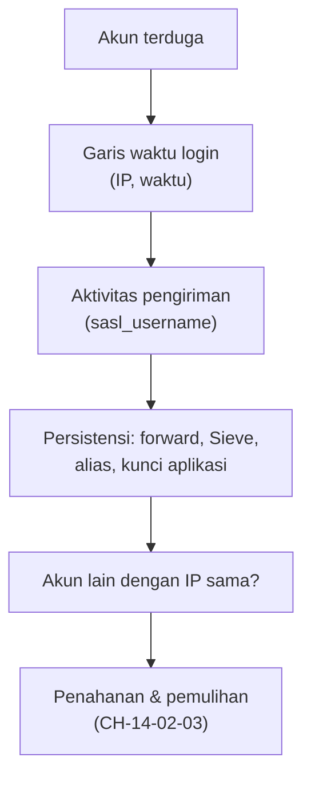

# Investigasi Kompromi Akun dan Penyalahgunaan Antrian

!!! info "Identitas chapter"
    **ID:** `CH-14-02-02` · **Kategori/modul:** CAT-14 / MOD-14-02 (Incident Response) · **Estimasi:** 150 menit · **Lingkungan:** produksi · [Lihat chapter ini di dashboard](../../../#CH-14-02-02)

!!! danger "Peringatan keras"
    Latih hanya pada lab dengan akun uji. Pada insiden nyata, penyelidikan mendalam atas email pengguna menyentuh privasi dan mungkin hukum; ikuti kebijakan dan persetujuan tertulis. Belum dijalankan penulis pada VM (`verified_on: null`).

## 1. Ringkasan

Anda menyelidiki akun yang terkompromi dan penyalahgunaan antrean: dari mana login berasal, apa yang diubah penyerang (forward, aturan Sieve, kata sandi), pesan apa yang dikirim, dan bagaimana menahan penyalahgunaan lanjutan.

## 2. Tujuan Pembelajaran

1. Menyusun garis waktu login dan pengiriman akun terduga.
2. Menemukan perubahan persisten (forward, filter, alias).
3. Menahan dan menganalisis penyalahgunaan antrean.

## 3. Prasyarat

- `CH-14-02-01` — Prosedur Incident Response dan Preservasi Forensik.
- Prosedur IR (`CH-14-02-01`); penahanan awal (`CH-13-02-04`).

## 4. Materi Teori

### 4.1 Pertanyaan investigasi

| Pertanyaan | Sumber |
|---|---|
| Kapan dan dari mana login mencurigakan pertama? | Log Dovecot (IMAP), SASL Postfix |
| Apa yang dikirim? | Log `sasl_username`, antrean, Message-ID |
| Apa yang diubah? | Alias, forward, aturan Sieve, pengaturan webmail |
| Dari mana kata sandi bocor? | Kebocoran pihak ketiga, phishing, brute force |
| Apakah ada akun lain? | Pola IP sama di akun berbeda |



### 4.2 Persistensi
Penyerang yang berhasil sering mengatur pengalihan email diam-diam atau aturan penyaringan agar tetap menerima salinan walau kata sandi diganti. Periksa itu sebelum menyatakan akun "bersih".

## 5. Praktik dan Implementasi

1. Kumpulkan login dan pengiriman akun uji 7 hari.
2. Kelompokkan per IP dan waktu.
3. Periksa aturan penyaringan dan forward.
4. Cari akun lain dengan IP yang sama.
5. Tulis kesimpulan dan rekomendasi.

## 6. Perintah Linux

```bash title="Login dan pengiriman (akun uji)"
sudo journalctl -u dovecot --since "7 days ago" --no-pager | grep -F 'user=<ani@example.com>' | grep -oE 'rip=[0-9a-f:.]+' | sort | uniq -c | sort -rn | head
sudo journalctl -u 'postfix@-' --since "7 days ago" --no-pager | grep 'sasl_username=ani@example.com' | grep -oE 'client=[^ ,]*' | sort | uniq -c | sort -rn | head
```

Pola `user=<...>` dan `rip=` mengikuti format log login Dovecot bawaan; sesuaikan bila format log Anda berbeda.

```bash title="Perubahan persisten"
sudo postmap -q ani@example.com hash:/etc/postfix/virtual
sudo ls -la /var/vmail/example.com/ani/ | head -20
sudo grep -ril 'redirect\|forward' /var/vmail/example.com/ani/sieve 2>/dev/null | head
```

Jalur Sieve dapat berbeda sesuai konfigurasi; jika Sieve tidak dipakai, abaikan. Hasil yang diharapkan: tidak ada forward/aturan tak dikenal; bila ada, itu temuan.

```bash title="Akun lain dari IP yang sama"
sudo journalctl -u dovecot --since "7 days ago" --no-pager | grep -F 'rip=<IP-TERDUGA>' | grep -oE 'user=<[^>]*>' | sort -u
```

## 7. Konfigurasi

Tidak ada berkas konfigurasi yang diubah pada chapter ini.

## 8. Verifikasi

- Garis waktu: login pertama mencurigakan, IP, aktivitas, dan perubahan persisten.
- Daftar akun lain yang terdampak.
- Rekomendasi tindakan ditulis dan siap untuk pemulihan.

## 9. Troubleshooting

| Gejala | Kemungkinan penyebab | Tindakan |
|---|---|---|
| Tidak ada baris cocok | Format log berbeda | Lihat baris login nyata dan sesuaikan pola |
| IP semua dari proxy | Alamat klien tak diteruskan | `CH-12-01-04` |
| Aturan Sieve tidak ditemukan | Lokasi berbeda | Periksa konfigurasi Sieve/webmail |
| Terlalu banyak data | Rentang terlalu lebar | Persempit waktu |

## 10. Security Review

- Kumpulkan hanya data yang perlu; email pengguna adalah data pribadi.
- Cari juga kebocoran kredensial sumber (phishing/pihak ketiga).
- Jangan menyimpulkan "bersih" sebelum memeriksa persistensi dan akun lain.

## 11. Latihan

1. Susun garis waktu insiden simulasi.
2. Tulis daftar IOC (IP, akun, waktu) dari data.
3. Rancang cara menghindari terulangnya dari sumber kebocoran kata sandi.

## 12. Assessment

1. Apa itu persistensi dalam konteks akun email?
2. Mengapa memeriksa akun lain?
3. Mengapa membatasi data yang dikumpulkan?

**Kunci singkat.** (1) Perubahan yang membuat akses/pengalihan tetap ada. (2) Pola IP bisa menyentuh banyak akun. (3) Privasi.

## 13. Checklist Kelulusan

- [ ] Garis waktu dan IOC disusun.
- [ ] Persistensi diperiksa.
- [ ] Rekomendasi pemulihan tertulis.

!!! note "Status belajar"
    Ubah status chapter secara manual di dashboard. Menyelesaikan checklist ini tidak mengubah status otomatis.

## 14. Referensi Resmi

- [NIST SP 800-61 Rev. 2](https://csrc.nist.gov/pubs/sp/800/61/r2/final)
- [Dokumentasi Dovecot 2.3: Logging](https://doc.dovecot.org/2.3/admin_manual/logging/)
- [Postfix: postconf — smtpd_sasl_authenticated_header](https://www.postfix.org/postconf.5.html#smtpd_sasl_authenticated_header)

Tautan referensi tidak diverifikasi otomatis pada build ini; periksa ketersediaannya sebelum dipakai.

---

[Kembali ke dashboard kurikulum](../../../#CH-14-02-02){ .md-button }
