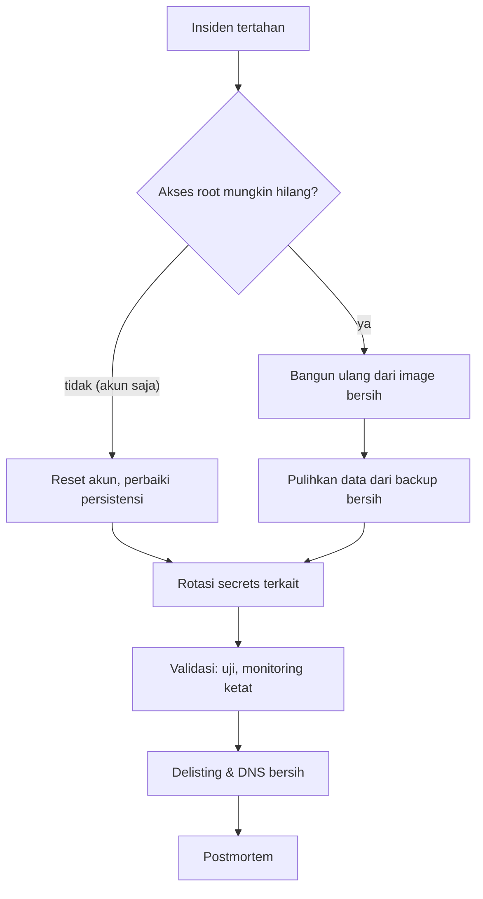

# Pemulihan Setelah Kompromi dan Postmortem

!!! info "Identitas chapter"
    **ID:** `CH-14-02-03` · **Kategori/modul:** CAT-14 / MOD-14-02 (Incident Response) · **Estimasi:** 120 menit · **Lingkungan:** produksi · [Lihat chapter ini di dashboard](../../../#CH-14-02-03)

!!! warning "Peringatan"
    Pemulihan setelah kompromi berarti membangun ulang kepercayaan: bukan sekadar memulai ulang layanan. Prosedur ini belum dijalankan penulis. Belum dijalankan penulis pada VM (`verified_on: null`).

## 1. Ringkasan

Setelah kompromi, Anda memulihkan layanan dari sumber yang bersih, merotasi semua secrets yang mungkin terekspos, membersihkan DNS dan daftar blokir, lalu menulis postmortem tanpa menyalahkan individu agar organisasi belajar.

## 2. Tujuan Pembelajaran

1. Memutuskan bangun ulang vs bersihkan, dan menjalankannya.
2. Merotasi secrets secara menyeluruh.
3. Menulis postmortem tanpa menyalahkan individu.

## 3. Prasyarat

- `CH-14-02-02` — Investigasi Kompromi Akun dan Penyalahgunaan Antrian.
- Investigasi (`CH-14-02-02`); backup dan restore (`CH-11-03-02`).

## 4. Materi Teori

### 4.1 Bangun ulang atau bersihkan

Bila penyerang mungkin memiliki akses root, **bangun ulang** dari image bersih lebih aman daripada "membersihkan": kita tak dapat membuktikan tidak ada pintu belakang. Pulihkan data (email) dari backup yang diketahui bersih dan periksa konfigurasi sebelum dipakai.



### 4.2 Daftar rotasi

| Secret | Tindakan |
|---|---|
| Kata sandi akun terdampak (semua pengguna bila perlu) | Reset + paksa ganti |
| Kunci SSH admin, kunci akses penyedia/API | Terbitkan baru, cabut lama |
| Kunci DKIM | Selector baru, hapus yang lama |
| Kunci privat TLS | Terbitkan ulang sertifikat dan cabut lama |
| Kata sandi database, `des_key` webmail, token layanan | Ganti |
| Kata sandi DNS/registrar | Ganti + audit record |

### 4.3 Postmortem tanpa menyalahkan
Fokus pada sistem dan proses: apa yang terjadi, mengapa kontrol gagal, apa yang berjalan baik, dan tindakan perbaikan berpemilik dan bertenggat. Menyalahkan individu menghentikan pelaporan jujur.

## 5. Praktik dan Implementasi

1. Putuskan strategi pemulihan dan catat alasan.
2. Susun daftar rotasi dan tandai selesai satu per satu.
3. Validasi layanan dan monitoring.
4. Tulis postmortem dalam 5 hari.

## 6. Perintah Linux

```bash title="Validasi pascapemulihan (contoh baca-saja)"
sudo /usr/local/sbin/mail-healthcheck.sh; echo "exit=$?"
dig +short TXT example.com
dig +short TXT 202610._domainkey.example.com
sudo ufw status verbose
sudo journalctl -u 'postfix@-' --since "1 hour ago" --no-pager | grep -c 'status=sent'
```

Gunakan `opendkim-genkey` dan penerbitan ulang sertifikat (`CH-08-01-02`, `CH-08-02-02`) untuk rotasi kunci baru. Pastikan kunci lama tidak lagi dipublikasikan.

## 7. Konfigurasi

```text title="Templat postmortem"
Ringkasan        :
Dampak           : (pengguna, durasi, data)
Garis waktu      : (UTC)
Akar masalah     : (sistem/proses)
Yang berjalan baik:
Yang perlu diperbaiki:
Tindakan         : (pemilik, tenggat)
Pelajaran        :
```

## 8. Verifikasi

- Layanan sehat dan berasal dari sumber bersih.
- Semua item rotasi ditandai selesai dengan tanggal.
- Postmortem tersedia dengan tindakan berpemilik; tindakan dipantau hingga selesai.

## 9. Troubleshooting

| Gejala | Kemungkinan penyebab | Tindakan |
|---|---|---|
| Serangan berulang | Persistensi / kebocoran tak tertutup | Perluas investigasi |
| Masih terdaftar di blocklist | Belum diajukan / penyebab ada | Perbaiki lalu ikuti proses delist |
| Postmortem berujung menyalahkan | Budaya | Fokuskan pada sistem |
| Rotasi terlewat | Tak ada daftar | Gunakan daftar baku |

## 10. Security Review

- Kredensial lama yang tidak dicabut tetap berbahaya.
- Pantau lebih ketat beberapa minggu setelah pemulihan.
- Simpan bukti sesuai kewajiban hukum sebelum menghapus.

## 11. Latihan

1. Tulis postmortem dari insiden simulasi.
2. Susun daftar rotasi khusus lingkungan Anda.
3. Rancang kriteria "layanan boleh dikembalikan ke produksi".

## 12. Assessment

1. Mengapa membangun ulang lebih aman?
2. Mengapa postmortem tanpa menyalahkan?
3. Apa yang dirotasi selain kata sandi akun?

**Kunci singkat.** (1) Tak dapat membuktikan tak ada pintu belakang. (2) Mendorong pelaporan jujur. (3) Kunci SSH/DKIM/TLS, token, kata sandi layanan.

## 13. Checklist Kelulusan

- [ ] Strategi pemulihan dan rotasi lengkap.
- [ ] Postmortem ditulis dengan tindakan berpemilik.

!!! note "Status belajar"
    Ubah status chapter secara manual di dashboard. Menyelesaikan checklist ini tidak mengubah status otomatis.

## 14. Referensi Resmi

- [NIST SP 800-61 Rev. 2](https://csrc.nist.gov/pubs/sp/800/61/r2/final)
- [Google SRE Book: Postmortem Culture](https://sre.google/sre-book/postmortem-culture/)
- [Let's Encrypt: Dokumentasi](https://letsencrypt.org/docs/)

Tautan referensi tidak diverifikasi otomatis pada build ini; periksa ketersediaannya sebelum dipakai.

---

[Kembali ke dashboard kurikulum](../../../#CH-14-02-03){ .md-button }
