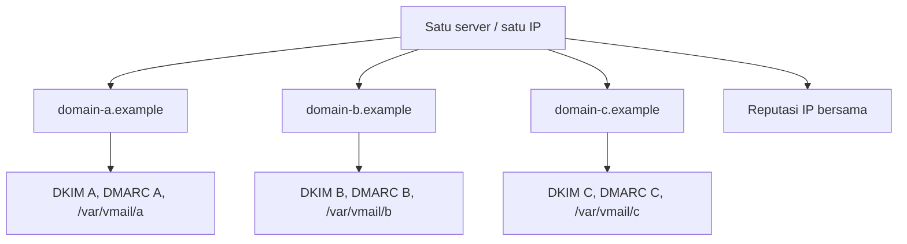

# Multiple Domain pada Satu Server

!!! info "Identitas chapter"
    **ID:** `CH-15-01-01` · **Kategori/modul:** CAT-15 / MOD-15-01 (Multi-Domain dan Routing) · **Estimasi:** 120 menit · **Lingkungan:** uji publik (VPS, IP publik, domain) · [Lihat chapter ini di dashboard](../../../#CH-15-01-01)

!!! note "Catatan"
    Level 14 bersifat opsional dan lanjutan. Konfigurasi di sini adalah contoh desain yang belum dijalankan penulis; uji di lab sebelum mengadopsi, dan jangan menambah kompleksitas tanpa kebutuhan nyata. Belum dijalankan penulis pada VM (`verified_on: null`).

## 1. Ringkasan

Satu server dapat melayani banyak domain. Tantangannya bukan konfigurasi Postfix semata, tetapi menjaga **isolasi dan kebijakan per domain**: kunci DKIM, DMARC, sertifikat, kuota, dan batas pengiriman.

## 2. Tujuan Pembelajaran

1. Menambah banyak domain secara terstruktur (konvensi, tabel, direktori).
2. Menerapkan kebijakan per domain: DKIM, DMARC, batas, sertifikat.
3. Menilai batas isolasi pada satu server.

## 3. Prasyarat

- `CH-14-02-03` — Pemulihan Setelah Kompromi dan Postmortem.
- Tambah domain (`CH-13-01-01`).

## 4. Materi Teori

### 4.1 Model data

| Elemen | Per domain? |
|---|---|
| DNS (MX, SPF, DKIM, DMARC) | Ya |
| Kunci DKIM dan selector | Ya (satu kunci per domain) |
| Penyimpanan mailbox | Ya (`/var/vmail/<domain>/`) |
| Kuota dan retensi | Bisa per domain |
| Sertifikat web/webmail | Ya, jika nama berbeda |
| Reputasi IP | **Tidak**: dibagi semua domain di IP yang sama |



### 4.2 Risiko bersama
Satu domain yang menyalahgunakan pengiriman merusak reputasi IP untuk semua domain lain. Batasi dengan kebijakan penerimaan pelanggan, batas kirim per akun, dan, bila perlu, IP terpisah per kelompok risiko.

### 4.3 SNI
Postfix mendukung pemilihan sertifikat berdasarkan nama (SNI) lewat `tls_server_sni_maps` (Postfix 3.4 ke atas); Dovecot mendukung blok `local_name`. Periksa dokumentasi versi Anda sebelum memakainya.

## 5. Praktik dan Implementasi

1. Tetapkan konvensi penamaan (direktori, selector, berkas).
2. Tambahkan dua domain uji.
3. Verifikasi isolasi (penyimpanan, kunci, DMARC).
4. Tulis kebijakan penerimaan domain.

## 6. Perintah Linux

```bash title="Memeriksa konfigurasi multi-domain"
postconf virtual_mailbox_domains
awk '{print $1}' /etc/opendkim/signing.table
sudo ls -ld /var/vmail/*/
sudo postmap -q info@domain-a.example hash:/etc/postfix/vmailbox
```

```bash title="Menguji penandatanganan terpisah"
opendkim-testkey -d domain-a.example -s 202610 -vvv
opendkim-testkey -d domain-b.example -s 202610 -vvv
```

## 7. Konfigurasi

```text title="/etc/postfix/main.cf (potongan)"
virtual_mailbox_domains = domain-a.example, domain-b.example
```

```text title="/etc/opendkim/signing.table"
*@domain-a.example 202610._domainkey.domain-a.example
*@domain-b.example 202610._domainkey.domain-b.example
```

Pola nama selector yang sama pada domain berbeda tidak masalah karena record DNS-nya berbeda. Gunakan kunci terpisah per domain.

## 8. Verifikasi

- Pesan dari tiap domain bertanda tangan DKIM dengan `d=` domain masing-masing.
- Mailbox tiap domain terpisah dan izinnya sesuai.
- DMARC dan SPF tiap domain terpublikasi.

## 9. Troubleshooting

| Gejala | Kemungkinan penyebab | Tindakan |
|---|---|---|
| Pesan ditandatangani dengan domain salah | Tabel penandatanganan keliru | Periksa `signing.table` |
| Domain A memengaruhi reputasi B | IP bersama | Batasi, pertimbangkan IP terpisah |
| Sertifikat webmail salah nama | SNI/nama | Periksa konfigurasi nama |
| Kuota membingungkan | Aturan global | Tetapkan per domain |

## 10. Security Review

- Isolasi per domain pada satu server terbatas: kompromi root mempengaruhi semuanya.
- Pelanggan/domain yang tidak tepercaya sebaiknya tidak berbagi IP dengan domain penting.
- Pisahkan akses administratif per domain bila ada pengelola berbeda.

## 11. Latihan

1. Rancang konvensi penamaan untuk 20 domain.
2. Tulis kebijakan penerimaan pelanggan baru.
3. Putuskan kapan IP terpisah wajib.

## 12. Assessment

1. Apa yang dibagi semua domain pada satu IP?
2. Mengapa kunci DKIM terpisah?
3. Apa fungsi SNI?

**Kunci singkat.** (1) Reputasi IP. (2) Isolasi dan rotasi independen. (3) Memilih sertifikat sesuai nama.

## 13. Checklist Kelulusan

- [ ] Dua domain beroperasi dengan kebijakan terpisah.
- [ ] Kebijakan penerimaan domain tertulis.

!!! note "Status belajar"
    Ubah status chapter secara manual di dashboard. Menyelesaikan checklist ini tidak mengubah status otomatis.

## 14. Referensi Resmi

- [Postfix: VIRTUAL_README](https://www.postfix.org/VIRTUAL_README.html)
- [Postfix: TLS_README (SNI)](https://www.postfix.org/TLS_README.html)
- [Dokumentasi Dovecot 2.3: SSL](https://doc.dovecot.org/2.3/configuration_manual/dovecot_ssl_configuration/)

Tautan referensi tidak diverifikasi otomatis pada build ini; periksa ketersediaannya sebelum dipakai.

---

[Kembali ke dashboard kurikulum](../../../#CH-15-01-01){ .md-button }
