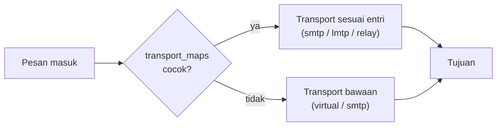

# Transport Routing Lanjutan

!!! info "Identitas chapter"
    **ID:** `CH-15-01-02` · **Kategori/modul:** CAT-15 / MOD-15-01 (Multi-Domain dan Routing) · **Estimasi:** 120 menit · **Lingkungan:** uji publik (VPS, IP publik, domain) · [Lihat chapter ini di dashboard](../../../#CH-15-01-02)

!!! warning "Peringatan"
    Salah konfigurasi transport dapat membuat loop atau mengirim email ke tujuan salah. Selalu uji dengan `postmap -q`, mulai dari akun uji, dan backup `main.cf` serta tabel. Belum dijalankan penulis pada VM (`verified_on: null`).

## 1. Ringkasan

`transport_maps` memungkinkan Postfix mengarahkan email berdasarkan domain atau penerima ke transport atau server tertentu, misalnya meneruskan satu domain ke server internal lain. Anda menulis tabel, mengujinya, dan menghindari loop.

## 2. Tujuan Pembelajaran

1. Menulis `transport_maps` untuk routing per domain.
2. Menguji hasil lookup dan memverifikasi di log.
3. Mengenali dan mencegah loop routing.

## 3. Prasyarat

- `CH-15-01-01` — Multiple Domain pada Satu Server.
- Multi-domain (`CH-15-01-01`); alias dan transport (`CH-06-01-05`).

## 4. Materi Teori

### 4.1 Format

`pola  transport:tujuan`. Contoh:

| Entri | Arti |
|---|---|
| `domain-b.example smtp:[mx-b.internal.example]:25` | Kirim ke server internal; tanda kurung mencegah pencarian MX |
| `.legacy.example relay:[10.0.0.30]` | Subdomain ke host tertentu |
| `ani@domain-a.example lmtp:unix:private/dovecot-lmtp` | Penerima tertentu ke LMTP |



### 4.2 Loop
Loop terjadi bila dua server saling meneruskan domain yang sama. Gejala: header `Received` bertambah cepat dan galat `mail forwarding loop` (batas hop tercapai). Pastikan server tujuan benar-benar melayani domain itu sebagai tujuan akhir, bukan meneruskannya balik.

## 5. Praktik dan Implementasi

1. Backup `main.cf`.
2. Tulis `transport` untuk satu domain uji.
3. Uji lookup dan kirim pesan uji.
4. Pantau log untuk status dan hop.

## 6. Perintah Linux

```bash title="Membuat dan menguji"
sudo cp -a /etc/postfix/main.cf /root/main.cf.bak
sudo postconf -e 'transport_maps = hash:/etc/postfix/transport'
echo 'domain-b.example smtp:[mx-b.internal.example]:25' | sudo tee /etc/postfix/transport >/dev/null
sudo postmap /etc/postfix/transport
sudo postmap -q domain-b.example hash:/etc/postfix/transport
sudo postfix check && sudo systemctl reload postfix
```

Hasil yang diharapkan dari `postmap -q`: `smtp:[mx-b.internal.example]:25`. Untuk domain yang masuk `relay_domains`/`virtual_mailbox_domains`, pastikan domain tidak diperlakukan ganda.

```bash title="Memantau"
sudo journalctl -u 'postfix@-' --since "10 min ago" --no-pager | grep -E 'relay=|status='
```

## 7. Konfigurasi

Tidak ada berkas konfigurasi yang diubah pada chapter ini.

## 8. Verifikasi

- Lookup memberi hasil yang diharapkan dan pesan uji sampai ke tujuan.
- Log menampilkan `relay=` tujuan benar.
- Tidak ada pesan `loops back to myself` atau lonjakan `Received`.

## 9. Troubleshooting

| Gejala | Kemungkinan penyebab | Tindakan |
|---|---|---|
| `mail for ... loops back to myself` | Domain di `mydestination` / MX ke diri sendiri | Periksa `mydestination` dan tujuan |
| Entri tidak berlaku | Belum `postmap` / tidak reload | Jalankan |
| Pesan tertahan | Tujuan menolak | Baca status, log tujuan |
| Penerima salah | Pola terlalu luas | Perketat pola |

## 10. Security Review

- Transport ke host eksternal tanpa TLS membocorkan email; atur `smtp_tls_security_level` yang sesuai.
- Jangan mengarahkan ke host yang tidak Anda kendalikan.
- Perubahan routing memengaruhi pengiriman semua pengguna: lewat prosedur perubahan.

## 11. Latihan

1. Rancang tabel untuk tiga domain, masing-masing ke tujuan berbeda.
2. Simulasikan loop di lab dan baca gejalanya.
3. Jelaskan fungsi tanda kurung pada `[host]`.

## 12. Assessment

1. Apa fungsi `transport_maps`?
2. Apa penyebab loop?
3. Mengapa `postmap -q` sebelum reload?

**Kunci singkat.** (1) Routing per domain/penerima. (2) Dua sistem saling meneruskan. (3) Memverifikasi hasil lookup.

## 13. Checklist Kelulusan

- [ ] Routing uji bekerja dan terpantau.
- [ ] Prosedur anti-loop dipahami.

!!! note "Status belajar"
    Ubah status chapter secara manual di dashboard. Menyelesaikan checklist ini tidak mengubah status otomatis.

## 14. Referensi Resmi

- [Postfix: transport(5)](https://www.postfix.org/transport.5.html)
- [Postfix: ADDRESS_REWRITING_README](https://www.postfix.org/ADDRESS_REWRITING_README.html)
- [Postfix: postconf — transport_maps](https://www.postfix.org/postconf.5.html#transport_maps)

Tautan referensi tidak diverifikasi otomatis pada build ini; periksa ketersediaannya sebelum dipakai.

---

[Kembali ke dashboard kurikulum](../../../#CH-15-01-02){ .md-button }
