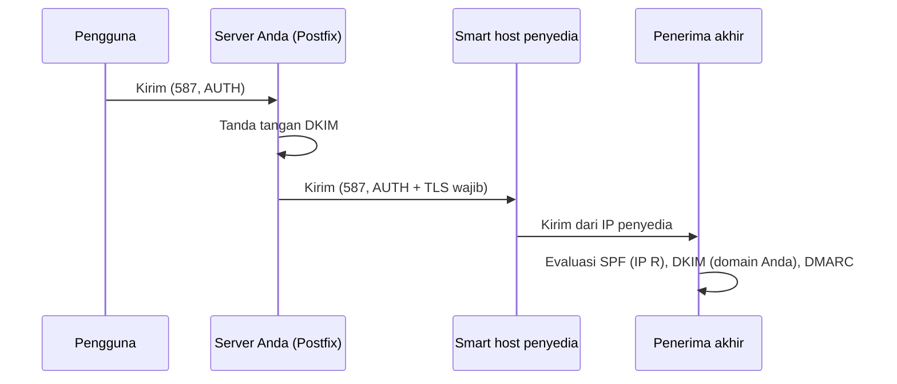

# Relay dan Smart Host

!!! info "Identitas chapter"
    **ID:** `CH-15-01-03` · **Kategori/modul:** CAT-15 / MOD-15-01 (Multi-Domain dan Routing) · **Estimasi:** 120 menit · **Lingkungan:** uji publik (VPS, IP publik, domain) · [Lihat chapter ini di dashboard](../../../#CH-15-01-03)

!!! warning "Peringatan"
    Berkas kata sandi smart host memuat kredensial. Izin `0600` milik root, jangan di repositori, dan jangan tampil di log atau argumen perintah. Belum dijalankan penulis pada VM (`verified_on: null`).

## 1. Ringkasan

Smart host (relayhost) menerima email keluar Anda lalu meneruskannya. Ini berguna bila port 25 keluar diblokir atau IP Anda berreputasi buruk. Anda mengonfigurasi `relayhost` dengan autentikasi dan TLS, dan menilai konsekuensinya untuk SPF/DKIM/DMARC.

## 2. Tujuan Pembelajaran

1. Menjelaskan kapan smart host sesuai dan kompromi yang menyertainya.
2. Mengonfigurasi `relayhost` dengan SASL dan TLS wajib.
3. Menyesuaikan SPF dan memastikan DKIM tetap selaras.

## 3. Prasyarat

- `CH-15-01-02` — Transport Routing Lanjutan.
- Pembatasan port 25 (`CH-12-01-01`); autentikasi email (Level 7).

## 4. Materi Teori

### 4.1 Alur



### 4.2 Dampak

| Aspek | Dampak |
|---|---|
| SPF | Penerima melihat IP smart host: tambahkan `include:` penyedia ke SPF |
| DKIM | Tanda tangan Anda tetap valid bila pesan tidak diubah |
| Reputasi | Dipinjam dari penyedia (dan dibagi dengan pelanggannya) |
| Ketergantungan | Penyedia down = pengiriman tertunda |
| Privasi | Penyedia dapat membaca email keluar yang tak terenkripsi ujung-ke-ujung |

## 5. Praktik dan Implementasi

1. Pilih penyedia dan baca dokumentasi autentikasinya.
2. Simpan kredensial di berkas khusus berizin ketat.
3. Konfigurasikan `relayhost` dan TLS wajib.
4. Perbarui SPF.
5. Uji dan lihat `relay=` di log.

## 6. Perintah Linux

```bash title="Menyimpan kredensial (dari editor, bukan argumen)"
sudo install -m 0600 -o root -g root /dev/null /etc/postfix/sasl_passwd
sudo nano /etc/postfix/sasl_passwd
sudo postmap /etc/postfix/sasl_passwd
sudo chmod 0600 /etc/postfix/sasl_passwd /etc/postfix/sasl_passwd.db
```

Isi berkas satu baris: `[smtp.penyedia.example]:587 nama-pengguna:kata-sandi` (ganti dengan nilai dari penyedia; **jangan** masukkan nilai nyata ke dokumen ini atau repositori).

```bash title="Aktivasi dan uji"
sudo postfix check && sudo systemctl reload postfix
printf 'Subject: uji smart host\n\nIsi.\n' | sendmail akun-uji@domain-eksternal.example
sudo journalctl -u 'postfix@-' --since "5 min ago" --no-pager | grep -E 'relay=|status='
```

## 7. Konfigurasi

```text title="/etc/postfix/main.cf (potongan)"
relayhost = [smtp.penyedia.example]:587
smtp_sasl_auth_enable = yes
smtp_sasl_password_maps = hash:/etc/postfix/sasl_passwd
smtp_sasl_security_options = noanonymous
smtp_tls_security_level = encrypt
smtp_tls_CAfile = /etc/ssl/certs/ca-certificates.crt
```

```text title="SPF (contoh)"
v=spf1 mx include:spf.penyedia.example -all
```

- `smtp.penyedia.example` dan `spf.penyedia.example` adalah placeholder; ambil nilai asli dari dokumentasi penyedia.
- `smtp_tls_security_level = encrypt` menolak pengiriman bila TLS gagal; itu lebih aman daripada `may`.
- Tambahkan paket `libsasl2-modules` bila autentikasi gagal karena modul SASL klien hilang.

## 8. Verifikasi

- Log menunjukkan `relay=smtp.penyedia.example[...]:587` dan `status=sent`.
- Header di penerima: `spf=pass` (lewat include) dan `dkim=pass` untuk domain Anda.
- Berkas kata sandi berizin 0600.

## 9. Troubleshooting

| Gejala | Kemungkinan penyebab | Tindakan |
|---|---|---|
| `SASL authentication failed` | Kredensial salah / modul tak ada | Periksa, pasang `libsasl2-modules` |
| `TLS is required, but was not offered` | Penyedia tak menawarkan TLS pada port itu | Gunakan port/penyedia yang benar |
| `spf=fail` | SPF belum memuat penyedia | Tambah `include:` |
| Pesan ditunda | Penyedia membatasi | Baca kebijakan batas kirim |

## 10. Security Review

- Kredensial smart host yang bocor memungkinkan pengiriman atas nama Anda; rotasi segera bila bocor.
- `postmap` menghasilkan `.db` yang juga rahasia; jaga izin kedua berkas.
- Penyedia melihat metadata (dan isi bila tidak terenkripsi ujung-ke-ujung).

## 11. Latihan

1. Bandingkan MTA langsung vs smart host dalam tabel risiko.
2. Rancang prosedur rotasi kredensial smart host.
3. Jelaskan dampak smart host pada DMARC alignment.

## 12. Assessment

1. Kapan smart host layak dipakai?
2. Mengapa SPF perlu diperbarui?
3. Mengapa `encrypt` lebih aman dari `may`?

**Kunci singkat.** (1) Port 25 diblokir atau reputasi IP buruk. (2) Penerima melihat IP penyedia. (3) Menolak pengiriman tanpa TLS.

## 13. Checklist Kelulusan

- [ ] Smart host berfungsi dengan TLS wajib.
- [ ] SPF dan DKIM lulus pada uji.
- [ ] Kredensial dilindungi dan prosedur rotasi ada.

!!! note "Status belajar"
    Ubah status chapter secara manual di dashboard. Menyelesaikan checklist ini tidak mengubah status otomatis.

## 14. Referensi Resmi

- [Postfix: SASL_README (klien)](https://www.postfix.org/SASL_README.html)
- [Postfix: postconf — relayhost](https://www.postfix.org/postconf.5.html#relayhost)
- [Postfix: TLS_README](https://www.postfix.org/TLS_README.html)
- [RFC 7208 — SPF](https://www.rfc-editor.org/rfc/rfc7208)

Tautan referensi tidak diverifikasi otomatis pada build ini; periksa ketersediaannya sebelum dipakai.

---

[Kembali ke dashboard kurikulum](../../../#CH-15-01-03){ .md-button }
