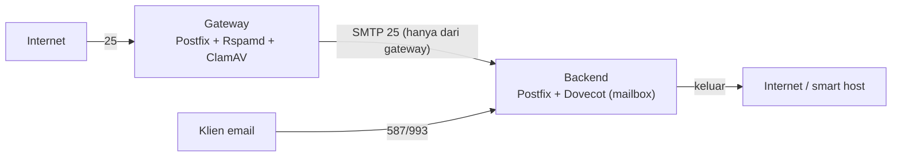

# Gateway Filtering Spam Terdedikasi

!!! info "Identitas chapter"
    **ID:** `CH-15-02-01` · **Kategori/modul:** CAT-15 / MOD-15-02 (Gateway dan Backend Pengguna) · **Estimasi:** 150 menit · **Lingkungan:** uji publik (VPS, IP publik, domain) · [Lihat chapter ini di dashboard](../../../#CH-15-02-01)

!!! note "Catatan"
    Chapter ini konseptual disertai potongan konfigurasi ilustratif yang belum dijalankan penulis. Gateway menambah titik kegagalan dan kompleksitas; terapkan hanya bila kebutuhan nyata. Belum dijalankan penulis pada VM (`verified_on: null`).

## 1. Ringkasan

Gateway spam terdedikasi adalah MTA terpisah di garis depan yang menyaring email masuk lalu meneruskan yang bersih ke server mailbox (backend). Manfaatnya: backend tidak langsung terpapar internet dan beban penyaringan terisolasi.

## 2. Tujuan Pembelajaran

1. Merancang arsitektur gateway dan backend.
2. Mencegah backscatter dengan validasi penerima di gateway.
3. Mengatur routing ke backend dan mengunci akses backend.

## 3. Prasyarat

- `CH-15-01-03` — Relay dan Smart Host.
- Rspamd (`CH-10-02-01`, `CH-10-02-02`); transport routing (`CH-15-01-02`).

## 4. Materi Teori

### 4.1 Arsitektur



### 4.2 Validasi penerima

Gateway harus tahu alamat yang valid, kalau tidak ia menerima semua lalu gagal meneruskan dan menghasilkan bounce ke alamat palsu (backscatter). Dua cara: salin daftar penerima ke gateway (`relay_recipient_maps`) secara otomatis, atau minta backend memvalidasi penerima saat transaksi (verifikasi alamat tujuan). Daftar yang basi menolak email sah; atur sinkronisasi dan pantau.

### 4.3 Mengunci backend
Backend hanya menerima port 25 dari gateway (firewall) sehingga penyerang tidak melewati filter dengan menyambung langsung. MX publik hanya menunjuk gateway.

## 5. Praktik dan Implementasi

1. Gambar arsitektur dan daftar aliran data.
2. Tentukan sumber daftar penerima di gateway.
3. Rancang aturan firewall.
4. Rencanakan pengujian: spam diblokir, email sah lewat, alamat tak dikenal ditolak saat SMTP.

## 6. Perintah Linux

```bash title="Menguji di gateway"
sudo postmap /etc/postfix/relay_recipients /etc/postfix/transport
postmap -q ani@example.com hash:/etc/postfix/relay_recipients
postmap -q example.com hash:/etc/postfix/transport
```

```bash title="Menguji penolakan penerima tak dikenal (dari host uji)"
nc gateway.example.com 25
```

Ketik `EHLO uji.invalid`, `MAIL FROM:<a@uji.invalid>`, `RCPT TO:<tidak-ada@example.com>`, `QUIT`. Hasil yang diharapkan: penolakan `5.1.1` saat RCPT. Jangan menyelesaikan `DATA`.

## 7. Konfigurasi

```text title="Gateway: /etc/postfix/main.cf (potongan ilustratif)"
relay_domains = example.com
relay_recipient_maps = hash:/etc/postfix/relay_recipients
transport_maps = hash:/etc/postfix/transport
smtpd_milters = inet:127.0.0.1:11332
milter_default_action = accept
```

```text title="Gateway: /etc/postfix/transport"
example.com smtp:[backend.internal.example]:25
```

```text title="Gateway: /etc/postfix/relay_recipients"
ani@example.com OK
budi@example.com OK
```

```text title="Backend: aturan firewall (konsep)"
Izinkan 25/tcp hanya dari alamat gateway; tolak sumber lain.
```

## 8. Verifikasi

- Penerima tak dikenal ditolak di gateway, bukan setelah diterima.
- Email sah sampai ke backend; spam diblokir/ditandai di gateway.
- Backend tidak dapat dijangkau langsung dari internet.

## 9. Troubleshooting

| Gejala | Kemungkinan penyebab | Tindakan |
|---|---|---|
| Email sah ditolak | Daftar penerima basi | Otomasi sinkronisasi |
| Backscatter muncul | Gateway menerima semua | Validasi penerima |
| Pesan tertahan di gateway | Backend tak terjangkau | Periksa firewall dan log |
| Skor spam berbeda dari backend | Dua filter | Hanya satu yang menilai |

## 10. Security Review

- Backend yang terjangkau publik meniadakan manfaat gateway.
- Gateway adalah titik kegagalan tunggal baru: pertimbangkan kapasitas dan redundansi.
- Daftar penerima memuat alamat; jaga izin berkas.

## 11. Latihan

1. Rancang cara sinkronisasi penerima otomatis.
2. Buat skenario kegagalan: gateway mati, backend mati; tulis dampaknya.
3. Tulis rencana pengujian lengkap.

## 12. Assessment

1. Mengapa gateway perlu daftar penerima?
2. Apa tujuan mengunci backend?
3. Apa kerugian gateway terdedikasi?

**Kunci singkat.** (1) Mencegah backscatter. (2) Agar filter tidak dilewati. (3) Kompleksitas dan titik kegagalan baru.

## 13. Checklist Kelulusan

- [ ] Arsitektur dan rencana uji tertulis.
- [ ] Validasi penerima dirancang.

!!! note "Status belajar"
    Ubah status chapter secara manual di dashboard. Menyelesaikan checklist ini tidak mengubah status otomatis.

## 14. Referensi Resmi

- [Postfix: STANDARD_CONFIGURATION_README](https://www.postfix.org/STANDARD_CONFIGURATION_README.html)
- [Postfix: relay_recipient_maps](https://www.postfix.org/postconf.5.html#relay_recipient_maps)
- [Postfix: BACKSCATTER_README](https://www.postfix.org/BACKSCATTER_README.html)

Tautan referensi tidak diverifikasi otomatis pada build ini; periksa ketersediaannya sebelum dipakai.

---

[Kembali ke dashboard kurikulum](../../../#CH-15-02-01){ .md-button }
