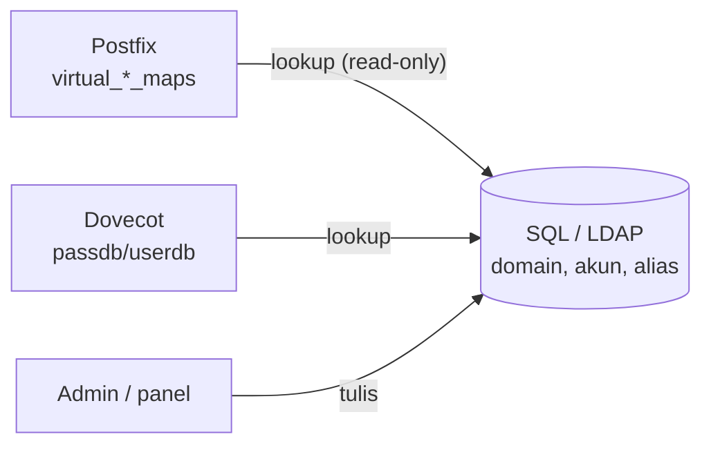

# Virtual User Berbasis SQL atau LDAP

!!! info "Identitas chapter"
    **ID:** `CH-15-02-02` · **Kategori/modul:** CAT-15 / MOD-15-02 (Gateway dan Backend Pengguna) · **Estimasi:** 180 menit · **Lingkungan:** uji publik (VPS, IP publik, domain) · [Lihat chapter ini di dashboard](../../../#CH-15-02-02)

!!! warning "Peringatan"
    Backend pengguna menjadi titik kegagalan tunggal: bila SQL/LDAP mati, login dan penerimaan terganggu. Gunakan akun baca-saja, TLS ke backend, dan uji kegagalan di lab. Konfigurasi di bawah belum dijalankan penulis. Belum dijalankan penulis pada VM (`verified_on: null`).

## 1. Ringkasan

Daripada `passwd-file`, akun virtual dapat disimpan di database SQL atau direktori LDAP, sehingga Postfix dan Dovecot membaca sumber kebenaran yang sama dan pengelolaan skala besar lebih mudah.

## 2. Tujuan Pembelajaran

1. Memetakan data yang dibutuhkan Postfix (domain, penerima, alias) dan Dovecot (otentikasi, lokasi).
2. Mengonfigurasi lookup SQL (atau LDAP) untuk keduanya.
3. Menguji lookup dan memitigasi ketersediaan backend.

## 3. Prasyarat

- `CH-15-02-01` — Gateway Filtering Spam Terdedikasi.
- Mailbox virtual (`CH-07-01-01`); multi-domain (`CH-15-01-01`).

## 4. Materi Teori

### 4.1 Satu sumber, dua konsumen



### 4.2 Skema contoh (SQL)

| Tabel | Kolom penting |
|---|---|
| `domains` | `name` |
| `users` | `email`, `password_hash`, `quota` |
| `aliases` | `source`, `destination` |

### 4.3 Ketersediaan
Lookup yang gagal membuat Postfix menunda pesan (galat sementara) dan Dovecot menolak login. Pasang cache pendek, replikasi baca, dan pantau; jangan membiarkan satu instans database tanpa backup.

## 5. Praktik dan Implementasi

1. Siapkan database uji dan skema contoh.
2. Buat pengguna database baca-saja untuk Postfix dan Dovecot.
3. Tulis berkas lookup dan uji dengan `postmap -q`.
4. Hubungkan Dovecot dan uji `doveadm auth test`.
5. Matikan database dan amati perilaku.

## 6. Perintah Linux

```bash title="Paket yang diperlukan (contoh MariaDB/MySQL)"
sudo apt install postfix-mysql dovecot-mysql
```

Untuk LDAP: `postfix-ldap` dan `dovecot-ldap`.

```bash title="Menguji lookup"
sudo postmap -q example.com mysql:/etc/postfix/mysql-domains.cf
sudo postmap -q ani@example.com mysql:/etc/postfix/mysql-mailboxes.cf
sudo doveadm auth test ani@example.com
sudo doveadm user ani@example.com
```

## 7. Konfigurasi

```text title="/etc/postfix/mysql-mailboxes.cf (kredensial placeholder; izin 0640 root:postfix)"
user = postfix_ro
password = <DARI-PENGELOLA-RAHASIA>
hosts = 127.0.0.1
dbname = mailserver
query = SELECT 1 FROM users WHERE email='%s'
```

```text title="/etc/postfix/main.cf"
virtual_mailbox_domains = mysql:/etc/postfix/mysql-domains.cf
virtual_mailbox_maps = mysql:/etc/postfix/mysql-mailboxes.cf
```

```text title="/etc/dovecot/dovecot-sql.conf.ext (kredensial placeholder; izin ketat)"
driver = mysql
connect = host=127.0.0.1 dbname=mailserver user=dovecot_ro password=<DARI-PENGELOLA-RAHASIA>
default_pass_scheme = SHA512-CRYPT
password_query = SELECT email AS user, password_hash AS password FROM users WHERE email='%u'
user_query = SELECT 5000 AS uid, 5000 AS gid, '/var/vmail/%d/%n' AS home
```

```text title="/etc/dovecot/conf.d/auth-sql.conf.ext (potongan)"
passdb {
  driver = sql
  args = /etc/dovecot/dovecot-sql.conf.ext
}
userdb {
  driver = static
  args = uid=vmail gid=vmail home=/var/vmail/%d/%n
}
```

- Jangan menaruh kata sandi database sebenarnya di dokumen; muat dari berkas berizin ketat.
- Gunakan TLS ke database jika tidak lokal.
- Nama kolom/query hanyalah contoh skema; sesuaikan dengan skema Anda dan gunakan parameter yang aman (`%s`, `%u` dienkapsulasi oleh Postfix/Dovecot).
- Untuk LDAP, filter pencarian dan `bind` ditulis di berkas `ldap:` serupa; ikuti dokumentasi.

## 8. Verifikasi

- `postmap -q` mengembalikan hasil untuk domain/penerima valid dan kosong untuk yang tidak ada.
- `doveadm auth test` berhasil dengan akun uji.
- Saat database dimatikan, Postfix menunda (tidak menolak permanen) dan login gagal; setelah hidup kembali, pulih tanpa intervensi.

## 9. Troubleshooting

| Gejala | Kemungkinan penyebab | Tindakan |
|---|---|---|
| `postmap -q` kosong | Query / kredensial salah | Uji query langsung di klien SQL |
| Email ditolak permanen saat DB mati | Lookup error ditangani keliru | Pastikan galat lookup menjadi sementara |
| Login lambat | DB lambat / tanpa indeks | Indeks, cache |
| Kata sandi tidak cocok | Skema hash berbeda | Samakan `default_pass_scheme` |

## 10. Security Review

- Akun database hanya-baca dan minimal; tulis hanya oleh panel admin.
- Hindari SQL injection: jangan menyusun query dari input tak tepercaya; gunakan variabel yang disediakan.
- Berkas lookup memuat kredensial: izin `0640` dan grup yang tepat.
- Enkripsi koneksi bila di luar `localhost`.

## 11. Latihan

1. Rancang skema dan indeks untuk 10.000 akun.
2. Uji kegagalan database dan tulis perilaku yang diamati.
3. Bandingkan SQL dan LDAP untuk organisasi Anda.

## 12. Assessment

1. Mengapa akun database hanya-baca?
2. Apa yang terjadi saat database mati?
3. Mengapa menjaga skema hash konsisten?

**Kunci singkat.** (1) Batasi dampak kebocoran. (2) Pesan tertunda, login gagal. (3) Agar autentikasi cocok.

## 13. Checklist Kelulusan

- [ ] Lookup Postfix dan Dovecot teruji pada backend uji.
- [ ] Uji kegagalan backend dilakukan.
- [ ] Kredensial dilindungi.

!!! note "Status belajar"
    Ubah status chapter secara manual di dashboard. Menyelesaikan checklist ini tidak mengubah status otomatis.

## 14. Referensi Resmi

- [Postfix: MYSQL_README](https://www.postfix.org/MYSQL_README.html)
- [Postfix: LDAP_README](https://www.postfix.org/LDAP_README.html)
- [Dokumentasi Dovecot 2.3: SQL](https://doc.dovecot.org/2.3/configuration_manual/authentication/sql/)
- [Dokumentasi Dovecot 2.3: LDAP](https://doc.dovecot.org/2.3/configuration_manual/authentication/ldap/)

Tautan referensi tidak diverifikasi otomatis pada build ini; periksa ketersediaannya sebelum dipakai.

---

[Kembali ke dashboard kurikulum](../../../#CH-15-02-02){ .md-button }
