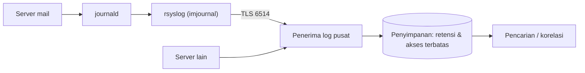

# Centralized Logging

!!! info "Identitas chapter"
    **ID:** `CH-15-02-03` · **Kategori/modul:** CAT-15 / MOD-15-02 (Gateway dan Backend Pengguna) · **Estimasi:** 120 menit · **Lingkungan:** uji publik (VPS, IP publik, domain) · [Lihat chapter ini di dashboard](../../../#CH-15-02-03)

!!! warning "Peringatan"
    Log berisi data pribadi dan sering menjadi target. Enkripsi transport log, batasi akses penyimpanan pusat, dan tetapkan retensi sebelum mengirim log ke luar server. Belum dijalankan penulis pada VM (`verified_on: null`).

## 1. Ringkasan

Mengumpulkan log dari banyak server ke satu tempat memudahkan pencarian, korelasi insiden, dan melindungi bukti dari penyerang lokal. Anda mengirim log lewat TLS ke penerima pusat dan menjaga integritas dan retensinya.

## 2. Tujuan Pembelajaran

1. Merancang aliran log ke pusat dengan transport terenkripsi.
2. Mengonfigurasi pengirim log (rsyslog) dengan TLS.
3. Menetapkan retensi dan kontrol akses di pusat.

## 3. Prasyarat

- `CH-15-02-02` — Virtual User Berbasis SQL atau LDAP.
- Integritas log dan retensi lokal (`CH-10-03-02`).

## 4. Materi Teori

### 4.1 Alur



### 4.2 Opsi
`rsyslog` meneruskan log melalui TCP dengan TLS; `systemd-journal-remote` adalah opsi lain berbasis journal. Ubuntu Server 24.04 tidak selalu memasang rsyslog; pasang bila dibutuhkan. Pilih satu opsi dan dokumentasikan.

### 4.3 Integritas dan privasi
Pengirim yang disusupi dapat mengirim log palsu; pusat sebaiknya memberi label sumber dan mengotentikasi pengirim (sertifikat klien). Log memuat alamat email dan IP: batasi akses dan terapkan retensi minimum.

## 5. Praktik dan Implementasi

1. Tentukan server penerima (lab) dan sertifikatnya.
2. Pasang rsyslog di pengirim.
3. Konfigurasikan penerusan TLS.
4. Verifikasi pesan tiba di pusat.
5. Atur retensi dan akses di pusat.

## 6. Perintah Linux

```bash title="Pengirim"
sudo apt install rsyslog rsyslog-gnutls
sudo rsyslogd -N1
sudo systemctl restart rsyslog
logger -p mail.info "uji log terpusat dari $(hostname)"
```

`rsyslogd -N1` memeriksa sintaks konfigurasi. Pada penerima, cari pesan uji pada berkas atau penyimpanan log yang dikonfigurasi.

## 7. Konfigurasi

```text title="/etc/rsyslog.d/90-forward.conf (pengirim; nilai contoh)"
global(
  DefaultNetstreamDriver="gtls"
  DefaultNetstreamDriverCAFile="/etc/ssl/certs/ca-certificates.crt"
)
*.* action(type="omfwd" target="log.example.com" port="6514" protocol="tcp"
  StreamDriver="gtls" StreamDriverMode="1" StreamDriverAuthMode="x509/name"
  StreamDriverPermittedPeers="log.example.com"
  action.resumeRetryCount="-1" queue.type="LinkedList" queue.filename="fwd" queue.maxDiskSpace="500m" queue.saveOnShutdown="on")
```

- Nama direktif rsyslog sensitif versi; verifikasi dengan `rsyslogd -N1` dan dokumentasi rsyslog terpasang.
- `log.example.com` adalah placeholder; penerima harus memiliki sertifikat dengan nama itu dan dipercaya CA.
- Antrean disk menahan log saat pusat tak terjangkau; atur batas ruangnya.
- Penerima dikonfigurasi dengan `imtcp` dan TLS; ikuti dokumentasi rsyslog.

## 8. Verifikasi

- Pesan uji muncul di pusat dengan nama host sumber benar.
- Saat pusat dimatikan, log tertahan di antrean pengirim lalu terkirim ketika pulih.
- Retensi dan akses di pusat terdokumentasi dan terbatas.

## 9. Troubleshooting

| Gejala | Kemungkinan penyebab | Tindakan |
|---|---|---|
| Tidak ada log di pusat | TLS/nama/firewall | `rsyslogd -N1`, log rsyslog, uji port |
| Handshake gagal | Nama sertifikat tak cocok | Samakan `PermittedPeers` |
| Log hilang saat pusat down | Tanpa antrean | Aktifkan antrean disk |
| Pusat kebanjiran | Semua `*.*` dikirim | Saring fasilitas penting |

## 10. Security Review

- Log tidak terenkripsi melintasi jaringan membocorkan alamat dan IP.
- Pusat log menjadi target bernilai tinggi: amankan, batasi, dan cadangkan.
- Retensi harus mengikuti kebijakan privasi dan hukum.

## 11. Latihan

1. Rancang pemfilteran fasilitas yang dikirim.
2. Uji kegagalan pusat dan ukur lamanya antrean.
3. Tulis kebijakan retensi pusat.

## 12. Assessment

1. Mengapa log dikirim ke pusat?
2. Mengapa TLS?
3. Apa fungsi antrean disk?

**Kunci singkat.** (1) Tahan manipulasi lokal dan memudahkan korelasi. (2) Melindungi data saat transit. (3) Menahan log saat pusat tak terjangkau.

## 13. Checklist Kelulusan

- [ ] Log terkirim ke pusat lewat TLS pada lab.
- [ ] Antrean dan retensi diuji.

!!! note "Status belajar"
    Ubah status chapter secara manual di dashboard. Menyelesaikan checklist ini tidak mengubah status otomatis.

## 14. Referensi Resmi

- [rsyslog: Dokumentasi](https://www.rsyslog.com/doc/)
- [rsyslog: Enkripsi TLS](https://www.rsyslog.com/doc/tutorials/tls.html)
- [systemd: systemd-journal-remote](https://www.freedesktop.org/software/systemd/man/latest/systemd-journal-remote.service.html)

Tautan referensi tidak diverifikasi otomatis pada build ini; periksa ketersediaannya sebelum dipakai.

---

[Kembali ke dashboard kurikulum](../../../#CH-15-02-03){ .md-button }
