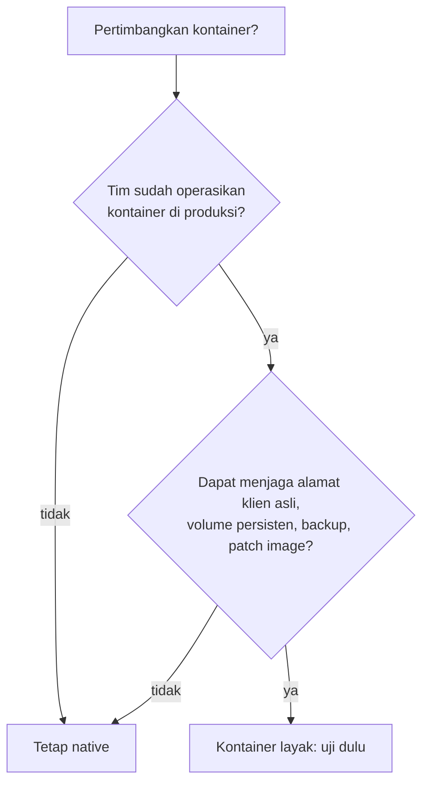

# Pertimbangan Kontainerisasi dan Docker

!!! info "Identitas chapter"
    **ID:** `CH-15-03-01` · **Kategori/modul:** CAT-15 / MOD-15-03 (Arsitektur Skala Besar) · **Estimasi:** 90 menit · **Lingkungan:** uji publik (VPS, IP publik, domain) · [Lihat chapter ini di dashboard](../../../#CH-15-03-01)

!!! note "Catatan"
    Chapter ini konseptual. Kontainerisasi mail server tidak dipraktikkan di kurikulum ini; deployment native adalah jalur utama. Belum dijalankan penulis pada VM (`verified_on: null`).

## 1. Ringkasan

Kontainer menawarkan reproduksibilitas dan isolasi, tetapi email memiliki kebutuhan yang tidak selalu cocok: IP dan reputasi yang stabil, alamat klien asli, data persisten, dan identitas jaringan (PTR/HELO). Anda membandingkan deployment native dan kontainer dengan jujur.

## 2. Tujuan Pembelajaran

1. Membandingkan native dan kontainer untuk komponen mail server.
2. Mengenali risiko operasional kontainer untuk email.
3. Memutuskan kapan kontainer masuk akal.

## 3. Prasyarat

- `CH-15-02-03` — Centralized Logging.
- Seluruh pemahaman arsitektur mail server (Level 5–10).

## 4. Materi Teori

### 4.1 Perbandingan

| Aspek | Native | Kontainer |
|---|---|---|
| Instalasi/pembaruan | APT, patch keamanan Ubuntu | Image pihak ketiga atau buatan sendiri; Anda memelihara rantai pembaruan |
| Alamat klien | Asli | Dapat berubah menjadi alamat jembatan (NAT) bila tidak dikonfigurasi, merusak rate limit, Fail2ban, dan log |
| Data persisten | Filesystem biasa | Volume harus dikelola dan di-backup |
| Reputasi/PTR | Terikat host | Tetap terikat host; kontainer tidak mengubahnya |
| Proses dan sinyal | systemd | Satu proses per kontainer; Postfix/Dovecot multi-proses menuntut penanganan khusus |
| Observabilitas | journald | Log kontainer; perlu pengaturan |
| Keamanan | Hardening host | Tambahan lapis: image, runtime, jaringan |

### 4.2 Titik rawan
- Firewall kontainer dan aturan jaringan host dapat berinteraksi dengan cara tak terduga (aturan UFW bisa terlewati oleh pengaturan jaringan kontainer); verifikasi eksposur dengan pemindaian eksternal.
- Pembaruan keamanan bergantung pada image yang Anda pilih; tinjau kebijakan pembaruan penyedia image.
- Kontainer yang memetakan port 25 membutuhkan IP publik dan PTR yang tepat pada host.

## 5. Praktik dan Implementasi

1. Isi tabel perbandingan untuk lingkungan Anda.
2. Daftar tiga risiko terbesar dan mitigasinya.
3. Putuskan dan tulis alasan (ADR singkat).

## 6. Perintah Linux

Chapter ini konseptual; tidak ada perintah yang mengubah sistem.

## 7. Konfigurasi

Tidak ada berkas konfigurasi yang diubah pada chapter ini.

## 8. Verifikasi

- Keputusan didokumentasikan dengan alasan dan risiko.
- Jika memilih kontainer: ada rencana alamat klien, persistensi, backup, dan patch image yang teruji.

## 9. Troubleshooting

| Gejala | Kemungkinan penyebab | Tindakan |
|---|---|---|
| Alamat klien tampak sama untuk semua | NAT jaringan kontainer | Gunakan mode jaringan yang menjaga alamat asli |
| Data hilang saat kontainer diganti | Tak ada volume | Gunakan volume dan backup |
| Aturan firewall terlewati | Interaksi jaringan | Verifikasi eksposur dengan pemindaian luar |
| Image usang | Tak ada pembaruan | Proses pembaruan terjadwal |

## 10. Security Review

- Image yang tidak dikenal dapat memuat kerentanan atau kode berbahaya; gunakan sumber tepercaya dan pantau pembaruan.
- Jangan menjalankan kontainer dengan hak berlebihan.
- Rahasia tidak ditanam dalam image.

## 11. Latihan

1. Tulis catatan keputusan arsitektur (ADR) untuk lingkungan Anda.
2. Daftar apa yang perlu dibuktikan sebelum kontainer dipakai produksi.
3. Jelaskan bagaimana rate limit gagal bila alamat klien hilang.

## 12. Assessment

1. Mengapa alamat klien penting?
2. Apa risiko pembaruan image?
3. Kapan tetap native?

**Kunci singkat.** (1) Untuk rate limit, Fail2ban, log, SPF. (2) Rantai patch bergantung pada pemilik image. (3) Bila belum siap mengoperasikan kontainer.

## 13. Checklist Kelulusan

- [ ] Perbandingan dan keputusan tertulis.
- [ ] Risiko dan mitigasi terdokumentasi.

!!! note "Status belajar"
    Ubah status chapter secara manual di dashboard. Menyelesaikan checklist ini tidak mengubah status otomatis.

## 14. Referensi Resmi

- [Docker: Dokumentasi](https://docs.docker.com/)
- [Docker: Networking](https://docs.docker.com/engine/network/)
- [Postfix: Overview](https://www.postfix.org/OVERVIEW.html)

Tautan referensi tidak diverifikasi otomatis pada build ini; periksa ketersediaannya sebelum dipakai.

---

[Kembali ke dashboard kurikulum](../../../#CH-15-03-01){ .md-button }
