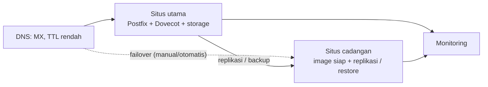

# Arsitektur High Availability dan DR

!!! info "Identitas chapter"
    **ID:** `CH-15-03-02` · **Kategori/modul:** CAT-15 / MOD-15-03 (Arsitektur Skala Besar) · **Estimasi:** 150 menit · **Lingkungan:** uji publik (VPS, IP publik, domain) · [Lihat chapter ini di dashboard](../../../#CH-15-03-02)

!!! note "Catatan"
    Chapter ini konseptual: desain, bukan implementasi. Jangan menerapkan HA sebelum backup dan restore teruji (`CH-11-03-02`) dan sebelum RTO/RPO ditetapkan. Belum dijalankan penulis pada VM (`verified_on: null`).

## 1. Ringkasan

Anda merancang high availability (HA) dan disaster recovery (DR) berdasarkan RTO/RPO, mengenali titik kegagalan tunggal, dan menilai pola yang tersedia beserta biayanya. Chapter ini memperdalam konsep di `CH-11-03-05`.

## 2. Tujuan Pembelajaran

1. Memetakan RTO/RPO ke pola arsitektur.
2. Mengidentifikasi titik kegagalan tunggal dan mitigasinya.
3. Menyusun rancangan HA dan DR sederhana beserta analisis trade-off.

## 3. Prasyarat

- `CH-15-03-01` — Pertimbangan Kontainerisasi dan Docker.
- RTO/RPO (`CH-11-03-03`); konsep HA (`CH-11-03-05`).

## 4. Materi Teori

### 4.1 Pola

| Pola | RTO tipikal | Kompleksitas | Catatan |
|---|---|---|---|
| Backup + bangun ulang | Jam | Rendah | Cukup untuk banyak organisasi kecil |
| Standby dingin | Puluhan menit–jam | Sedang | Server siap, data dipulihkan saat bencana |
| Standby hangat (replikasi data) | Menit–puluhan menit | Tinggi | Replikasi + pengalihan DNS |
| Aktif-aktif | Sangat kecil | Sangat tinggi | Konsistensi penyimpanan dan reputasi IP rumit |

Perkiraan RTO di atas sekadar orde besaran; ukur sendiri.

### 4.2 Aspek khusus email

- **Sisi masuk:** SMTP toleran; pengirim sah mengantre dan mencoba ulang selama beberapa hari, sehingga gangguan singkat sering tak menghilangkan email masuk.
- **Sisi pengguna (IMAP):** butuh penyimpanan konsisten; Dovecot menyediakan replikasi (`dsync`), tetapi pelajari batasan dan konsistensinya dalam dokumentasi.
- **Sisi keluar:** identitas (IP, PTR, SPF) melekat pada alamat; pindah situs berarti pindah IP dan perbaruan SPF/PTR, yang tidak instan.
- **DNS:** TTL rendah dan akses DNS yang tahan gangguan menentukan kecepatan failover.
- **Replikasi bukan backup:** kesalahan dan penghapusan ikut tereplikasi.

## 5. Praktik dan Implementasi

1. Tulis RTO/RPO dan kebutuhan bisnisnya.
2. Daftar titik kegagalan tunggal.
3. Pilih pola dan jelaskan trade-off.
4. Tulis runbook failover dan failback.
5. Rencanakan latihan DR.

## 6. Perintah Linux

Chapter ini konseptual; tidak ada perintah yang mengubah sistem.

## 7. Konfigurasi

Tidak ada berkas konfigurasi yang diubah pada chapter ini.

## 8. Verifikasi

- Rancangan mencakup diagram, titik kegagalan, pola yang dipilih, biaya perkiraan, dan runbook.
- Latihan DR terjadwal dengan kriteria sukses terukur (waktu pemulihan, data hilang).

## 9. Troubleshooting

| Gejala | Kemungkinan penyebab | Tindakan |
|---|---|---|
| RTO tak tercapai | Asumsi tak diuji | Latih dan ukur |
| Failover membuat reputasi buruk | IP baru tanpa riwayat | Rencanakan pemanasan atau smart host |
| Split-brain data | Aktif-aktif tanpa kontrol | Hindari bila belum siap |
| DNS lambat berpindah | TTL tinggi | Turunkan TTL terencana |

## 10. Security Review

- Situs cadangan harus diamankan setara situs utama (kunci, akses, patch).
- Replikasi memperbanyak salinan data sensitif; kendalikan akses dan enkripsi.
- Latihan DR di lab, bukan di produksi tanpa persetujuan.

## 11. Latihan

1. Buat rancangan HA/DR untuk organisasi 50 orang dengan RTO 4 jam.
2. Bandingkan biaya dan manfaat dua pola.
3. Tulis kriteria sukses latihan DR.

## 12. Assessment

1. Mengapa replikasi bukan backup?
2. Apa tantangan failover untuk email keluar?
3. Mengapa SMTP relatif toleran terhadap gangguan?

**Kunci singkat.** (1) Kesalahan ikut direplikasi. (2) Reputasi/identitas melekat pada IP. (3) Pengirim mengantre dan mencoba ulang.

## 13. Checklist Kelulusan

- [ ] Rancangan HA/DR dengan trade-off tertulis.
- [ ] Runbook failover dan rencana latihan ada.

!!! note "Status belajar"
    Ubah status chapter secara manual di dashboard. Menyelesaikan checklist ini tidak mengubah status otomatis.

## 14. Referensi Resmi

- [NIST SP 800-34 Rev. 1](https://csrc.nist.gov/pubs/sp/800/34/r1/upd1/final)
- [Dokumentasi Dovecot 2.3: Replication](https://doc.dovecot.org/2.3/configuration_manual/replication/)
- [RFC 5321 — SMTP (antrean dan percobaan ulang)](https://www.rfc-editor.org/rfc/rfc5321)
- [Google SRE Book: Embracing Risk](https://sre.google/sre-book/embracing-risk/)

Tautan referensi tidak diverifikasi otomatis pada build ini; periksa ketersediaannya sebelum dipakai.

---

[Kembali ke dashboard kurikulum](../../../#CH-15-03-02){ .md-button }
