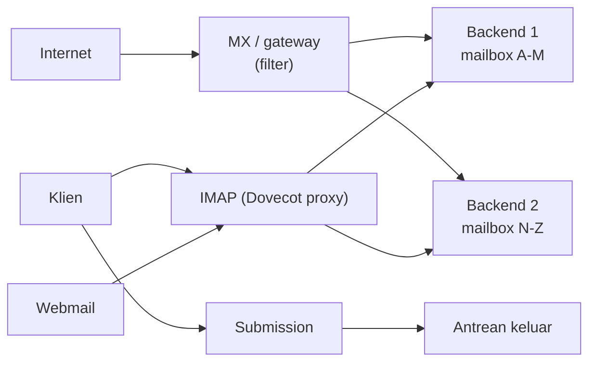

# Scaling, Desain Storage, dan Multi-Server

!!! info "Identitas chapter"
    **ID:** `CH-15-03-03` · **Kategori/modul:** CAT-15 / MOD-15-03 (Arsitektur Skala Besar) · **Estimasi:** 150 menit · **Lingkungan:** uji publik (VPS, IP publik, domain) · [Lihat chapter ini di dashboard](../../../#CH-15-03-03)

!!! note "Catatan"
    Chapter ini konseptual. Angka kapasitas adalah contoh perhitungan; ukur beban nyata Anda. Belum dijalankan penulis pada VM (`verified_on: null`).

## 1. Ringkasan

Saat pengguna dan data bertambah, satu server tidak cukup. Anda merancang pemisahan peran, penyimpanan, dan routing multi-server serta menghitung kapasitas dari data nyata.

## 2. Tujuan Pembelajaran

1. Memisahkan peran: MX/gateway, submission, IMAP, penyimpanan, webmail.
2. Menghitung kebutuhan storage, IOPS, dan koneksi dari asumsi yang terdokumentasi.
3. Merancang routing email multi-server dan memilih desain storage.

## 3. Prasyarat

- `CH-15-03-02` — Arsitektur High Availability dan DR.
- Gateway dan routing (`CH-15-02-01`, `CH-15-01-02`); kapasitas (`CH-11-03-05`).

## 4. Materi Teori

### 4.1 Pemisahan peran

Pembagian pengguna ke backend (misalnya per alfabet atau per domain) menyederhanakan penyimpanan; konsekuensinya Anda memerlukan lapisan yang mengarahkan pengguna ke backend yang benar (proxy IMAP/lookup di Postfix).

### 4.2 Desain storage

| Opsi | Kelebihan | Risiko |
|---|---|---|
| Disk lokal per backend | Sederhana, cepat | Kapasitas per server |
| Penyimpanan jaringan | Terpusat | Maildir di sistem berkas jaringan butuh perhatian pada penguncian dan konsistensi; baca panduan Dovecot |
| Replikasi antar server | Redundansi | Kompleksitas, latensi |

### 4.3 Perhitungan kapasitas (contoh)

`storage = pengguna × rata-rata_isi × faktor_pertumbuhan`. Misalnya 500 pengguna × 2 GB × 1,5 ≈ 1,5 TB. Tambahkan margin untuk antrean, log, dan backup (backup biasanya lebih dari 1× data).

## 5. Praktik dan Implementasi

1. Kumpulkan metrik nyata: pengguna aktif, rata-rata ukuran, pertumbuhan, koneksi puncak.
2. Hitung kapasitas 12–24 bulan.
3. Pilih desain peran dan storage.
4. Rancang routing dan rencana pengujian beban (di lab).

## 6. Perintah Linux

Chapter ini konseptual; tidak ada perintah yang mengubah sistem.

## 7. Konfigurasi

Tidak ada berkas konfigurasi yang diubah pada chapter ini.

## 8. Verifikasi

- Dokumen kapasitas memuat asumsi, data, rumus, dan margin.
- Rancangan menyertakan titik kegagalan dan prosedur pemindahan pengguna antar backend.
- Rencana uji beban terukur.

## 9. Troubleshooting

| Gejala | Kemungkinan penyebab | Tindakan |
|---|---|---|
| Kapasitas meleset | Asumsi usang | Ukur ulang tiap kuartal |
| Satu backend jenuh | Distribusi tak merata | Rebalancing terencana |
| Performa buruk di penyimpanan jaringan | Latensi/penguncian | Ikuti rekomendasi Dovecot, ukur |
| Routing salah | Tabel usang | Sumber kebenaran tunggal |

## 10. Security Review

- Pemisahan peran mengurangi dampak kompromi satu komponen bila jaringan antar komponen dibatasi.
- Lalu lintas antar server dienkripsi dan diautentikasi.
- Setiap server baru menambah permukaan serangan dan beban patch.

## 11. Latihan

1. Hitung kapasitas untuk 2.000 pengguna dengan asumsi Anda.
2. Gambar rencana migrasi pengguna antar backend.
3. Tentukan metrik yang memicu penambahan server.

## 12. Assessment

1. Mengapa memisahkan peran?
2. Apa risiko penyimpanan jaringan untuk Maildir?
3. Mengapa menambah margin pada storage?

**Kunci singkat.** (1) Skala, isolasi, dan fokus. (2) Penguncian dan konsistensi. (3) Antrean, log, backup, pertumbuhan.

## 13. Checklist Kelulusan

- [ ] Perhitungan kapasitas dengan asumsi tertulis.
- [ ] Desain peran dan storage terdokumentasi.

!!! note "Status belajar"
    Ubah status chapter secara manual di dashboard. Menyelesaikan checklist ini tidak mengubah status otomatis.

## 14. Referensi Resmi

- [Dokumentasi Dovecot 2.3](https://doc.dovecot.org/2.3/)
- [Dokumentasi Dovecot 2.3: Maildir](https://doc.dovecot.org/2.3/admin_manual/mailbox_formats/maildir/)
- [Postfix: TUNING_README](https://www.postfix.org/TUNING_README.html)

Tautan referensi tidak diverifikasi otomatis pada build ini; periksa ketersediaannya sebelum dipakai.

---

[Kembali ke dashboard kurikulum](../../../#CH-15-03-03){ .md-button }
