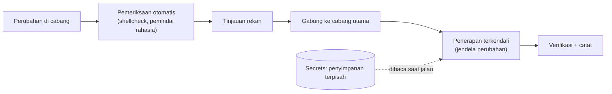

# Otomasi Administrasi yang Aman

!!! info "Identitas chapter"
    **ID:** `CH-15-03-04` · **Kategori/modul:** CAT-15 / MOD-15-03 (Arsitektur Skala Besar) · **Estimasi:** 120 menit · **Lingkungan:** uji publik (VPS, IP publik, domain) · [Lihat chapter ini di dashboard](../../../#CH-15-03-04)

!!! warning "Peringatan"
    Otomasi yang buruk menyebarkan kesalahan dengan cepat dan dapat membocorkan secrets ke repositori. Mulai dari lab, tinjau setiap perubahan, dan pasang pemeriksaan rahasia sebelum menyimpan ke Git. Belum dijalankan penulis pada VM (`verified_on: null`).

## 1. Ringkasan

Otomasi administrasi yang aman berarti perubahan melewati repositori, tinjauan, pemeriksaan otomatis, dan jejak audit, sementara secrets disimpan terpisah. Anda membangun alur kerja minimal dengan Git, skrip yang diperiksa, dan pemeriksaan rahasia.

## 2. Tujuan Pembelajaran

1. Menyusun repositori konfigurasi dan skrip tanpa secrets.
2. Menerapkan tinjauan perubahan dan pemeriksaan otomatis (shellcheck, pemindaian rahasia sederhana).
3. Menjalankan perubahan terjadwal dengan audit.

## 3. Prasyarat

- `CH-15-03-03` — Scaling, Desain Storage, dan Multi-Server.
- Bash aman (`CH-11-02-01`); manajemen konfigurasi (`CH-11-03-04`); change management (`CH-13-03-02`).

## 4. Materi Teori

### 4.1 Alur



### 4.2 Pemisahan secrets

Repositori berisi struktur dan nama variabel, bukan nilai. Nilai rahasia disimpan di pengelola rahasia atau berkas berizin ketat di server; alat manajemen konfigurasi menyediakan fitur untuk mengenkripsi nilai (mis. Ansible Vault, SOPS); pelajari dokumentasinya sebelum mengadopsi.

### 4.3 Audit
Riwayat Git (siapa, kapan, mengapa), catatan jendela perubahan, dan log sistem membentuk jejak audit. Tanda tangan commit dan akses repositori terbatas memperkuatnya.

## 5. Praktik dan Implementasi

1. Buat repositori `infra/` dengan struktur dan README.
2. Tambahkan pemeriksaan pra-commit sederhana.
3. Lakukan satu perubahan lewat cabang dan tinjauan.
4. Terapkan di lab dan catat.

## 6. Perintah Linux

```bash title="Repositori dan struktur"
mkdir -p infra/{scripts,snapshot,runbooks,decisions} && cd infra && git init
printf '*.key\n*.pem\n*.private\nsasl_passwd*\n*.env\nusers\n' > .gitignore
git add -A && git commit -m "struktur awal tanpa rahasia"
```

```bash title="Pemeriksaan sebelum commit"
shellcheck scripts/*.sh
git diff --cached | grep -nEi 'password|passwd|secret|token|BEGIN (RSA|EC|OPENSSH|PRIVATE)' && echo "PERIKSA: kemungkinan rahasia" || echo "tidak ada pola rahasia"
```

Pola `grep` hanyalah pemeriksaan kasar yang bisa lolos; gunakan pemindai rahasia khusus bila tersedia dan tinjau perubahan secara manual.

## 7. Konfigurasi

```bash title=".git/hooks/pre-commit (contoh; berikan izin eksekusi)"
#!/usr/bin/env bash
set -euo pipefail
if git diff --cached | grep -qEi 'BEGIN (RSA |EC |OPENSSH )?PRIVATE KEY'; then
  echo "Commit dibatalkan: ditemukan kunci privat" >&2
  exit 1
fi
if ls scripts/*.sh >/dev/null 2>&1; then shellcheck scripts/*.sh; fi
```

- Hook lokal dapat dilewati; terapkan juga pemeriksaan di sisi server/CI bila repositori dibagikan.
- Jangan menyimpan hasil `doveconf -n` atau berkas `users` tanpa membersihkan rahasia.

## 8. Verifikasi

- Commit yang memuat pola kunci privat ditolak oleh hook.
- Riwayat Git memuat setiap perubahan dengan pesan yang bermakna.
- Penerapan di lab dicatat; rollback dengan `git revert` atau checkout versi sebelumnya teruji.

## 9. Troubleshooting

| Gejala | Kemungkinan penyebab | Tindakan |
|---|---|---|
| Rahasia sudah ter-commit | Tidak ada pemeriksaan | Rotasi rahasia, bersihkan riwayat, tambah pemeriksaan |
| Hook tidak berjalan | Tanpa izin eksekusi | `chmod +x` |
| Banyak positif palsu | Pola terlalu luas | Sempurnakan pola |
| Perubahan langsung di server | Melewati alur | Wajibkan perubahan lewat repositori |

## 10. Security Review

- Riwayat Git permanen: rahasia yang pernah masuk dianggap bocor.
- Batasi siapa yang boleh menggabung dan menerapkan.
- Akses repositori infrastruktur seketat akses server.

## 11. Latihan

1. Tambahkan pemindaian rahasia pada alur Anda.
2. Tulis aturan tinjauan (apa yang harus diperiksa pada setiap perubahan).
3. Latih rollback perubahan lewat Git.

## 12. Assessment

1. Mengapa secrets tidak di repositori?
2. Apa batas hook pra-commit?
3. Apa kegunaan riwayat Git untuk audit?

**Kunci singkat.** (1) Riwayat permanen dan mudah bocor. (2) Dapat dilewati pengguna lokal. (3) Siapa, kapan, mengapa tiap perubahan.

## 13. Checklist Kelulusan

- [ ] Repositori infrastruktur dengan pemeriksaan rahasia berjalan.
- [ ] Satu perubahan diterapkan lewat alur tinjauan dan dicatat.
- [ ] Rollback teruji.

!!! note "Status belajar"
    Ubah status chapter secara manual di dashboard. Menyelesaikan checklist ini tidak mengubah status otomatis.

## 14. Referensi Resmi

- [Pro Git](https://git-scm.com/book/id/v2)
- [ShellCheck](https://www.shellcheck.net/)
- [Ansible: Vault](https://docs.ansible.com/ansible/latest/vault_guide/index.html)
- [Mozilla SOPS](https://getsops.io/)

Tautan referensi tidak diverifikasi otomatis pada build ini; periksa ketersediaannya sebelum dipakai.

---

[Kembali ke dashboard kurikulum](../../../#CH-15-03-04){ .md-button }
