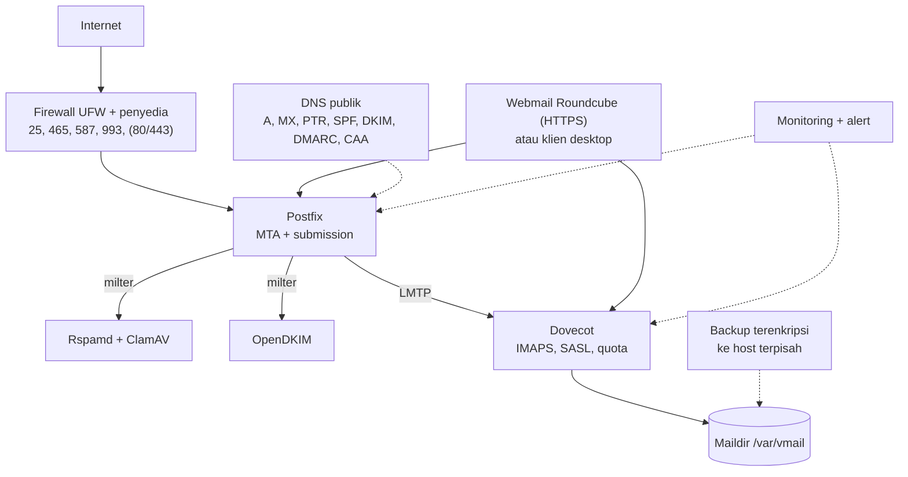
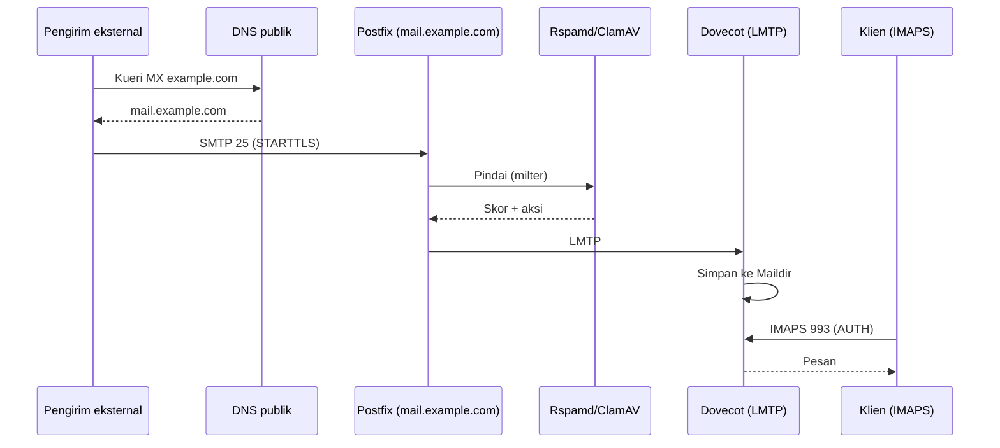

# Perencanaan dan Arsitektur Capstone

!!! info "Identitas chapter"
    **ID:** `CH-16-01-01` · **Kategori/modul:** CAT-16 / MOD-16-01 (Proyek Akhir) · **Estimasi:** 120 menit · **Lingkungan:** uji publik (VPS, IP publik, domain) · [Lihat chapter ini di dashboard](../../../#CH-16-01-01)

!!! warning "Peringatan"
    Capstone memakai domain dan server milik Anda sendiri. Rencanakan dengan batas jelas: jangan menguji pada sistem pihak lain, dan jangan menyimpan kredensial atau kunci di paket bukti. Belum dijalankan penulis pada VM (`verified_on: null`).

## 1. Ringkasan

Capstone adalah proyek akhir: Anda membangun mail server yang berfungsi untuk domain milik sendiri dan membuktikan setiap kontrol dengan bukti terukur. Chapter pertama ini membahas perencanaan: arsitektur, lingkup, jadwal, dan kriteria penerimaan yang jelas sebelum satu perintah dijalankan.

## 2. Tujuan Pembelajaran

1. Merancang arsitektur capstone dan menggambarkannya dengan diagram.
2. Menetapkan lingkup, asumsi, dan batasan.
3. Menetapkan kriteria penerimaan terukur dan bukti untuk tiap kriteria.
4. Menyusun jadwal implementasi dengan titik uji.

## 3. Prasyarat

- `CH-15-03-04` — Otomasi Administrasi yang Aman.
- Seluruh level sebelumnya (Level 0 sampai 13); Level 14 bersifat opsional dan tidak wajib untuk capstone.

## 4. Materi Teori

### 4.1 Arsitektur target



Diagram ini adalah titik awal; sesuaikan dengan pilihan Anda (mis. tanpa webmail).

### 4.2 Alur email end-to-end



### 4.3 Kriteria penerimaan

Kriteria dari dashboard kurikulum (jangan diubah tanpa alasan):

| # | Area | Kriteria terukur |
|---|---|---|
| 1 | Setup Ubuntu Server | SSH hanya kunci, firewall aktif dengan port minimal, baseline health check tanpa temuan kritis |
| 2 | Domain dan DNS | A/AAAA, MX, PTR konsisten (FCrDNS) dan terverifikasi dari minimal dua resolver |
| 3 | Postfix | `postfix check` tanpa error; konfigurasi (`postconf -n`) terdokumentasi |
| 4 | Dovecot | Login IMAPS berhasil untuk minimal dua akun; folder tersinkron pada minimal dua klien |
| 5 | Sertifikat TLS | Rantai valid; uji perpanjangan (dry-run) berhasil; tanggal kedaluwarsa dipantau |
| 6 | SMTP AUTH dan relay | Submission tanpa AUTH ditolak; relay ke domain eksternal tanpa autentikasi ditolak |
| 7 | SPF, DKIM, DMARC | `Authentication-Results` menunjukkan SPF dan DKIM pass dengan alignment pada pesan uji (bukan jaminan inbox) |
| 8 | Webmail atau klien | Kirim, terima, lampiran, dan logout teruji melalui HTTPS atau klien desktop |
| 9 | Uji masuk dan keluar | Minimal 3 uji masuk dan 3 uji keluar dengan Message-ID terlacak di log |
| 10 | Kontrol spam dan abuse | Filter spam aktif, rate limit teruji, dan Fail2ban terbukti memblokir uji brute-force |
| 11 | Monitoring operasional | Alert uji untuk disk, antrean, dan sertifikat tersimulasi dan diterima |
| 12 | Backup dan restore | Restore ke VM bersih berhasil; RTO dan RPO terukur dan tercatat |
| 13 | Validasi keamanan | Setiap kontrol preventif, detektif, dan korektif memiliki bukti verifikasi; pemindaian eksternal hanya menunjukkan port yang direncanakan |
| 14 | Dokumentasi troubleshooting | Minimal lima skenario: gejala, diagnosis, perbaikan, validasi |
| 15 | Penilaian kesiapan produksi | Checklist go-live terisi dan keputusan Go/No-Go dibenarkan secara tertulis |

### 4.4 Paket bukti

Dokumentasi konfigurasi, diagram arsitektur, log tersanitasi, hasil uji, checklist keamanan, bukti backup/restore, dan runbook akhir. **Jangan menyerahkan kata sandi, kunci privat, token, atau secrets hidup.**

## 5. Praktik dan Implementasi

1. Tentukan domain, server, dan lingkup (fitur wajib vs opsional).
2. Gambar arsitektur dan alur email versi Anda.
3. Tulis tabel kriteria penerimaan dengan kolom bukti dan lokasi penyimpanan bukti.
4. Susun jadwal: urutan modul, titik uji, dan waktu cadangan.
5. Tulis daftar risiko dan mitigasi, serta aturan penanganan data bukti.

## 6. Perintah Linux

Chapter ini konseptual; tidak ada perintah yang mengubah sistem.

## 7. Konfigurasi

```text title="Templat tabel bukti (diisi pada tiap tahap)"
# | Kriteria | Perintah/uji | Bukti (berkas) | Tanggal | Hasil | Catatan
1 | SSH hanya kunci | sshd -T | bukti/01-ssh.txt | | |
...
```

Gunakan struktur direktori bukti terpisah (mis. `bukti/01-...`) tanpa rahasia; tambahkan hash bila perlu (`sha256sum`).

## 8. Verifikasi

- Dokumen perencanaan memuat arsitektur, lingkup, jadwal, 15 kriteria dengan bukti yang direncanakan, dan risiko.
- Seorang rekan dapat memahami rencana tanpa penjelasan lisan.
- Tidak ada rahasia dalam dokumen perencanaan.

## 9. Troubleshooting

| Gejala | Kemungkinan penyebab | Tindakan |
|---|---|---|
| Lingkup terlalu besar | Terlalu banyak fitur opsional | Prioritaskan 15 kriteria wajib |
| Kriteria tidak terukur | Kata-kata umum | Tambah angka/perintah bukti |
| Jadwal meleset | Estimasi optimis | Tambah buffer, utamakan jalur kritis |
| Domain belum siap | DNS/registrar | Mulai urus lebih awal |

## 10. Security Review

- Hapus kredensial dan data pribadi sebelum bukti dibagikan.
- Rencanakan akses pihak ketiga (penilai) dengan akun sementara atau bukti tersanitasi.
- Jangan membuat bukti dengan mengirim email ke pihak luar tanpa izin.

## 11. Latihan

1. Isi tabel kriteria penerimaan dengan perintah bukti untuk setiap baris.
2. Gambar ulang diagram dengan nama host dan alamat Anda.
3. Tulis tiga risiko terbesar dan mitigasinya.

## 12. Assessment

1. Mengapa kriteria harus terukur?
2. Mengapa menyiapkan lokasi bukti sejak awal?
3. Apa yang tidak boleh ada di paket bukti?

**Kunci singkat.** (1) Agar dapat dibuktikan dan dinilai. (2) Bukti dikumpulkan saat kejadian, bukan diingat. (3) Kata sandi, kunci privat, token.

## 13. Checklist Kelulusan

- [ ] Arsitektur, lingkup, dan jadwal tertulis.
- [ ] 15 kriteria penerimaan dengan rencana bukti.
- [ ] Risiko dan aturan penanganan data ditetapkan.

!!! note "Status belajar"
    Ubah status chapter secara manual di dashboard. Menyelesaikan checklist ini tidak mengubah status otomatis.

## 14. Referensi Resmi

- [Postfix: Dokumentasi](https://www.postfix.org/documentation.html)
- [Dokumentasi Dovecot 2.3](https://doc.dovecot.org/2.3/)
- [Ubuntu Server: Dokumentasi](https://documentation.ubuntu.com/server/)
- [NIST SP 800-45 Ver. 2](https://csrc.nist.gov/pubs/sp/800/45/ver2/final)

Tautan referensi tidak diverifikasi otomatis pada build ini; periksa ketersediaannya sebelum dipakai.

---

[Kembali ke dashboard kurikulum](../../../#CH-16-01-01){ .md-button }
