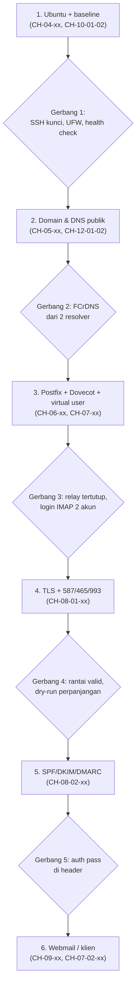

# Implementasi Mail Server Capstone

!!! info "Identitas chapter"
    **ID:** `CH-16-01-02` · **Kategori/modul:** CAT-16 / MOD-16-01 (Proyek Akhir) · **Estimasi:** 480 menit · **Lingkungan:** uji publik (VPS, IP publik, domain) · [Lihat chapter ini di dashboard](../../../#CH-16-01-02)

!!! warning "Peringatan"
    Chapter ini tidak mengulang langkah per perintah; ia menuntun urutan implementasi dengan merujuk chapter sebelumnya. Kerjakan dengan snapshot di setiap tahap, jangan membuka layanan ke internet sebelum uji relay lulus, dan jangan menyimpan kredensial di bukti. Belum dijalankan penulis pada VM (`verified_on: null`).

## 1. Ringkasan

Anda membangun seluruh sistem sesuai rencana: Ubuntu, DNS, Postfix, Dovecot, TLS, autentikasi email, dan webmail atau klien desktop. Chapter ini adalah peta implementasi berurutan dengan gerbang verifikasi di setiap tahap; detail perintah ada pada chapter yang dirujuk.

## 2. Tujuan Pembelajaran

1. Membangun sistem tahap demi tahap dengan gerbang verifikasi.
2. Mengumpulkan bukti saat setiap tahap selesai.
3. Memperbaiki masalah mengikuti metodologi troubleshooting.

## 3. Prasyarat

- `CH-16-01-01` — Perencanaan dan Arsitektur Capstone.
- Rencana capstone (`CH-16-01-01`).

## 4. Materi Teori

### 4.1 Urutan dan gerbang



### 4.2 Prinsip
- **Satu tahap, satu gerbang:** jangan lanjut sebelum bukti gerbang tersimpan.
- **Snapshot** sebelum setiap tahap besar.
- **Relay tertutup sebelum port 25 publik.**
- **Catat konfigurasi akhir** dengan `postconf -n`, `doveconf -n`, dan snapshot yang disanitasi (`CH-11-03-04`).

## 5. Praktik dan Implementasi

Kerjakan tahap berurutan; untuk tiap tahap rujuk chapter terkait dan jalankan uji gerbangnya.

| Tahap | Rujukan utama | Bukti gerbang (disimpan di `bukti/`) |
|---|---|---|
| 1 Ubuntu | `CH-04-02-xx`, `CH-04-03-xx`, `CH-10-01-02` | `sshd -T`, `ufw status verbose`, keluaran health check |
| 2 DNS | `CH-05-01-xx`, `CH-12-01-02` | `dig` dari dua resolver, `dig -x` |
| 3 Inti | `CH-06-xx`, `CH-07-01-xx` | `postfix check`, `postconf -n`, uji relay anonim ditolak, `doveadm auth test` |
| 4 TLS | `CH-08-01-xx` | `openssl s_client` 587/465/993, `certbot renew --dry-run` |
| 5 Autentikasi | `CH-08-02-xx` | Header dengan `spf/dkim/dmarc=pass` |
| 6 Webmail/klien | `CH-09-01-xx` atau `CH-07-02-01` | Uji kirim, terima, lampiran, logout |

## 6. Perintah Linux

```bash title="Paket bukti per tahap (contoh pola)"
mkdir -p ~/bukti
sudo sshd -T | grep -iE 'passwordauthentication|permitrootlogin' | tee ~/bukti/01-ssh.txt
sudo ufw status verbose | tee ~/bukti/01-ufw.txt
postconf -n > ~/bukti/03-postconf-n.txt
sudo doveconf -n > ~/bukti/03-doveconf-n.txt
sudo certbot renew --dry-run 2>&1 | tail -5 | tee ~/bukti/04-certbot-dryrun.txt
```

Periksa semua berkas bukti terhadap rahasia sebelum dibagikan (`grep -riE 'pass|secret|token' ~/bukti`). `doveconf -n` biasanya tidak memuat kata sandi pengguna, tetapi periksa tetap.

## 7. Konfigurasi

Tidak ada berkas konfigurasi yang diubah pada chapter ini.

## 8. Verifikasi

- Semua gerbang 1–6 lulus dengan bukti.
- `postfix check` dan `doveconf -n` tanpa galat.
- Server siap untuk pengujian terpadu di `CH-16-01-03`.

## 9. Troubleshooting

| Gejala | Kemungkinan penyebab | Tindakan |
|---|---|---|
| Tahap gagal gerbang | Lewati rujukan chapter | Kembali ke chapter terkait, ulang uji |
| Beberapa komponen bertabrakan | Perubahan tidak tercatat | Gunakan snapshot, ulang dengan catatan |
| DNS belum menyebar | TTL | Tunggu, ulangi |
| Waktu habis | Estimasi | Prioritaskan wajib dahulu |

## 10. Security Review

- Jangan membuka port 25 publik sebelum uji relay lulus.
- Pastikan tidak ada layanan internal (Redis, DB, kontroler) yang terbuka.
- Jaga kunci DKIM dan TLS dari paket bukti.

## 11. Latihan

1. Isi tabel bukti untuk tahap 1–3.
2. Tandai masalah yang muncul dan cara menyelesaikannya.
3. Catat estimasi vs waktu aktual per tahap.

## 12. Assessment

1. Mengapa gerbang per tahap?
2. Mengapa relay ditutup sebelum port 25 dibuka?
3. Mengapa mencatat konfigurasi akhir?

**Kunci singkat.** (1) Menangkap kesalahan lebih awal. (2) Mencegah open relay. (3) Dokumentasi dan pemulihan.

## 13. Checklist Kelulusan

- [ ] Enam tahap selesai dengan bukti gerbang.
- [ ] Konfigurasi akhir dicatat tanpa rahasia.

!!! note "Status belajar"
    Ubah status chapter secara manual di dashboard. Menyelesaikan checklist ini tidak mengubah status otomatis.

## 14. Referensi Resmi

- [Postfix: Dokumentasi](https://www.postfix.org/documentation.html)
- [Dokumentasi Dovecot 2.3](https://doc.dovecot.org/2.3/)
- [Let's Encrypt: Dokumentasi](https://letsencrypt.org/docs/)
- [Roundcube: Wiki](https://github.com/roundcube/roundcubemail/wiki)

Tautan referensi tidak diverifikasi otomatis pada build ini; periksa ketersediaannya sebelum dipakai.

---

[Kembali ke dashboard kurikulum](../../../#CH-16-01-02){ .md-button }
