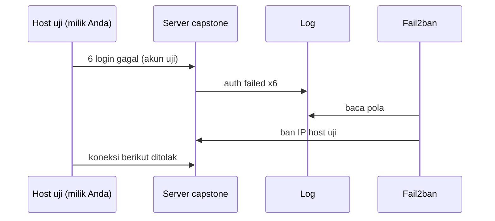

# Pengujian Mail Flow, Autentikasi, dan Kontrol Spam/Abuse

!!! info "Identitas chapter"
    **ID:** `CH-16-01-03` · **Kategori/modul:** CAT-16 / MOD-16-01 (Proyek Akhir) · **Estimasi:** 240 menit · **Lingkungan:** uji publik (VPS, IP publik, domain) · [Lihat chapter ini di dashboard](../../../#CH-16-01-03)

!!! warning "Peringatan"
    Pengujian keluar mengirim email nyata ke mailbox uji Anda; pengujian relay dan brute-force dilakukan hanya pada server milik sendiri dan dari host uji milik sendiri. Belum dijalankan penulis pada VM (`verified_on: null`).

## 1. Ringkasan

Sekarang Anda membuktikan bahwa sistem bekerja dan aman: email masuk dan keluar dengan Message-ID terlacak, autentikasi lulus, relay ditolak, filter spam aktif, rate limit teruji, dan Fail2ban terbukti memblokir uji brute-force.

## 2. Tujuan Pembelajaran

1. Menguji 3 email masuk dan 3 email keluar dengan Message-ID terlacak.
2. Menguji autentikasi (SPF, DKIM, DMARC) dari pesan nyata.
3. Menguji kontrol spam dan abuse: relay, filter, rate limit, Fail2ban.

## 3. Prasyarat

- `CH-16-01-02` — Implementasi Mail Server Capstone.
- Implementasi lengkap (`CH-16-01-02`).

## 4. Materi Teori

### 4.1 Rencana uji

| Kelompok | Uji | Hasil yang diharapkan |
|---|---|---|
| Masuk | Kirim dari mailbox eksternal ke akun Anda (3×) | Tiba; log `status=sent`; header autentikasi tercatat |
| Keluar | Kirim dari akun Anda ke mailbox eksternal (3×) | Tiba; `spf/dkim/dmarc=pass` pada header penerima |
| Relay | Percakapan SMTP anonim ke domain eksternal | Ditolak `5.7.1` |
| Submission | Kirim tanpa AUTH di 587 | Ditolak |
| Spam | Pesan uji spam standar | Diberi skor/ditandai oleh Rspamd |
| Rate limit | Koneksi/pesan beruntun dari host uji | Terbatas sesuai konfigurasi |
| Brute force | Beberapa login gagal dari host uji | IP diblokir Fail2ban |



### 4.2 Etika uji
Semua uji hanya terhadap sistem Anda. Jangan menguji spam/brute-force pada pihak lain, dan jangan mengirim massal. Siapkan akses konsol bila IP host uji Anda ikut terblokir.

## 5. Praktik dan Implementasi

1. Jalankan uji masuk dan keluar; catat Message-ID.
2. Ambil header penerima dan sanitasi.
3. Jalankan uji relay anonim dan submission tanpa AUTH.
4. Jalankan uji spam, rate limit, dan Fail2ban dari host uji.
5. Simpan bukti pada struktur `bukti/`.

## 6. Perintah Linux

```bash title="Melacak pesan uji di server"
sudo journalctl -u 'postfix@-' --since "1 hour ago" --no-pager -g 'message-id=<ID-PESAN-UJI>' | tail
sudo journalctl -u 'postfix@-' --since "1 hour ago" --no-pager | grep -E 'status=(sent|deferred|bounced)' | tail
```

```bash title="Relay anonim (dari host uji; jangan selesaikan DATA)"
nc mail.example.com 25
```

Ketik `EHLO uji.invalid`, `MAIL FROM:<a@uji.invalid>`, `RCPT TO:<orang@domain-eksternal.example>`, `QUIT`. Harapan: penolakan relay.

```bash title="Memeriksa filter dan Fail2ban"
rspamc stat
sudo fail2ban-client status dovecot
sudo fail2ban-client get dovecot banip
```

Untuk brute-force, gunakan akun uji dengan kata sandi salah **dari host uji milik Anda** dalam jumlah di atas `maxretry`. Buka blokir dengan `sudo fail2ban-client set dovecot unbanip <IP-HOST-UJI>`.

## 7. Konfigurasi

Tidak ada berkas konfigurasi yang diubah pada chapter ini.

## 8. Verifikasi

- Minimal 3 masuk + 3 keluar dengan Message-ID terlacak.
- Header menunjukkan `spf=pass` dan `dkim=pass` (selaras) pada pesan keluar.
- Relay anonim dan submission tanpa AUTH ditolak; filter spam aktif; rate limit berfungsi; Fail2ban mem-ban host uji.

## 9. Troubleshooting

| Gejala | Kemungkinan penyebab | Tindakan |
|---|---|---|
| Pesan keluar masuk spam | Reputasi IP baru | `CH-14-01-04`; hasil dicatat apa adanya |
| `dkim=fail` | Kunci/DNS/milter | `CH-14-01-03` |
| Fail2ban tidak mem-ban | `journalmatch`/pola | `fail2ban-regex`, `CH-10-01-05` |
| IP uji ikut terblokir permanen | `bantime` panjang | `unbanip`, `ignoreip` untuk admin |

## 10. Security Review

- Jangan menjalankan uji spam/relay dari jaringan umum yang bukan milik Anda.
- Hapus pesan uji dan header yang memuat data pribadi setelah bukti diambil.
- Kembalikan setelan uji sementara (mis. `maxretry` rendah) setelah selesai.

## 11. Latihan

1. Isi tabel hasil dengan bukti untuk setiap uji.
2. Tambahkan dua uji kegagalan (sertifikat salah, MX salah) di lab dan catat gejalanya.
3. Hitung tingkat keberhasilan dan simpulkan.

## 12. Assessment

1. Mengapa Message-ID perlu dicatat?
2. Mengapa `DATA` tidak diselesaikan pada uji relay?
3. Mengapa uji brute-force dari host milik sendiri?

**Kunci singkat.** (1) Pelacakan end-to-end. (2) Menghindari pengiriman nyata. (3) Etika dan hukum.

## 13. Checklist Kelulusan

- [ ] Kriteria 6, 7, 8, 9, dan 10 terbukti.
- [ ] Bukti tersimpan tanpa rahasia.

!!! note "Status belajar"
    Ubah status chapter secara manual di dashboard. Menyelesaikan checklist ini tidak mengubah status otomatis.

## 14. Referensi Resmi

- [Postfix: SMTPD_ACCESS_README](https://www.postfix.org/SMTPD_ACCESS_README.html)
- [Rspamd: Dokumentasi](https://docs.rspamd.com/)
- [Fail2ban: Dokumentasi](https://fail2ban.readthedocs.io/en/latest/)
- [RFC 8601 — Authentication-Results](https://www.rfc-editor.org/rfc/rfc8601)

Tautan referensi tidak diverifikasi otomatis pada build ini; periksa ketersediaannya sebelum dipakai.

---

[Kembali ke dashboard kurikulum](../../../#CH-16-01-03){ .md-button }
