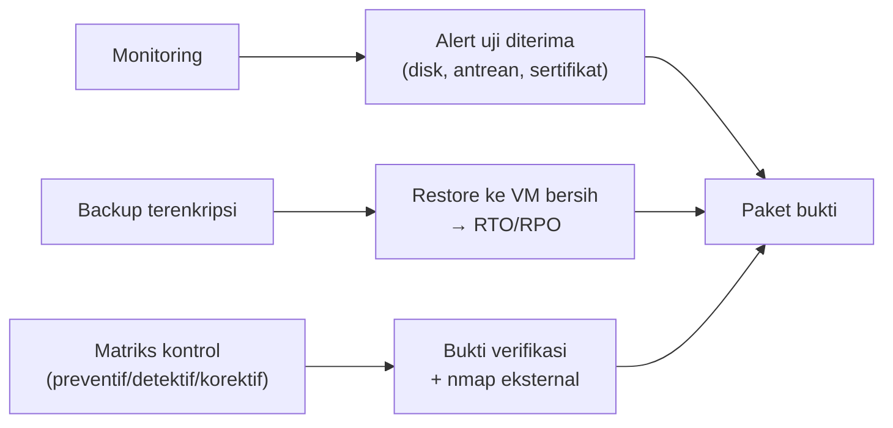

# Monitoring, Backup, Restore, dan Validasi Keamanan

!!! info "Identitas chapter"
    **ID:** `CH-16-01-04` · **Kategori/modul:** CAT-16 / MOD-16-01 (Proyek Akhir) · **Estimasi:** 240 menit · **Lingkungan:** uji publik (VPS, IP publik, domain) · [Lihat chapter ini di dashboard](../../../#CH-16-01-04)

!!! warning "Peringatan"
    Uji restore memakai data nyata di VM terpisah: isolasi VM itu dan hapus setelah selesai. Pemindaian eksternal hanya terhadap server milik Anda. Belum dijalankan penulis pada VM (`verified_on: null`).

## 1. Ringkasan

Anda menerapkan monitoring dengan alert uji, membuktikan backup dapat dipulihkan ke VM bersih dengan RTO/RPO terukur, dan memvalidasi bahwa setiap kontrol keamanan memiliki bukti.

## 2. Tujuan Pembelajaran

1. Mensimulasikan alert untuk disk, antrean, dan sertifikat dan memastikan diterima.
2. Melakukan backup dan restore penuh ke VM bersih, dengan RTO/RPO terukur.
3. Memvalidasi matriks kontrol keamanan dengan bukti dan pemindaian eksternal.

## 3. Prasyarat

- `CH-16-01-03` — Pengujian Mail Flow, Autentikasi, dan Kontrol Spam/Abuse.
- Pengujian mail flow (`CH-16-01-03`); monitoring dan backup (Level 10).

## 4. Materi Teori

### 4.1 Tiga pembuktian



### 4.2 Mengukur RTO dan RPO

RPO terukur = selisih waktu antara backup terakhir yang berhasil dan saat gangguan simulasi. RTO terukur = waktu dari keputusan memulihkan sampai layanan lulus uji (kirim/terima). Catat dengan cap waktu, bukan perkiraan.

## 5. Praktik dan Implementasi

1. Picu setiap alert dengan cara aman (ambang dinaikkan sementara atau berkas uji).
2. Jalankan backup, lalu mulai penghitungan waktu dan restore di VM bersih.
3. Uji layanan hasil restore.
4. Lengkapi matriks kontrol dan pindai dari host eksternal.

## 6. Perintah Linux

```bash title="Simulasi alert (contoh aman)"
sudo /usr/local/sbin/mail-healthcheck.sh; echo "exit=$?"
sudo systemctl stop dovecot; sudo /usr/local/sbin/mail-healthcheck.sh; echo "exit=$?"; sudo systemctl start dovecot
```

Pastikan alert tiba lewat saluran independen (`CH-11-01-03`). Untuk sertifikat, ubah ambang sementara pada skrip ke nilai besar agar peringatan terpicu, lalu kembalikan.

```bash title="Restore ke VM bersih (ringkas; detail di CH-11-03-02)"
sha256sum -c SHA256SUMS
age -d -i kunci-backup.txt config-TANGGAL.tar.gz.age | tar -xzf - -C /tmp/restore-uji
sudo doveadm mailbox status -u ani@example.com messages INBOX
```

```bash title="Pemindaian eksternal (dari host lain, server milik sendiri)"
nmap -Pn -p 1-1024,3306,5432,6379,11334 mail.example.com
```

## 7. Konfigurasi

Tidak ada berkas konfigurasi yang diubah pada chapter ini.

## 8. Verifikasi

- Tiga alert uji diterima dan terdokumentasi.
- Restore berhasil dengan cap waktu RTO dan RPO terukur.
- Matriks kontrol: tiap baris memiliki bukti; `nmap` hanya menunjukkan port rencana.

## 9. Troubleshooting

| Gejala | Kemungkinan penyebab | Tindakan |
|---|---|---|
| Alert tidak tiba | Saluran bergantung server | `CH-11-01-03` |
| Restore gagal | Kunci/paket/UID | `CH-11-03-02` |
| RTO jauh dari target | Langkah manual | Otomasi atau revisi target |
| `nmap` menunjukkan port tak terduga | Layanan terbuka | Tutup dan ulang |

## 10. Security Review

- Hapus VM restore dan data uji setelah selesai.
- Kunci dekripsi tidak dibagikan ke penilai.
- Hasil `nmap` dan konfigurasi dapat mengungkap arsitektur: tersanitasi sebelum dibagikan.

## 11. Latihan

1. Susun tabel RTO/RPO terukur dan bandingkan dengan target Anda.
2. Perbaiki satu kontrol yang bukti verifikasinya lemah.
3. Jadwalkan uji restore berkala.

## 12. Assessment

1. Bagaimana RPO terukur?
2. Mengapa restore di VM bersih?
3. Mengapa saluran alert harus independen?

**Kunci singkat.** (1) Selisih backup terakhir dan titik gangguan. (2) Membuktikan runbook lengkap. (3) Server yang diuji mungkin tidak dapat mengirim.

## 13. Checklist Kelulusan

- [ ] Kriteria 11, 12, dan 13 terbukti.
- [ ] RTO/RPO tercatat dengan cap waktu.
- [ ] VM restore dihapus.

!!! note "Status belajar"
    Ubah status chapter secara manual di dashboard. Menyelesaikan checklist ini tidak mengubah status otomatis.

## 14. Referensi Resmi

- [NIST SP 800-34 Rev. 1](https://csrc.nist.gov/pubs/sp/800/34/r1/upd1/final)
- [age](https://github.com/FiloSottile/age)
- [Nmap: Dokumentasi](https://nmap.org/docs.html)
- [Google SRE Book: Monitoring Distributed Systems](https://sre.google/sre-book/monitoring-distributed-systems/)

Tautan referensi tidak diverifikasi otomatis pada build ini; periksa ketersediaannya sebelum dipakai.

---

[Kembali ke dashboard kurikulum](../../../#CH-16-01-04){ .md-button }
