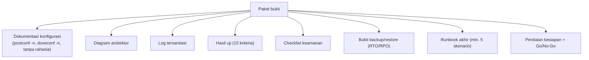

# Dokumentasi, Runbook, dan Penilaian Kesiapan Produksi

!!! info "Identitas chapter"
    **ID:** `CH-16-01-05` · **Kategori/modul:** CAT-16 / MOD-16-01 (Proyek Akhir) · **Estimasi:** 240 menit · **Lingkungan:** uji publik (VPS, IP publik, domain) · [Lihat chapter ini di dashboard](../../../#CH-16-01-05)

!!! warning "Peringatan"
    Paket akhir dibagikan kepada penilai. Pastikan tidak ada kata sandi, kunci privat, token, atau data pribadi pengguna lain di dalamnya. Belum dijalankan penulis pada VM (`verified_on: null`).

## 1. Ringkasan

Chapter terakhir menutup kurikulum: Anda menyusun dokumentasi dan runbook akhir, mengisi penilaian kesiapan produksi, dan membuat keputusan **Go/No-Go** yang dibenarkan secara tertulis. Ini adalah chapter terakhir dan Level 15 adalah level terakhir.

## 2. Tujuan Pembelajaran

1. Menyusun paket bukti lengkap dan runbook akhir.
2. Mengisi checklist kesiapan produksi dengan bukti.
3. Membuat keputusan Go/No-Go dan menuliskan alasannya.
4. Merefleksikan perjalanan belajar dan menyusun rencana lanjutan.

## 3. Prasyarat

- `CH-16-01-04` — Monitoring, Backup, Restore, dan Validasi Keamanan.
- Seluruh bukti capstone (`CH-16-01-01` sampai `CH-16-01-04`).

## 4. Materi Teori

### 4.1 Isi paket bukti



### 4.2 Penilaian kesiapan produksi

| Area | Pertanyaan keputusan |
|---|---|
| Keamanan | Semua kontrol memiliki bukti? Port eksternal sesuai rencana? |
| Keandalan | Backup–restore teruji? RTO/RPO diterima? |
| Operasi | Monitoring, alert, checklist rutin, dan runbook ada? |
| Identitas | FCrDNS, TLS, SPF/DKIM/DMARC valid? |
| Kepatuhan | Kebijakan privasi, retensi, dan abuse ditetapkan? |
| Risiko tersisa | Diketahui, diterima, dan dimiliki? |

### 4.3 Keputusan Go/No-Go

**Go** berarti kriteria wajib terpenuhi dan risiko tersisa diterima secara sadar. **No-Go** berarti ada kriteria wajib belum terbukti; tuliskan pekerjaan yang diperlukan dan tenggatnya. Keputusan tertulis lebih berharga daripada keputusan benar tanpa alasan.

## 5. Praktik dan Implementasi

1. Kumpulkan seluruh bukti dan periksa rahasia.
2. Tulis runbook akhir minimal lima skenario (gejala, diagnosis, perbaikan, validasi).
3. Isi checklist kesiapan dengan rujukan bukti.
4. Tulis keputusan Go/No-Go dan alasannya.
5. Tulis refleksi dan rencana pembelajaran lanjutan.

## 6. Perintah Linux

```bash title="Memeriksa rahasia dan menyusun paket"
grep -riEn 'password|passwd|secret|token|BEGIN (RSA |EC |OPENSSH )?PRIVATE KEY' ~/bukti || echo "tidak ada pola rahasia"
tar -czf capstone-bukti-$(date +%F).tar.gz -C ~ bukti
sha256sum capstone-bukti-*.tar.gz
```

Pemeriksaan `grep` hanya penyaring kasar; tinjau manual sebelum menyerahkan. Hapus berkas sementara yang memuat data pribadi.

## 7. Konfigurasi

```text title="Templat keputusan Go/No-Go"
Tanggal        :
Penilai        :
Kriteria 1..15 : terpenuhi / tidak (rujukan bukti)
Risiko tersisa : (dimiliki oleh, mitigasi)
Keputusan      : GO / NO-GO
Alasan         :
Syarat/tenggat bila No-Go:
```

## 8. Verifikasi

- Paket bukti lengkap, tanpa rahasia, dengan hash.
- Runbook memuat lima skenario dan pernah diuji.
- Checklist kesiapan dan keputusan Go/No-Go tertulis dengan alasan.

## 9. Troubleshooting

| Gejala | Kemungkinan penyebab | Tindakan |
|---|---|---|
| Kriteria tak terbukti | Bukti tak dikumpulkan | Ulangi uji, kumpulkan bukti |
| Runbook tak bisa diikuti | Asumsi tersembunyi | Uji oleh orang lain |
| Banyak risiko tersisa | Kontrol lemah | Prioritaskan mitigasi, putuskan No-Go bila wajib |
| Rahasia ditemukan di paket | Kurang disanitasi | Hapus, rotasi rahasia |

## 10. Security Review

- Rahasia yang pernah masuk paket dianggap bocor: rotasi.
- Bagikan paket lewat kanal terkontrol.
- Go-live nyata tetap memerlukan persetujuan pihak berwenang di organisasi Anda.

## 11. Latihan

1. Isi templat Go/No-Go untuk capstone Anda.
2. Presentasikan arsitektur dan hasil selama 10 menit kepada rekan.
3. Tulis rencana belajar 6 bulan ke depan (mis. Level 14 opsional, otomasi, keamanan lanjutan).

## 12. Assessment

1. Apa syarat keputusan Go?
2. Mengapa alasan tertulis penting?
3. Apa yang dilakukan bila rahasia ditemukan di paket?

**Kunci singkat.** (1) Kriteria wajib terpenuhi dan risiko tersisa diterima. (2) Dapat diaudit dan dipelajari. (3) Hapus dan rotasi.

## 13. Checklist Kelulusan

- [ ] Kriteria 14 dan 15 terbukti; seluruh 15 kriteria terjawab.
- [ ] Paket bukti tersanitasi dan lengkap.
- [ ] Keputusan Go/No-Go dan refleksi tertulis.

!!! success "Kurikulum selesai"
    Chapter ini adalah chapter terakhir pada Level 15, level terakhir dalam kurikulum. Selamat telah menyelesaikan perjalanan dari dasar Linux hingga operasi mail server. Penyelesaian tetap ditandai secara manual di dashboard, dengan bukti yang Anda simpan di paket capstone.

!!! note "Status belajar"
    Ubah status chapter secara manual di dashboard. Menyelesaikan checklist ini tidak mengubah status otomatis.

## 14. Referensi Resmi

- [Postfix: Dokumentasi](https://www.postfix.org/documentation.html)
- [Dokumentasi Dovecot 2.3](https://doc.dovecot.org/2.3/)
- [NIST SP 800-45 Ver. 2](https://csrc.nist.gov/pubs/sp/800/45/ver2/final)
- [Google SRE Book](https://sre.google/sre-book/table-of-contents/)

Tautan referensi tidak diverifikasi otomatis pada build ini; periksa ketersediaannya sebelum dipakai.

---

[Kembali ke dashboard kurikulum](../../../#CH-16-01-05){ .md-button }
