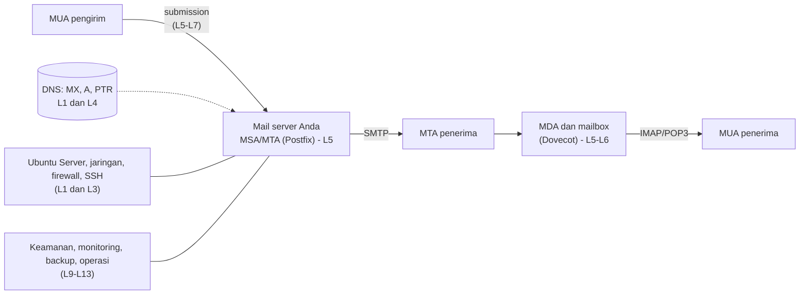

# Level 0 — Orientasi dan Persiapan Belajar

!!! info "Identitas"
    **ID:** `CAT-01` · **Level:** L0 · **Lingkungan:** lab lokal (VM) · **Estimasi:** 4 jam (3 chapter) · [Lihat di dashboard](../../../#CAT-01)

## Tujuan level

1. Memahami struktur kurikulum dan cara memakai portal ini.
2. Menyiapkan lab VM yang aman dan dapat dipulihkan.
3. Memahami batas antara lab, uji publik, dan produksi.

**Deliverable:** rencana belajar pribadi, VM lab kosong beserta snapshot, ringkasan kriteria transisi antar lingkungan.

## Prasyarat

Tidak ada. Anda cukup nyaman memakai komputer. Pengalaman Linux tidak diperlukan karena Level 1 membangunnya.

## Chapter

| Urutan | ID | Judul | Estimasi |
|---|---|---|---|
| 1 | [`CH-01-01-01`](../chapter/CH-01-01-01.md) | Peta Belajar dan Profil Pembelajar | 60 mnt |
| 2 | [`CH-01-01-02`](../chapter/CH-01-01-02.md) | Menyiapkan Lingkungan Lab (VM dan Snapshot) | 120 mnt |
| 3 | [`CH-01-01-03`](../chapter/CH-01-01-03.md) | Jalur Lab ke Produksi dan Etika Operasional | 60 mnt |

## Gambaran besar: apa yang akan Anda bangun

Gambar berikut adalah peta ringkas sistem email yang akan dibangun, ditandai dengan level tempat setiap bagian dipelajari. Penjelasan rinci komponen, percakapan SMTP, dan alur pengiriman ada di `CH-03-01-01` (Level 2).

Diagram ini memperlihatkan mengapa urutan belajarnya dimulai dari dasar sistem operasi dan jaringan, bukan langsung dari Postfix.

## Progres ke Level 1

Level 0 menghasilkan **lingkungan** (VM + snapshot) dan **rencana**. Level 1 memakai lingkungan itu untuk membangun **keterampilan**: command line, service, jaringan, dan SSH. Syarat masuk L1: VM lab berjalan, snapshot awal terbukti dapat dipulihkan, dan Anda sudah memahami batas lab vs produksi.

## Rangkuman

- Kurikulum terstruktur dalam 16 level dan lima tahap lingkungan; Anda memulai di lab lokal.
- VM dengan snapshot memungkinkan eksperimen aman.
- Lab yang berhasil belum berarti siap produksi; reputasi, DNS, kebijakan penyedia, dan serangan nyata baru muncul di internet.
- Operator email bertanggung jawab atas abuse, privasi, dan keamanan.

## Referensi

- [Dokumentasi Ubuntu Server](https://documentation.ubuntu.com/server/)
- [Unduh Ubuntu Server](https://ubuntu.com/download/server)
- [RFC 5321 — Simple Mail Transfer Protocol](https://www.rfc-editor.org/rfc/rfc5321)

[Lanjut ke Level 1](L1.md){ .md-button } [Kembali ke dashboard kurikulum](../../../#CAT-01){ .md-button }
