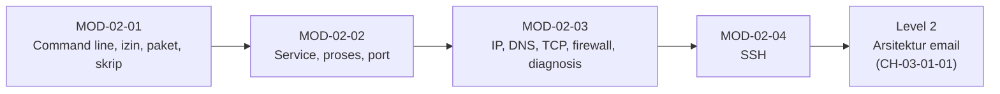

# Level 1 — Dasar Linux dan Jaringan

!!! info "Identitas"
    **ID:** `CAT-02` · **Level:** L1 · **Lingkungan:** lab lokal (VM) · **Estimasi:** 21 jam 30 menit (12 chapter) · [Lihat di dashboard](../../../#CAT-02)

## Tujuan level

1. Mengoperasikan Ubuntu Server melalui command line secara aman.
2. Mengelola paket, pengguna, izin, dan service dengan systemd.
3. Memahami IP, routing, DNS resolution, TCP/IP, firewall, dan mendiagnosisnya.

**Deliverable:** skrip diagnostik dasar dan laporan baseline jaringan server lab.

## Prasyarat

Level 0 selesai: VM lab berjalan, snapshot awal teruji, rencana belajar tersedia, dan batas lab vs produksi dipahami.

## Progres dari Level 0

| | Level 0 | Level 1 |
|---|---|---|
| Fokus | Lingkungan dan rencana | Keterampilan operasional |
| Hasil | VM + snapshot + rencana | Skrip diagnostik + baseline jaringan |
| Sifat | Konseptual dan persiapan | Praktik command line |

Level 1 tidak mengulang pembuatan VM atau pembahasan etika dari Level 0; ia memakai VM itu dan membangun di atasnya.

## Modul dan chapter

### Command Line dan Administrasi Dasar (`MOD-02-01`)

| ID | Judul | Estimasi |
|---|---|---|
| [`CH-02-01-01`](../chapter/CH-02-01-01.md) | Konsep Linux dan Ubuntu Server | 60 mnt |
| [`CH-02-01-02`](../chapter/CH-02-01-02.md) | Navigasi Filesystem dan Hierarki Direktori | 90 mnt |
| [`CH-02-01-03`](../chapter/CH-02-01-03.md) | Pengguna, Grup, Izin, dan sudo | 120 mnt |
| [`CH-02-01-04`](../chapter/CH-02-01-04.md) | Manajemen Paket dengan APT | 90 mnt |
| [`CH-02-01-05`](../chapter/CH-02-01-05.md) | Dasar Shell Scripting | 150 mnt |

### Service dan Proses (`MOD-02-02`)

| ID | Judul | Estimasi |
|---|---|---|
| [`CH-02-02-01`](../chapter/CH-02-02-01.md) | systemd dan Manajemen Service | 90 mnt |
| [`CH-02-02-02`](../chapter/CH-02-02-02.md) | Proses, Socket, dan Port Listening | 90 mnt |

### Jaringan (`MOD-02-03`)

| ID | Judul | Estimasi |
|---|---|---|
| [`CH-02-03-01`](../chapter/CH-02-03-01.md) | Alamat IP, Subnet, Routing, dan Gateway | 120 mnt |
| [`CH-02-03-02`](../chapter/CH-02-03-02.md) | Resolusi DNS dan Alat Diagnosis | 120 mnt |
| [`CH-02-03-03`](../chapter/CH-02-03-03.md) | TCP/IP, Port, dan Firewall (UFW/nftables) | 150 mnt |
| [`CH-02-03-04`](../chapter/CH-02-03-04.md) | Diagnosis Koneksi dengan curl dan openssl | 90 mnt |

### SSH (`MOD-02-04`)

| ID | Judul | Estimasi |
|---|---|---|
| [`CH-02-04-01`](../chapter/CH-02-04-01.md) | Administrasi Server dengan SSH | 120 mnt |

## Hubungan antar modul

## Hubungan dengan email

Setiap modul menyiapkan bagian dari kerja mail server:

- **Service dan port:** Postfix dan Dovecot adalah service yang membuka port 25/587/993.
- **DNS:** MX menentukan tujuan pengiriman; PTR dan TXT memengaruhi reputasi.
- **TCP dan firewall:** protokol email berjalan di atas TCP dan hanya port yang diperlukan boleh terbuka.
- **Diagnosis:** `nc`, `openssl`, dan `dig` adalah alat pertama saat email gagal.

Tiga diagram wajib kurikulum (arsitektur mail server, percakapan SMTP, dan alur pengiriman email dengan MX, antrean ulang, dan penolakan permanen) dibahas pada [`CH-03-01-01`](../chapter/CH-03-01-01.md) di Level 2, setelah dasar pada level ini terpenuhi. Level ini hanya menyiapkan prasyaratnya.

## Catatan verifikasi

Perintah baca-saja diuji pada 2026-10-13 di Ubuntu 24.04.3 LTS di WSL2 (bukan VM server). Perintah yang mengubah sistem (`adduser`, `apt install`, `systemctl restart`, `ufw`, konfigurasi `sshd`) belum dijalankan penulis; lihat catatan pada tiap chapter. `CH-02-03-03` tidak memiliki tanggal verifikasi karena seluruh perintahnya belum dijalankan.

## Rangkuman

- Linux terdiri dari kernel dan userspace yang dikemas sebagai distribusi; produksi memakai rilis LTS.
- Izin dan `sudo` menerapkan least privilege.
- APT mengelola paket; systemd mengelola service; `ss` memetakan port ke proses.
- Routing, DNS, TCP, dan firewall menentukan apakah email dapat sampai ke server Anda.
- SSH dengan kunci adalah cara aman mengelola server jarak jauh.

## Referensi

- [Dokumentasi Ubuntu Server](https://documentation.ubuntu.com/server/)
- [RFC Editor](https://www.rfc-editor.org/)
- [Filesystem Hierarchy Standard](https://refspecs.linuxfoundation.org/fhs.shtml)

[Level sebelumnya](L0.md){ .md-button } [Lanjut ke Level 2](L2.md){ .md-button } [Kembali ke dashboard kurikulum](../../../#CAT-02){ .md-button }
