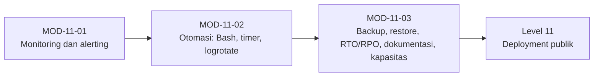

# Level 10 — Monitoring, Otomasi, Backup, dan Disaster Recovery

!!! info "Identitas"
    **ID:** `CAT-11` · **Level:** L10 · **Lingkungan:** lab lokal (VM) · **Estimasi:** 19 jam 30 menit (11 chapter) · [Lihat di dashboard](../../../#CAT-11)

## Tujuan level

1. Memantau sumber daya, antrian, service, dan sertifikat.
2. Mengotomasi tugas rutin secara aman.
3. Membuat backup yang teruji dan rencana disaster recovery.

**Deliverable:** Skrip monitoring dan alert uji, jadwal otomatis, backup terenkripsi dengan bukti restore, dokumen RTO/RPO.

## Prasyarat

Level 9 selesai: kontrol keamanan dasar terverifikasi. Anda memiliki VM lab dengan layanan email lengkap, dan satu mesin terpisah untuk uji restore.

## Progres dari level sebelumnya

Level 9 membuat server sulit diserang; Level 10 membuatnya **dapat dipantau, diotomasi, dan dipulihkan**. Ini menutup bagian lab dari kurikulum; deployment publik dan operasi produksi dimulai di level berikutnya.

!!! note "Catatan verifikasi"
    Skrip dan unit systemd dijalankan sebagai root. Hanya uji di VM lab. Perintah belum dijalankan penulis (`verified_on: null`). Konsep HA hanya diperkenalkan, bukan diimplementasikan.

## Modul dan chapter

### Monitoring dan Alerting (`MOD-11-01`)

| ID | Judul | Estimasi |
|---|---|---|
| [`CH-11-01-01`](../chapter/CH-11-01-01.md) | Monitoring Sumber Daya, Disk, dan Inode | 90 mnt |
| [`CH-11-01-02`](../chapter/CH-11-01-02.md) | Health Check Service, Antrian, dan Sertifikat | 120 mnt |
| [`CH-11-01-03`](../chapter/CH-11-01-03.md) | Alerting, Metrik, dan Dashboard | 150 mnt |

### Otomasi (`MOD-11-02`)

| ID | Judul | Estimasi |
|---|---|---|
| [`CH-11-02-01`](../chapter/CH-11-02-01.md) | Otomasi dengan Bash yang Aman | 120 mnt |
| [`CH-11-02-02`](../chapter/CH-11-02-02.md) | Scheduled Jobs: systemd Timer dan Cron | 90 mnt |
| [`CH-11-02-03`](../chapter/CH-11-02-03.md) | Log Rotation | 60 mnt |

### Backup dan Disaster Recovery (`MOD-11-03`)

| ID | Judul | Estimasi |
|---|---|---|
| [`CH-11-03-01`](../chapter/CH-11-03-01.md) | Strategi dan Otomasi Backup | 150 mnt |
| [`CH-11-03-02`](../chapter/CH-11-03-02.md) | Validasi Integritas dan Uji Restore | 120 mnt |
| [`CH-11-03-03`](../chapter/CH-11-03-03.md) | RTO, RPO, dan Rencana Disaster Recovery | 90 mnt |
| [`CH-11-03-04`](../chapter/CH-11-03-04.md) | Manajemen Konfigurasi dan Dokumentasi Infrastruktur | 90 mnt |
| [`CH-11-03-05`](../chapter/CH-11-03-05.md) | Perencanaan Kapasitas dan Konsep High Availability | 90 mnt |

## Hubungan antar modul

## Rangkuman

- Health check bermakna memeriksa fungsi, bukan hanya status proses, dan alert harus lewat saluran independen.
- Skrip operasi harus idempoten, terkunci, dan bebas rahasia; timer systemd menangkap jadwal yang terlewat.
- Backup baru valid setelah diuji restore ke sistem bersih.
- RTO dan RPO adalah keputusan yang diukur; HA tidak menggantikan backup.

## Referensi

- [systemd.timer(5)](https://www.freedesktop.org/software/systemd/man/latest/systemd.timer.html)
- [NIST SP 800-34 Rev. 1](https://csrc.nist.gov/pubs/sp/800/34/r1/upd1/final)
- [Google SRE Book](https://sre.google/sre-book/table-of-contents/)
- [age](https://github.com/FiloSottile/age)

[Level sebelumnya](L9.md){ .md-button } [Lanjut ke Level 11](L11.md){ .md-button } [Kembali ke dashboard kurikulum](../../../#CAT-11){ .md-button }
