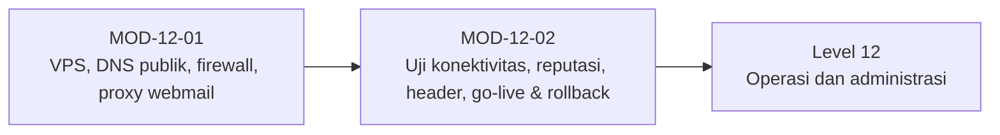

# Level 11 — Deployment Publik dan Kesiapan Produksi

!!! info "Identitas"
    **ID:** `CAT-12` · **Level:** L11 · **Lingkungan:** uji publik (VPS, IP publik, domain) · **Estimasi:** 13 jam (8 chapter) · [Lihat di dashboard](../../../#CAT-12)

## Tujuan level

1. Menyiapkan VPS dan DNS publik untuk mail server.
2. Menguji konektivitas dan pengiriman ke penyedia eksternal.
3. Menyusun checklist go-live dan rencana rollback.

**Deliverable:** Checklist go-live terisi, hasil uji masuk dan keluar, analisis header, rencana rollback.

## Prasyarat

Level 10 selesai: monitoring, backup, dan restore teruji di lab. Anda memiliki domain, akses panel DNS, dan VPS (atau rencana memilihnya).

## Progres dari level sebelumnya

Level 1–10 berlangsung di lab. Level 11 membawa server **ke internet publik** secara terkendali: infrastruktur yang tepat, DNS publik, pengujian dari luar, dan keputusan Go/No-Go yang dibenarkan. Kesalahan di sini berdampak ke pihak lain (spam, reputasi IP).

!!! note "Catatan verifikasi"
    Level ini menyentuh internet. Jangan membuka layanan sebelum uji relay lulus. Perintah belum dijalankan penulis (`verified_on: null`); kebijakan penyedia berubah-ubah sehingga selalu baca dokumentasi terkini.

## Modul dan chapter

### Persiapan Infrastruktur Publik (`MOD-12-01`)

| ID | Judul | Estimasi |
|---|---|---|
| [`CH-12-01-01`](../chapter/CH-12-01-01.md) | Memilih VPS dan Memahami Pembatasan Port SMTP | 90 mnt |
| [`CH-12-01-02`](../chapter/CH-12-01-02.md) | DNS Publik dan Koordinasi PTR | 90 mnt |
| [`CH-12-01-03`](../chapter/CH-12-01-03.md) | Aturan Firewall dan Eksposur Layanan Publik | 90 mnt |
| [`CH-12-01-04`](../chapter/CH-12-01-04.md) | Reverse Proxy dan Keamanan Webmail Publik | 90 mnt |

### Pengujian dan Go-Live (`MOD-12-02`)

| ID | Judul | Estimasi |
|---|---|---|
| [`CH-12-02-01`](../chapter/CH-12-02-01.md) | Pengujian Konektivitas Masuk dan Keluar | 90 mnt |
| [`CH-12-02-02`](../chapter/CH-12-02-02.md) | Reputasi Server dan Uji Pengiriman ke Penyedia Eksternal | 120 mnt |
| [`CH-12-02-03`](../chapter/CH-12-02-03.md) | Analisis Header dan Diagnosis Folder Spam | 90 mnt |
| [`CH-12-02-04`](../chapter/CH-12-02-04.md) | Kebijakan Abuse Penyedia, Checklist Go-Live, dan Rollback | 120 mnt |

## Hubungan antar modul

## Rangkuman

- Port 25 keluar, IP statis, dan kendali PTR adalah syarat pemilihan penyedia.
- A, MX, dan PTR harus konsisten (FCrDNS) dan diperiksa dari luar.
- Uji masuk dan keluar dengan Message-ID terlacak; reputasi tidak dapat dijamin.
- Go-live memerlukan checklist berbukti dan rencana rollback yang dilatih.

## Referensi

- [RFC 5321 — SMTP](https://www.rfc-editor.org/rfc/rfc5321)
- [RFC 2142 — Mailbox Names for Common Services](https://www.rfc-editor.org/rfc/rfc2142)
- [M3AAWG — Dokumen praktik terbaik](https://www.m3aawg.org/published-documents)

[Level sebelumnya](L10.md){ .md-button } [Lanjut ke Level 12](L12.md){ .md-button } [Kembali ke dashboard kurikulum](../../../#CAT-12){ .md-button }
