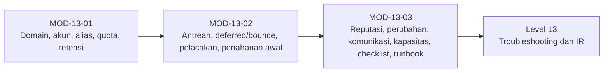

# Level 12 — Operasi dan Administrasi Email

!!! info "Identitas"
    **ID:** `CAT-13` · **Level:** L12 · **Lingkungan:** produksi · **Estimasi:** 25 jam (15 chapter) · [Lihat di dashboard](../../../#CAT-13)

## Tujuan level

1. Mengelola domain, akun, alias, quota, dan retensi.
2. Mengelola antrian dan melacak kegagalan pengiriman.
3. Menjalankan operasi rutin, upgrade, dan runbook.

**Deliverable:** Prosedur operasional baku, jadwal harian sampai kuartalan, dan kumpulan runbook.

## Prasyarat

Level 11 selesai: server publik berjalan dengan keputusan Go. Anda memiliki akses administrator, monitoring, dan backup yang teruji.

## Progres dari level sebelumnya

Level 11 menyalakan layanan; Level 12 **menjalankannya setiap hari**: domain dan akun, antrean, reputasi, perubahan terkendali, dan runbook. Fokusnya konsistensi, jejak audit, dan kebiasaan operasional.

!!! note "Catatan verifikasi"
    Prosedur ini mengubah produksi dan belum dijalankan penulis (`verified_on: null`). Latih lebih dulu di lab dan ikuti proses perubahan Anda.

## Modul dan chapter

### Administrasi Domain dan Akun (`MOD-13-01`)

| ID | Judul | Estimasi |
|---|---|---|
| [`CH-13-01-01`](../chapter/CH-13-01-01.md) | Menambah dan Menghapus Domain | 90 mnt |
| [`CH-13-01-02`](../chapter/CH-13-01-02.md) | Membuat, Menonaktifkan, dan Menghapus Akun | 90 mnt |
| [`CH-13-01-03`](../chapter/CH-13-01-03.md) | Reset Password, Pemulihan Akses, dan Pengguna Tidak Bisa Login | 90 mnt |
| [`CH-13-01-04`](../chapter/CH-13-01-04.md) | Alias, Distribution Address, Forwarding, dan Shared Mailbox | 120 mnt |
| [`CH-13-01-05`](../chapter/CH-13-01-05.md) | Quota, Konsumsi Storage, dan Kebijakan Retensi | 90 mnt |

### Antrian dan Pengiriman (`MOD-13-02`)

| ID | Judul | Estimasi |
|---|---|---|
| [`CH-13-02-01`](../chapter/CH-13-02-01.md) | Inspeksi dan Manajemen Antrian yang Aman | 90 mnt |
| [`CH-13-02-02`](../chapter/CH-13-02-02.md) | Memantau Deferred dan Bounce | 90 mnt |
| [`CH-13-02-03`](../chapter/CH-13-02-03.md) | Melacak Message-ID dan Diagnosis Kegagalan Pengiriman | 120 mnt |
| [`CH-13-02-04`](../chapter/CH-13-02-04.md) | Volume Keluar Abnormal dan Akun Terkompromi (Penanganan Awal) | 120 mnt |

### Operasi Rutin dan Tata Kelola (`MOD-13-03`)

| ID | Judul | Estimasi |
|---|---|---|
| [`CH-13-03-01`](../chapter/CH-13-03-01.md) | Memantau Reputasi dan Hasil SPF, DKIM, DMARC | 90 mnt |
| [`CH-13-03-02`](../chapter/CH-13-03-02.md) | Upgrade, Maintenance Window, dan Change Management | 120 mnt |
| [`CH-13-03-03`](../chapter/CH-13-03-03.md) | Komunikasi Insiden dan Ketersediaan Layanan | 60 mnt |
| [`CH-13-03-04`](../chapter/CH-13-03-04.md) | Kapasitas, Perluasan Storage, dan Offboarding Akun | 90 mnt |
| [`CH-13-03-05`](../chapter/CH-13-03-05.md) | Checklist Operasional Harian, Mingguan, Bulanan, dan Kuartalan | 90 mnt |
| [`CH-13-03-06`](../chapter/CH-13-03-06.md) | Runbook Operasional | 150 mnt |

## Hubungan antar modul

## Rangkuman

- Perubahan domain dan akun mengikuti prosedur baku dengan jejak audit.
- Antrean dibaca, ditahan, baru dihapus; penghapusan permanen dicatat.
- Reputasi dan laporan DMARC dipantau sebagai tren.
- Runbook dan checklist periodik membuat operasi dapat diaudit dan dialihkan.

## Referensi

- [Postfix: Dokumentasi](https://www.postfix.org/documentation.html)
- [Dokumentasi Dovecot 2.3](https://doc.dovecot.org/2.3/)
- [Google SRE Book](https://sre.google/sre-book/table-of-contents/)

[Level sebelumnya](L11.md){ .md-button } [Lanjut ke Level 13](L13.md){ .md-button } [Kembali ke dashboard kurikulum](../../../#CAT-13){ .md-button }
