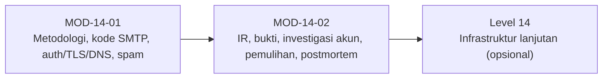

# Level 13 — Troubleshooting dan Incident Response

!!! info "Identitas"
    **ID:** `CAT-14` · **Level:** L13 · **Lingkungan:** produksi · **Estimasi:** 13 jam (7 chapter) · [Lihat di dashboard](../../../#CAT-14)

## Tujuan level

1. Mendiagnosis kegagalan pengiriman, autentikasi, TLS, dan DNS secara sistematis.
2. Menjalankan incident response dengan preservasi bukti.
3. Memulihkan layanan setelah kompromi dan menulis postmortem.

**Deliverable:** Dokumen troubleshooting minimal lima skenario, prosedur IR, dan templat postmortem.

## Prasyarat

Level 12 selesai: operasi rutin, antrean, dan runbook berjalan. Anda mampu melacak pesan dan menahan akun terduga.

## Progres dari level sebelumnya

Level 12 menjaga operasi normal; Level 13 menangani **saat sesuatu rusak atau diserang**: diagnosis sistematis, incident response dengan preservasi bukti, pemulihan setelah kompromi, dan postmortem tanpa menyalahkan.

!!! note "Catatan verifikasi"
    Latihan insiden dilakukan di lab dengan akun uji. Penyelidikan atas email pengguna nyata menyentuh privasi dan hukum. Perintah belum dijalankan penulis (`verified_on: null`).

## Modul dan chapter

### Troubleshooting (`MOD-14-01`)

| ID | Judul | Estimasi |
|---|---|---|
| [`CH-14-01-01`](../chapter/CH-14-01-01.md) | Metodologi Troubleshooting Email | 60 mnt |
| [`CH-14-01-02`](../chapter/CH-14-01-02.md) | Matriks Kegagalan Pengiriman dan Kode SMTP | 120 mnt |
| [`CH-14-01-03`](../chapter/CH-14-01-03.md) | Kegagalan Autentikasi, TLS, dan DNS | 120 mnt |
| [`CH-14-01-04`](../chapter/CH-14-01-04.md) | Penyebab Email Masuk Spam dan Penurunan Reputasi | 90 mnt |

### Incident Response (`MOD-14-02`)

| ID | Judul | Estimasi |
|---|---|---|
| [`CH-14-02-01`](../chapter/CH-14-02-01.md) | Prosedur Incident Response dan Preservasi Forensik | 120 mnt |
| [`CH-14-02-02`](../chapter/CH-14-02-02.md) | Investigasi Kompromi Akun dan Penyalahgunaan Antrian | 150 mnt |
| [`CH-14-02-03`](../chapter/CH-14-02-03.md) | Pemulihan Setelah Kompromi dan Postmortem | 120 mnt |

## Hubungan antar modul

## Rangkuman

- Troubleshooting adalah siklus hipotesis dan uji, bukan tebakan.
- Kode SMTP dan enhanced status code menentukan kategori tindakan.
- IR memiliki tahapan; bukti dikumpulkan dengan urutan volatilitas, hash, dan rantai penguasaan.
- Pemulihan setelah kompromi berarti membangun ulang kepercayaan: bangun ulang, rotasi secrets, postmortem.

## Referensi

- [NIST SP 800-61 Rev. 2](https://csrc.nist.gov/pubs/sp/800/61/r2/final)
- [RFC 3463 — Enhanced Status Codes](https://www.rfc-editor.org/rfc/rfc3463)
- [RFC 3227 — Evidence Collection](https://www.rfc-editor.org/rfc/rfc3227)

[Level sebelumnya](L12.md){ .md-button } [Lanjut ke Level 14](L14.md){ .md-button } [Kembali ke dashboard kurikulum](../../../#CAT-14){ .md-button }
