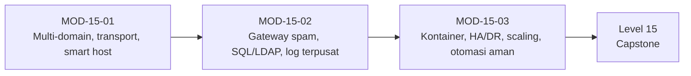

# Level 14 — Infrastruktur Email Lanjutan (Opsional)

!!! info "Identitas"
    **ID:** `CAT-15` · **Level:** L14 · **Lingkungan:** uji publik (VPS, IP publik, domain) · **Estimasi:** 22 jam (10 chapter) · [Lihat di dashboard](../../../#CAT-15)

## Tujuan level

1. Mengelola banyak domain dan routing lanjutan.
2. Menggunakan gateway spam, smart host, dan backend pengguna SQL/LDAP.
3. Merancang arsitektur HA, DR, dan multi-server.

**Deliverable:** Dokumen desain arsitektur lanjutan dengan analisis trade-off; lab spesialisasi pilihan.

## Prasyarat

Level 13 selesai: troubleshooting dan IR dipahami. Level ini **opsional** dan tidak wajib untuk capstone; ambil hanya topik yang dibutuhkan.

## Progres dari level sebelumnya

Level 1–13 membangun satu server yang dioperasikan dengan baik. Level 14 menjawab pertanyaan **skala dan kompleksitas**: banyak domain, routing, smart host, gateway, backend SQL/LDAP, log terpusat, kontainer, HA/DR, dan otomasi aman. Setiap topik menambah kompleksitas; terapkan bila kebutuhan nyata.

!!! note "Catatan verifikasi"
    Level opsional. Konfigurasi di sini adalah contoh desain yang belum dijalankan penulis (`verified_on: null`). Beberapa chapter konseptual.

## Modul dan chapter

### Multi-Domain dan Routing (`MOD-15-01`)

| ID | Judul | Estimasi |
|---|---|---|
| [`CH-15-01-01`](../chapter/CH-15-01-01.md) | Multiple Domain pada Satu Server | 120 mnt |
| [`CH-15-01-02`](../chapter/CH-15-01-02.md) | Transport Routing Lanjutan | 120 mnt |
| [`CH-15-01-03`](../chapter/CH-15-01-03.md) | Relay dan Smart Host | 120 mnt |

### Gateway dan Backend Pengguna (`MOD-15-02`)

| ID | Judul | Estimasi |
|---|---|---|
| [`CH-15-02-01`](../chapter/CH-15-02-01.md) | Gateway Filtering Spam Terdedikasi | 150 mnt |
| [`CH-15-02-02`](../chapter/CH-15-02-02.md) | Virtual User Berbasis SQL atau LDAP | 180 mnt |
| [`CH-15-02-03`](../chapter/CH-15-02-03.md) | Centralized Logging | 120 mnt |

### Arsitektur Skala Besar (`MOD-15-03`)

| ID | Judul | Estimasi |
|---|---|---|
| [`CH-15-03-01`](../chapter/CH-15-03-01.md) | Pertimbangan Kontainerisasi dan Docker | 90 mnt |
| [`CH-15-03-02`](../chapter/CH-15-03-02.md) | Arsitektur High Availability dan DR | 150 mnt |
| [`CH-15-03-03`](../chapter/CH-15-03-03.md) | Scaling, Desain Storage, dan Multi-Server | 150 mnt |
| [`CH-15-03-04`](../chapter/CH-15-03-04.md) | Otomasi Administrasi yang Aman | 120 mnt |

## Hubungan antar modul

## Rangkuman

- Reputasi IP dibagi semua domain pada satu IP.
- Smart host mengubah SPF dan menambah ketergantungan.
- Gateway memerlukan validasi penerima agar tidak menimbulkan backscatter.
- Replikasi bukan backup; HA harus mengikuti RTO/RPO.
- Otomasi tanpa tinjauan dan pemeriksaan rahasia menyebarkan kesalahan.

## Referensi

- [Postfix: STANDARD_CONFIGURATION_README](https://www.postfix.org/STANDARD_CONFIGURATION_README.html)
- [Dokumentasi Dovecot 2.3](https://doc.dovecot.org/2.3/)
- [NIST SP 800-34 Rev. 1](https://csrc.nist.gov/pubs/sp/800/34/r1/upd1/final)

[Level sebelumnya](L13.md){ .md-button } [Lanjut ke Level 15](L15.md){ .md-button } [Kembali ke dashboard kurikulum](../../../#CAT-15){ .md-button }
