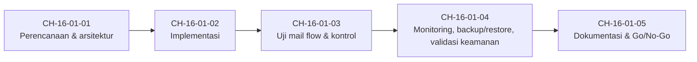

# Level 15 — Capstone dan Penilaian Operasional

!!! info "Identitas"
    **ID:** `CAT-16` · **Level:** L15 · **Lingkungan:** uji publik (VPS, IP publik, domain) · **Estimasi:** 22 jam (5 chapter) · [Lihat di dashboard](../../../#CAT-16)

## Tujuan level

1. Membangun mail server berfungsi untuk domain milik sendiri.
2. Membuktikan setiap kontrol teknis dan operasional dengan bukti terukur.
3. Menyusun dokumentasi dan penilaian kesiapan produksi.

**Deliverable:** Paket bukti: dokumentasi konfigurasi, diagram arsitektur, log tersanitasi, hasil uji, checklist keamanan, bukti backup/restore, runbook akhir.

## Prasyarat

Level 13 selesai (Level 14 opsional). Anda memiliki domain, server, dan seluruh keterampilan dari level sebelumnya.

## Progres dari level sebelumnya

Level 15 adalah **level terakhir**: bukan materi baru, melainkan pembuktian. Anda merancang, membangun, menguji, memvalidasi, dan mendokumentasikan mail server end-to-end, lalu memutuskan Go/No-Go berdasarkan bukti.

!!! note "Catatan verifikasi"
    Capstone memakai domain dan server milik Anda. Jangan menyertakan kata sandi, kunci privat, token, atau data pribadi dalam paket bukti. Chapter ini merujuk perintah di chapter sebelumnya yang belum dijalankan penulis (`verified_on: null`).

## Modul dan chapter

### Proyek Akhir (`MOD-16-01`)

| ID | Judul | Estimasi |
|---|---|---|
| [`CH-16-01-01`](../chapter/CH-16-01-01.md) | Perencanaan dan Arsitektur Capstone | 120 mnt |
| [`CH-16-01-02`](../chapter/CH-16-01-02.md) | Implementasi Mail Server Capstone | 480 mnt |
| [`CH-16-01-03`](../chapter/CH-16-01-03.md) | Pengujian Mail Flow, Autentikasi, dan Kontrol Spam/Abuse | 240 mnt |
| [`CH-16-01-04`](../chapter/CH-16-01-04.md) | Monitoring, Backup, Restore, dan Validasi Keamanan | 240 mnt |
| [`CH-16-01-05`](../chapter/CH-16-01-05.md) | Dokumentasi, Runbook, dan Penilaian Kesiapan Produksi | 240 mnt |

## Hubungan antar modul

## Rangkuman

- Kriteria penerimaan terukur (15 area) menentukan apa yang harus dibuktikan.
- Implementasi bergerbang: satu tahap, satu bukti.
- Keputusan Go/No-Go tertulis dengan alasan lebih penting daripada keputusannya semata.

## Referensi

- [Postfix: Dokumentasi](https://www.postfix.org/documentation.html)
- [Dokumentasi Dovecot 2.3](https://doc.dovecot.org/2.3/)
- [Dokumentasi Ubuntu Server](https://documentation.ubuntu.com/server/)

## Penutup kurikulum

Level ini adalah **level terakhir** kurikulum (Level 0 sampai Level 15). Tidak ada level berikutnya. Setelah paket bukti capstone dan keputusan Go/No-Go selesai, perjalanan belajar utama tuntas. Langkah lanjutan yang wajar: mengulang uji restore secara berkala, mengambil topik opsional Level 14 yang relevan, serta memelihara runbook dan checklist operasional.

Penanda selesai tetap diubah secara manual di dashboard, dengan bukti yang Anda simpan.

[Level sebelumnya](L14.md){ .md-button } [Kembali ke dashboard kurikulum](../../../#CAT-16){ .md-button }
