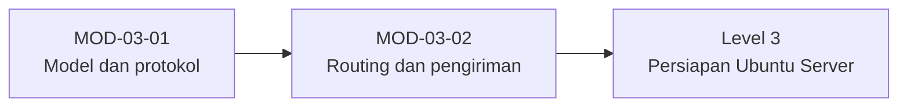

# Level 2 — Fundamental Arsitektur Email

!!! info "Identitas"
    **ID:** `CAT-03` · **Level:** L2 · **Lingkungan:** lab lokal (VM) · **Estimasi:** 10 jam 30 menit (7 chapter) · [Lihat di dashboard](../../../#CAT-03)

## Tujuan level

1. Menjelaskan siklus hidup email dari pengirim hingga mailbox.
2. Membedakan MUA, MSA, MTA, MDA, serta protokol SMTP, IMAP, dan POP3.
3. Memahami routing berbasis MX, antrean, bounce, dan log.

**Deliverable:** Diagram arsitektur email buatan sendiri dan catatan analisis satu pesan (envelope, header, MIME).

## Prasyarat

Level 1 selesai: Anda dapat mengoperasikan Ubuntu Server, memahami port dan DNS dasar, dan memakai `dig`, `nc`, serta `openssl s_client`.

## Progres dari level sebelumnya

Level 1 membangun keterampilan sistem dan jaringan; Level 2 memakainya untuk memahami **bagaimana email bekerja** sebelum ada yang dipasang. Level ini tidak memasang MTA; instalasi dimulai pada Level 5.

!!! note "Catatan verifikasi"
    Level ini konseptual. Perintah hanya mengamati (`dig`, `nc`, `openssl s_client`) dan belum diuji penulis pada VM (`verified_on: null`).

## Modul dan chapter

### Model dan Protokol Email (`MOD-03-01`)

| ID | Judul | Estimasi |
|---|---|---|
| [`CH-03-01-01`](../chapter/CH-03-01-01.md) | Siklus Hidup Email dan Peran MUA, MSA, MTA, MDA | 90 mnt |
| [`CH-03-01-02`](../chapter/CH-03-01-02.md) | Protokol SMTP, ESMTP, IMAP, dan POP3 | 120 mnt |
| [`CH-03-01-03`](../chapter/CH-03-01-03.md) | Envelope vs Header, MIME, dan Lampiran | 90 mnt |

### Routing dan Pengiriman (`MOD-03-02`)

| ID | Judul | Estimasi |
|---|---|---|
| [`CH-03-02-01`](../chapter/CH-03-02-01.md) | Lookup MX dan Routing SMTP | 90 mnt |
| [`CH-03-02-02`](../chapter/CH-03-02-02.md) | Antrian, Deferred, Retry, Bounce, dan DSN | 90 mnt |
| [`CH-03-02-03`](../chapter/CH-03-02-03.md) | Format Mailbox, Message-ID, dan Log Email | 90 mnt |
| [`CH-03-02-04`](../chapter/CH-03-02-04.md) | Mengirim, Menerima, Relay, dan Mengambil Email | 60 mnt |

## Hubungan antar modul

## Rangkuman

- Email melewati submission, transfer antarserver, dan retrieval dengan protokol berbeda.
- Envelope menentukan routing; header yang dilihat pengguna dapat berbeda.
- MX menentukan tujuan; kegagalan sementara diantre, kegagalan permanen di-bounce.
- Server hanya menerima untuk domain sendiri dan merelai hanya untuk pihak berwenang.

## Referensi

- [RFC 5321 — SMTP](https://www.rfc-editor.org/rfc/rfc5321)
- [RFC 5322 — Internet Message Format](https://www.rfc-editor.org/rfc/rfc5322)
- [Dokumentasi Postfix](https://www.postfix.org/documentation.html)

[Level sebelumnya](L1.md){ .md-button } [Lanjut ke Level 3](L3.md){ .md-button } [Kembali ke dashboard kurikulum](../../../#CAT-03){ .md-button }
