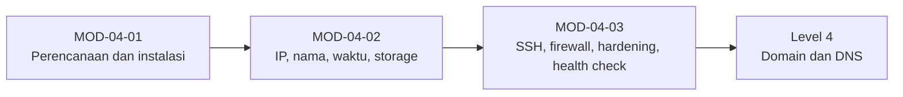

# Level 3 — Persiapan Ubuntu Server

!!! info "Identitas"
    **ID:** `CAT-04` · **Level:** L3 · **Lingkungan:** lab lokal (VM) · **Estimasi:** 12 jam (8 chapter) · [Lihat di dashboard](../../../#CAT-04)

## Tujuan level

1. Merencanakan dan memasang Ubuntu Server LTS.
2. Mengonfigurasi jaringan, hostname, FQDN, waktu, dan storage.
3. Menerapkan baseline keamanan dan health check awal.

**Deliverable:** Server Ubuntu berbasis baseline: IP statis, FQDN, SSH berbasis kunci, firewall aktif, skrip health check.

## Prasyarat

Level 2 selesai: arsitektur email dan peran tiap komponen dipahami. Anda memiliki VM lab dan snapshot dari Level 0.

## Progres dari level sebelumnya

Level 2 menjelaskan **apa** yang akan dibangun; Level 3 menyiapkan **fondasi servernya**. Perubahan jaringan dan SSH di level ini berisiko mengunci akses, sehingga snapshot dan konsol hypervisor wajib.

!!! note "Catatan verifikasi"
    Banyak perintah di level ini mengubah sistem dan belum dijalankan penulis (`verified_on: null`). Lakukan di VM lab dengan snapshot.

## Modul dan chapter

### Perencanaan dan Instalasi (`MOD-04-01`)

| ID | Judul | Estimasi |
|---|---|---|
| [`CH-04-01-01`](../chapter/CH-04-01-01.md) | Perencanaan Hardware, VM, dan Sizing | 60 mnt |
| [`CH-04-01-02`](../chapter/CH-04-01-02.md) | Instalasi Ubuntu Server LTS dan Pembaruan | 120 mnt |

### Konfigurasi Dasar (`MOD-04-02`)

| ID | Judul | Estimasi |
|---|---|---|
| [`CH-04-02-01`](../chapter/CH-04-02-01.md) | IP Statis dan Validasi Jaringan (Netplan) | 90 mnt |
| [`CH-04-02-02`](../chapter/CH-04-02-02.md) | Hostname, FQDN, Timezone, dan Sinkronisasi Waktu | 90 mnt |
| [`CH-04-02-03`](../chapter/CH-04-02-03.md) | Perencanaan Storage dan Izin Filesystem | 90 mnt |

### Baseline Keamanan Awal (`MOD-04-03`)

| ID | Judul | Estimasi |
|---|---|---|
| [`CH-04-03-01`](../chapter/CH-04-03-01.md) | SSH Aman dan Firewall Awal | 120 mnt |
| [`CH-04-03-02`](../chapter/CH-04-03-02.md) | Hardening Awal dan Pembaruan Otomatis | 90 mnt |
| [`CH-04-03-03`](../chapter/CH-04-03-03.md) | Pemeriksaan Kesehatan Baseline | 60 mnt |

## Hubungan antar modul

## Rangkuman

- Sizing dimulai dari asumsi tertulis dan dikoreksi dengan pengukuran.
- `netplan try` dan sesi SSH cadangan mencegah terkunci.
- Hostname, FQDN, PTR, dan sertifikat harus konsisten; waktu harus sinkron.
- Baseline keamanan: SSH kunci, UFW default-deny, pembaruan otomatis.

## Referensi

- [Dokumentasi Ubuntu Server](https://documentation.ubuntu.com/server/)
- [Dokumentasi Netplan](https://netplan.readthedocs.io/)
- [Paket Ubuntu](https://packages.ubuntu.com/)

[Level sebelumnya](L2.md){ .md-button } [Lanjut ke Level 4](L4.md){ .md-button } [Kembali ke dashboard kurikulum](../../../#CAT-04){ .md-button }
