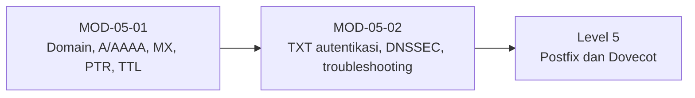

# Level 4 — Domain dan Infrastruktur DNS

!!! info "Identitas"
    **ID:** `CAT-05` · **Level:** L4 · **Lingkungan:** lab + domain yang Anda kendalikan · **Estimasi:** 9 jam 30 menit (7 chapter) · [Lihat di dashboard](../../../#CAT-05)

## Tujuan level

1. Menjelaskan fungsi record DNS untuk routing dan autentikasi email.
2. Mengonfigurasi A/AAAA, MX, dan PTR beserta FCrDNS.
3. Mendiagnosis kesalahan DNS umum.

**Deliverable:** Tabel rencana record DNS domain, hasil verifikasi dig, dan catatan troubleshooting DNS.

## Prasyarat

Level 3 selesai: server baseline dengan FQDN, IP statis, dan firewall. Anda mengendalikan sebuah domain (atau memiliki rencananya).

## Progres dari level sebelumnya

Level 3 menyiapkan server; Level 4 membuatnya **dapat ditemukan** lewat DNS. Level ini memakai domain nyata sehingga perubahan DNS berdampak di luar lab.

!!! note "Catatan verifikasi"
    Perintah `dig` bersifat baca-saja. Perubahan record dilakukan di panel penyedia DNS Anda. Belum diuji penulis (`verified_on: null`).

## Modul dan chapter

### Fondasi DNS untuk Email (`MOD-05-01`)

| ID | Judul | Estimasi |
|---|---|---|
| [`CH-05-01-01`](../chapter/CH-05-01-01.md) | Registrasi Domain dan Hosting DNS | 60 mnt |
| [`CH-05-01-02`](../chapter/CH-05-01-02.md) | Record A, AAAA, dan MX | 90 mnt |
| [`CH-05-01-03`](../chapter/CH-05-01-03.md) | PTR, Reverse DNS, dan FCrDNS | 90 mnt |
| [`CH-05-01-04`](../chapter/CH-05-01-04.md) | TTL, Propagasi, dan Cache DNS | 60 mnt |

### DNS Autentikasi dan Troubleshooting (`MOD-05-02`)

| ID | Judul | Estimasi |
|---|---|---|
| [`CH-05-02-01`](../chapter/CH-05-02-01.md) | Record Autentikasi: SPF, DKIM, DMARC (Publikasi DNS) | 90 mnt |
| [`CH-05-02-02`](../chapter/CH-05-02-02.md) | DNSSEC dan Split-Horizon DNS | 90 mnt |
| [`CH-05-02-03`](../chapter/CH-05-02-03.md) | Kesalahan Umum dan Troubleshooting DNS | 90 mnt |

## Hubungan antar modul

## Rangkuman

- A/AAAA dan MX membuat server ditemukan; PTR harus cocok dengan A (FCrDNS).
- Perubahan DNS dikendalikan lewat TTL; "propagasi" adalah kedaluwarsa cache.
- SPF, DKIM, DMARC dipublikasikan sebagai TXT; kebijakannya disusun di CAT-08.
- Diagnosis DNS dimulai dari nameserver otoritatif.

## Referensi

- [RFC 1035 — Domain Names](https://www.rfc-editor.org/rfc/rfc1035)
- [RFC 5321 — SMTP](https://www.rfc-editor.org/rfc/rfc5321)
- [RFC 7489 — DMARC](https://www.rfc-editor.org/rfc/rfc7489)

[Level sebelumnya](L3.md){ .md-button } [Lanjut ke Level 5](L5.md){ .md-button } [Kembali ke dashboard kurikulum](../../../#CAT-05){ .md-button }
