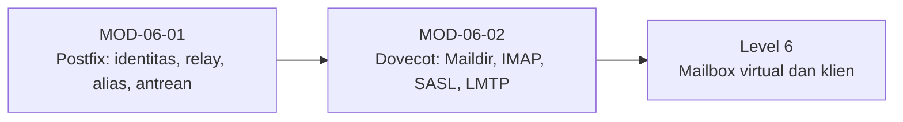

# Level 5 — Instalasi Inti Mail Server (Postfix dan Dovecot)

!!! info "Identitas"
    **ID:** `CAT-06` · **Level:** L5 · **Lingkungan:** lab lokal (VM) · **Estimasi:** 18 jam (10 chapter) · [Lihat di dashboard](../../../#CAT-06)

## Tujuan level

1. Memasang dan mengonfigurasi Postfix sebagai MTA yang aman.
2. Memasang Dovecot untuk IMAP, POP3, autentikasi, dan LMTP.
3. Mencegah open relay dan mengelola antrean serta log.

**Deliverable:** Server Postfix + Dovecot lokal yang mengirim dan menerima email, konfigurasi terdokumentasi, bukti uji relay ditolak.

## Prasyarat

Level 4 selesai: DNS domain terverifikasi dan server baseline siap. Server belum boleh dibuka ke internet sebelum uji relay lulus.

## Progres dari level sebelumnya

Level 4 membuat server ditemukan; Level 5 **memasang layanan emailnya**. TLS penuh, mailbox virtual, dan hardening menyusul di level berikutnya, sehingga konfigurasi akhir level ini masih untuk lab.

!!! note "Catatan verifikasi"
    Semua perintah yang mengubah konfigurasi belum dijalankan penulis (`verified_on: null`). Konfigurasi Postfix/Dovecot sensitif versi; catat versi terpasang dengan `postconf mail_version` dan `dovecot --version`.

## Modul dan chapter

### Postfix (`MOD-06-01`)

| ID | Judul | Estimasi |
|---|---|---|
| [`CH-06-01-01`](../chapter/CH-06-01-01.md) | Arsitektur Postfix dan Instalasi | 90 mnt |
| [`CH-06-01-02`](../chapter/CH-06-01-02.md) | main.cf, master.cf, dan Identitas Server | 120 mnt |
| [`CH-06-01-03`](../chapter/CH-06-01-03.md) | Antarmuka, Jaringan Tepercaya, dan Delivery Lokal | 90 mnt |
| [`CH-06-01-04`](../chapter/CH-06-01-04.md) | Pembatasan Relay dan Pencegahan Open Relay | 120 mnt |
| [`CH-06-01-05`](../chapter/CH-06-01-05.md) | Alias, Address Rewriting, dan Transport Maps | 120 mnt |
| [`CH-06-01-06`](../chapter/CH-06-01-06.md) | Manajemen Antrian dan Analisis Log | 120 mnt |

### Dovecot (`MOD-06-02`)

| ID | Judul | Estimasi |
|---|---|---|
| [`CH-06-02-01`](../chapter/CH-06-02-01.md) | Arsitektur Dovecot, Maildir, dan Izin | 90 mnt |
| [`CH-06-02-02`](../chapter/CH-06-02-02.md) | Konfigurasi IMAP dan POP3 | 90 mnt |
| [`CH-06-02-03`](../chapter/CH-06-02-03.md) | Autentikasi: Sistem vs Virtual User dan SASL dengan Postfix | 150 mnt |
| [`CH-06-02-04`](../chapter/CH-06-02-04.md) | Integrasi LMTP Postfix dan Dovecot | 90 mnt |

## Hubungan antar modul

## Rangkuman

- Postfix modular: smtpd, cleanup, qmgr, smtp, local/virtual/lmtp.
- `mynetworks` sempit dan `smtpd_relay_restrictions` benar mencegah open relay; buktikan dengan uji.
- Dovecot menyajikan Maildir lewat IMAP, memverifikasi kredensial lewat SASL, dan menerima delivery lewat LMTP.
- Antrean dan log adalah alat diagnosis pertama.

## Referensi

- [Dokumentasi Postfix](https://www.postfix.org/documentation.html)
- [Dokumentasi Dovecot](https://doc.dovecot.org/)
- [Dokumentasi Ubuntu Server](https://documentation.ubuntu.com/server/)

[Level sebelumnya](L4.md){ .md-button } [Lanjut ke Level 6](L6.md){ .md-button } [Kembali ke dashboard kurikulum](../../../#CAT-06){ .md-button }
