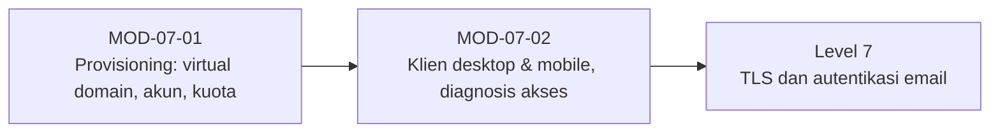

# Level 6 — Mailbox dan Konfigurasi Klien Email

!!! info "Identitas"
    **ID:** `CAT-07` · **Level:** L6 · **Lingkungan:** lab lokal (VM) · **Estimasi:** 10 jam 30 menit (7 chapter) · [Lihat di dashboard](../../../#CAT-07)

## Tujuan level

1. Menyediakan virtual domain dan mailbox.
2. Mengelola siklus hidup akun dan quota.
3. Mengonfigurasi klien desktop dan mobile serta mendiagnosis akses.

**Deliverable:** Dua akun virtual berfungsi, prosedur provisioning tertulis, bukti klien sinkron di minimal dua perangkat.

## Prasyarat

Level 5 selesai: Postfix dan Dovecot menerima, menyimpan, dan menyajikan email untuk akun uji, relay terbukti tertutup.

## Progres dari level sebelumnya

Level 5 memakai akun sistem; Level 6 memindahkan layanan ke **mailbox virtual** yang dapat dikelola, diberi kuota, dan dipakai dari klien nyata. Klien yang gagal login adalah gejala paling umum yang akan Anda diagnosis.

!!! note "Catatan verifikasi"
    Perintah mengubah konfigurasi Postfix/Dovecot dan belum dijalankan penulis (`verified_on: null`). Domain `example.com` adalah contoh dokumentasi.

## Modul dan chapter

### Provisioning Mailbox (`MOD-07-01`)

| ID | Judul | Estimasi |
|---|---|---|
| [`CH-07-01-01`](../chapter/CH-07-01-01.md) | Virtual Domain dan Virtual Mailbox | 150 mnt |
| [`CH-07-01-02`](../chapter/CH-07-01-02.md) | Akun Sistem vs Virtual User: Trade-off | 60 mnt |
| [`CH-07-01-03`](../chapter/CH-07-01-03.md) | Siklus Hidup Akun: Buat, Suspend, Hapus, Ganti Password | 120 mnt |
| [`CH-07-01-04`](../chapter/CH-07-01-04.md) | Quota Mailbox | 90 mnt |

### Klien Email (`MOD-07-02`)

| ID | Judul | Estimasi |
|---|---|---|
| [`CH-07-02-01`](../chapter/CH-07-02-01.md) | Konfigurasi Thunderbird dan Klien Desktop | 60 mnt |
| [`CH-07-02-02`](../chapter/CH-07-02-02.md) | Konfigurasi Android dan iOS | 60 mnt |
| [`CH-07-02-03`](../chapter/CH-07-02-03.md) | Troubleshooting Akses Mailbox dan Log Autentikasi | 90 mnt |

## Hubungan antar modul

## Rangkuman

- Model virtual memisahkan alamat email dari akun login Linux dan memusatkan penyimpanan di `vmail`.
- Siklus hidup akun (buat, suspend, ganti kata sandi, hapus) harus konsisten di Postfix dan Dovecot.
- Kuota melindungi disk tetapi menimbulkan bounce bila terlalu sempit.
- Diagnosis akses dimulai dari log autentikasi dan reproduksi TLS dengan `openssl s_client`.

## Referensi

- [Postfix: Virtual Domain Hosting Howto](https://www.postfix.org/VIRTUAL_README.html)
- [Dokumentasi Dovecot 2.3](https://doc.dovecot.org/2.3/)
- [RFC 3501 — IMAP4rev1](https://www.rfc-editor.org/rfc/rfc3501)

[Level sebelumnya](L5.md){ .md-button } [Lanjut ke Level 7](L7.md){ .md-button } [Kembali ke dashboard kurikulum](../../../#CAT-07){ .md-button }
