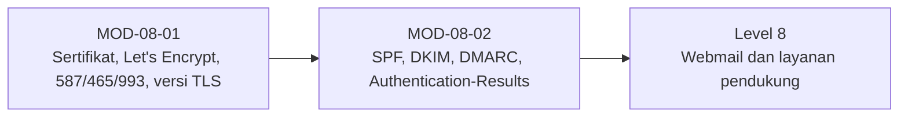

# Level 7 — TLS dan Autentikasi Email

!!! info "Identitas"
    **ID:** `CAT-08` · **Level:** L7 · **Lingkungan:** lab + domain yang Anda kendalikan · **Estimasi:** 15 jam (8 chapter) · [Lihat di dashboard](../../../#CAT-08)

## Tujuan level

1. Menerapkan TLS yang benar untuk SMTP dan IMAP.
2. Menerapkan SPF, DKIM, dan DMARC.
3. Menguji autentikasi email dengan aman dan realistis.

**Deliverable:** Sertifikat valid dengan perpanjangan otomatis, submission 587/465, IMAPS 993, SPF/DKIM/DMARC terpublikasi, hasil pembacaan Authentication-Results.

## Prasyarat

Level 6 selesai: akun virtual berfungsi. Anda mengendalikan domain nyata dengan akses ke panel DNS, dan server dapat dijangkau untuk validasi sertifikat.

## Progres dari level sebelumnya

Level 6 membuat email dapat dipakai; Level 7 membuatnya **tepercaya**: terenkripsi dengan TLS yang benar dan terautentikasi dengan SPF, DKIM, DMARC. Perubahan DNS pada domain nyata berdampak di luar lab.

!!! note "Catatan verifikasi"
    Penerbitan sertifikat dan perubahan DNS memerlukan domain nyata. Semua perintah belum dijalankan penulis (`verified_on: null`).

## Modul dan chapter

### TLS dan Port Layanan (`MOD-08-01`)

| ID | Judul | Estimasi |
|---|---|---|
| [`CH-08-01-01`](../chapter/CH-08-01-01.md) | Sertifikat TLS dan Trust Chain | 90 mnt |
| [`CH-08-01-02`](../chapter/CH-08-01-02.md) | Let's Encrypt, Certbot, dan Perpanjangan Otomatis | 120 mnt |
| [`CH-08-01-03`](../chapter/CH-08-01-03.md) | Submission 587/465 dan IMAPS 993 | 150 mnt |
| [`CH-08-01-04`](../chapter/CH-08-01-04.md) | Protokol TLS, Cipher, dan Monitoring Kedaluwarsa | 90 mnt |

### Autentikasi Email (`MOD-08-02`)

| ID | Judul | Estimasi |
|---|---|---|
| [`CH-08-02-01`](../chapter/CH-08-02-01.md) | SPF: Sintaks dan Keterbatasan | 90 mnt |
| [`CH-08-02-02`](../chapter/CH-08-02-02.md) | DKIM: Signing dan Rotasi Selector | 150 mnt |
| [`CH-08-02-03`](../chapter/CH-08-02-03.md) | DMARC: Alignment dan Progres Kebijakan | 120 mnt |
| [`CH-08-02-04`](../chapter/CH-08-02-04.md) | Authentication-Results dan Pengujian Aman | 90 mnt |

## Hubungan antar modul

## Rangkuman

- Sertifikat valid, rantai lengkap, dan perpanjangan otomatis dengan hook reload adalah syarat TLS yang berkelanjutan.
- Submission 587/465 dan IMAPS 993 memaksa TLS sebelum AUTH.
- SPF memeriksa envelope, DKIM menandatangani pesan, DMARC mengikatnya ke domain `From`.
- Bukti autentikasi adalah header `Authentication-Results` dari pesan nyata milik sendiri.

## Referensi

- [RFC 8314 — TLS untuk email](https://www.rfc-editor.org/rfc/rfc8314)
- [RFC 7208 — SPF](https://www.rfc-editor.org/rfc/rfc7208)
- [RFC 6376 — DKIM](https://www.rfc-editor.org/rfc/rfc6376)
- [RFC 7489 — DMARC](https://www.rfc-editor.org/rfc/rfc7489)
- [Dokumentasi Let's Encrypt](https://letsencrypt.org/docs/)

[Level sebelumnya](L6.md){ .md-button } [Lanjut ke Level 8](L8.md){ .md-button } [Kembali ke dashboard kurikulum](../../../#CAT-08){ .md-button }
