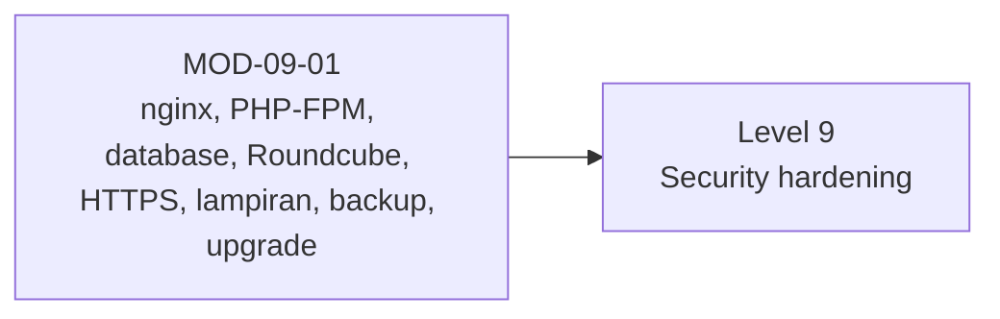

# Level 8 — Webmail dan Layanan Pendukung

!!! info "Identitas"
    **ID:** `CAT-09` · **Level:** L8 · **Lingkungan:** lab lokal (VM) · **Estimasi:** 7 jam 30 menit (4 chapter) · [Lihat di dashboard](../../../#CAT-09)

## Tujuan level

1. Memasang Roundcube di atas web server, PHP, dan database yang didukung.
2. Mengamankan webmail dengan HTTPS dan sesi yang aman.
3. Mengelola lampiran, backup, dan upgrade webmail.

**Deliverable:** Webmail Roundcube berjalan di HTTPS, terintegrasi IMAP/SMTP, dengan prosedur backup dan upgrade.

## Prasyarat

Level 7 selesai: TLS dan autentikasi email aktif, sertifikat valid tersedia.

## Progres dari level sebelumnya

Level 7 mengamankan jalur email; Level 8 menambahkan **antarmuka web** (Roundcube) yang membawa kata sandi pengguna lewat browser. Webmail menambah permukaan serangan baru sehingga HTTPS dan hardening wajib sejak awal.

!!! note "Catatan verifikasi"
    Level ini opsional tetapi direkomendasikan. Perintah belum dijalankan penulis (`verified_on: null`); nama paket, unit, dan berkas konfigurasi dapat berbeda antar versi.

## Modul dan chapter

### Roundcube (Opsional, Direkomendasikan) (`MOD-09-01`)

| ID | Judul | Estimasi |
|---|---|---|
| [`CH-09-01-01`](../chapter/CH-09-01-01.md) | Web Server, PHP, dan Database untuk Webmail | 120 mnt |
| [`CH-09-01-02`](../chapter/CH-09-01-02.md) | Instalasi Roundcube dan Integrasi IMAP/SMTP | 150 mnt |
| [`CH-09-01-03`](../chapter/CH-09-01-03.md) | HTTPS, Keamanan Browser, dan Sesi Login | 90 mnt |
| [`CH-09-01-04`](../chapter/CH-09-01-04.md) | Batas Lampiran, Backup, dan Upgrade Webmail | 90 mnt |

## Hubungan antar modul

## Rangkuman

- Roundcube tidak menyimpan email; Dovecot yang menyimpan.
- Koneksi Roundcube ke Dovecot/Postfix harus memverifikasi sertifikat.
- Batas lampiran harus selaras di nginx, PHP, dan Postfix.
- Backup mencakup database dan konfigurasi webmail; upgrade didahului snapshot.

## Referensi

- [Roundcube: Wiki](https://github.com/roundcube/roundcubemail/wiki)
- [Dokumentasi nginx](https://nginx.org/en/docs/)
- [Paket Ubuntu: roundcube](https://packages.ubuntu.com/noble/roundcube)

[Level sebelumnya](L7.md){ .md-button } [Lanjut ke Level 9](L9.md){ .md-button } [Kembali ke dashboard kurikulum](../../../#CAT-09){ .md-button }
