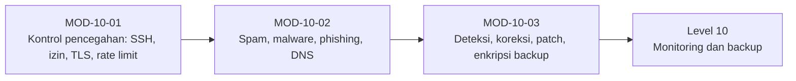

# Level 9 — Security Hardening dan Threat Defense

!!! info "Identitas"
    **ID:** `CAT-10` · **Level:** L9 · **Lingkungan:** lab lokal (VM) · **Estimasi:** 27 jam (14 chapter) · [Lihat di dashboard](../../../#CAT-10)

## Tujuan level

1. Menerapkan kontrol preventif, detektif, dan korektif.
2. Menerapkan filtering spam, malware, dan anti-phishing.
3. Menjaga integritas log, patch, dan backup terenkripsi.

**Deliverable:** Matriks kontrol keamanan (preventif, detektif, korektif) dengan bukti verifikasi, konfigurasi Rspamd dan Fail2ban terdokumentasi.

## Prasyarat

Level 8 selesai (atau dilewati bila tidak memakai webmail): layanan email ber-TLS dan terautentikasi berjalan di lab.

## Progres dari level sebelumnya

Level 7 dan 8 menyediakan fungsi dan enkripsi; Level 9 menambahkan **pertahanan berlapis**: kontrol preventif, detektif, dan korektif, penyaringan spam dan malware, serta pemeliharaan keamanan (log, patch, enkripsi backup).

!!! note "Catatan verifikasi"
    Hardening dapat mengunci Anda dari server atau menolak email sah. Terapkan di VM lab dengan snapshot. Semua perintah belum dijalankan penulis (`verified_on: null`).

## Modul dan chapter

### Kontrol Pencegahan (`MOD-10-01`)

| ID | Judul | Estimasi |
|---|---|---|
| [`CH-10-01-01`](../chapter/CH-10-01-01.md) | Kerangka Kontrol: Preventif, Detektif, Korektif | 60 mnt |
| [`CH-10-01-02`](../chapter/CH-10-01-02.md) | Hardening SSH dan Eksposur Jaringan | 120 mnt |
| [`CH-10-01-03`](../chapter/CH-10-01-03.md) | Least Privilege, Izin Service, dan Manajemen Secrets | 120 mnt |
| [`CH-10-01-04`](../chapter/CH-10-01-04.md) | Pemaksaan TLS, Keamanan SMTP AUTH, dan Kebijakan Password | 120 mnt |
| [`CH-10-01-05`](../chapter/CH-10-01-05.md) | Rate Limiting, Batas Koneksi, dan Fail2ban | 150 mnt |

### Spam, Malware, dan Phishing (`MOD-10-02`)

| ID | Judul | Estimasi |
|---|---|---|
| [`CH-10-02-01`](../chapter/CH-10-02-01.md) | Rspamd: Arsitektur dan Instalasi | 150 mnt |
| [`CH-10-02-02`](../chapter/CH-10-02-02.md) | Integrasi Rspamd dengan Postfix dan Tuning Kebijakan | 150 mnt |
| [`CH-10-02-03`](../chapter/CH-10-02-03.md) | Pemindaian Malware dan Risiko Lampiran | 120 mnt |
| [`CH-10-02-04`](../chapter/CH-10-02-04.md) | Pencegahan Phishing dan Spoofing; Strategi Enforcement DMARC | 120 mnt |
| [`CH-10-02-05`](../chapter/CH-10-02-05.md) | Keamanan DNS untuk Mail | 90 mnt |

### Deteksi, Koreksi, dan Pemeliharaan (`MOD-10-03`)

| ID | Judul | Estimasi |
|---|---|---|
| [`CH-10-03-01`](../chapter/CH-10-03-01.md) | Deteksi Penyalahgunaan dan Batas Pengiriman Keluar | 120 mnt |
| [`CH-10-03-02`](../chapter/CH-10-03-02.md) | Integritas Log, Akses Log, dan Retensi | 90 mnt |
| [`CH-10-03-03`](../chapter/CH-10-03-03.md) | Manajemen Patch dan Penilaian Kerentanan | 120 mnt |
| [`CH-10-03-04`](../chapter/CH-10-03-04.md) | Enkripsi Backup, Penghapusan Aman, dan Retensi | 90 mnt |

## Hubungan antar modul

## Rangkuman

- Setiap kontrol harus memiliki cara memverifikasi bahwa ia bekerja.
- Rspamd dan ClamAV disetel bertahap dengan data nyata, bukan tebakan.
- Enforcement DMARC dilakukan bertahap dengan data laporan dan rencana rollback.
- Log persisten, patch teratur, dan backup terenkripsi dengan kunci terpisah adalah dasar pemulihan.

## Referensi

- [Dokumentasi Rspamd](https://docs.rspamd.com/)
- [Dokumentasi ClamAV](https://docs.clamav.net/)
- [Dokumentasi Fail2ban](https://fail2ban.readthedocs.io/en/latest/)
- [NIST SP 800-45 Ver. 2](https://csrc.nist.gov/pubs/sp/800/45/ver2/final)

[Level sebelumnya](L8.md){ .md-button } [Lanjut ke Level 10](L10.md){ .md-button } [Kembali ke dashboard kurikulum](../../../#CAT-10){ .md-button }
